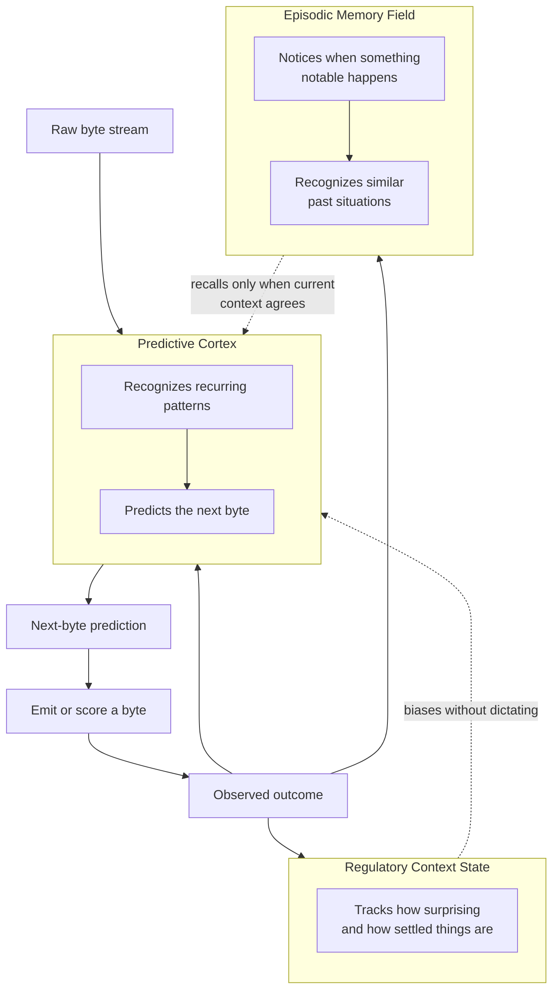

# ALM: Architecture Overview

**Audience:** public — this document describes what the system does and why
it is organized the way it is. It intentionally omits implementation details,
internal formulas, and file-level references, which live in the technical
architecture documents used internally.

## Summary

ALM is a continual learning system for byte-level prediction. It has no
separate training and inference phase, no backpropagation, and no fixed
parameter count — it reads a stream of raw bytes once, forward in time,
predicting each byte before it arrives and adjusting its own structure from
the outcome. Growth and forgetting are both ongoing processes: new structure
forms from repeated patterns, and structure that stops earning its keep is
removed to keep the whole system within a fixed memory budget.

The system is organized as three cooperating components. Each one answers a
different question about the incoming stream, and none of them require a
central controller or a symbolic lookup table to work together.

## Architecture diagram

The forward path — cortex to prediction to emitted byte — is what actually
produces output. The other two components influence that path indirectly;
neither one can name a byte on its own.

## What each component does

### Predictive Cortex

The cortex is the system's durable, reusable knowledge. It recognizes
recurring structure in the byte stream — at multiple scales, from single
bytes up through longer motifs — and uses that structure to predict what
comes next given recent context.

Its representation is deliberately shared: the same learned pattern can
participate in predicting many different passages, not just the one it was
first learned from. That reuse is what lets a small, fixed-size system
generalize instead of memorizing verbatim. New structure is added when
patterns repeat enough to justify it; existing structure is retired when it
stops being useful, so the cortex's total size stays within a fixed budget
regardless of how much data it has seen.

### Regulatory Context State

This component doesn't predict bytes. It watches the cortex's own behavior —
how surprising recent predictions have been, how much internal structure is
actively being reused versus contested, how close the system is to its
capacity limit — and condenses those signals into a small, slow-moving
state describing the current regime.

That state feeds back as a weak bias, not an instruction: local prediction
and memory decisions still solve their own problem, but their behavior can
be made more mutually consistent by a shared sense of "what kind of moment
this is." It never directly selects an output.

### Episodic Memory Field

This component gives the system a notion of specific events, distinct from
the cortex's general-purpose reusable patterns. It notices when something
in the stream departs meaningfully from what was expected, keeps a compact
trace of that moment, and can later recognize when a new situation
resembles one of those stored traces.

Recall is conservative by design: a stored memory can only influence output
when the system's own internal expectation and newly arriving external
evidence agree. Neither one is sufficient on its own — this is what keeps
the memory field from reinforcing its own guesses.

## Design principles

- **No tokenizer, no labels.** The system operates directly on raw bytes.
  Nothing is assumed about language, modality, or task structure in advance.
- **No backpropagation, no global loss.** Every update is local — driven by
  what a specific piece of structure predicted and what actually happened
  next — rather than a gradient computed across the whole system.
- **Bounded, not unbounded.** The system is designed to operate within a
  fixed memory footprint. Reported size is the system's actual serialized
  footprint, not a parameter count, and growth is always balanced against
  forgetting to stay inside that footprint.
- **Causal by construction.** Predictions are made — and memories are
  recalled — before the outcome that would confirm them is available.
  Nothing in the architecture is allowed to use information from the future
  to improve a prediction about the present.
- **Continuous, not phased.** There is no separate training run followed by
  a frozen deployment. The same system that learns from historical data
  keeps learning, in the same way, after it is put to use.

## Status

The Predictive Cortex and Regulatory Context State are the production
system: they are what actually runs today, trained directly on raw byte
streams with no GPU required. The Episodic Memory Field is active research
— its design is established and partially validated, but reliably recalling
and using a specific past event to improve a specific future prediction is
still an open problem the team is working through, not a solved capability.
