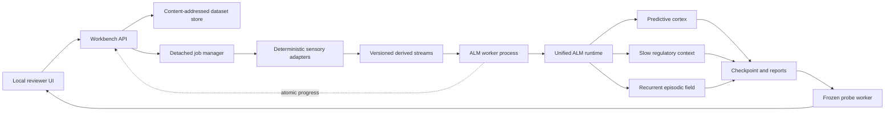

# ALM Reviewer Workbench Design v0.1

**Status:** proposed implementation design, September 8, 2026

**Scope:** dendritic ALM only; production Sonic remains outside this design

**Purpose:** let an independent reviewer supply a bounded dataset, observe one
ALM develop from its stream, and probe the resulting organism without writing
Python or accepting undocumented preprocessing.

**Architecture reference:** [ALM V1 Architecture](ALM_V1_Architecture.md)

## 1. Product definition

The ALM Reviewer Workbench is a local-first web application that performs four
operations:

1. Ingest reviewer-owned files and convert supported formats into deterministic
   structured streams.
2. Develop a new bounded ALM, or resume one, by exposing it to those streams in
   causal order.
3. Save the entire organism and a reproducibility manifest.
4. Probe the organism through continuation, scoring, and matched causal
   interventions.

The application is a scientific workbench rather than a chat product. Its
primary interaction is **stream continuation**. A text question can be used as
a cue, but the workbench must not imply that ALM has a general question-answer
interface. It can answer reliably only when its learned stream contains enough
compatible question/answer structure.

The smallest useful release is a single-user local application. Training runs
always execute in detached worker processes so closing the browser does not end
development.

## 2. Design principles

- **Nature remains the ontology.** ALM receives ordered sensory events and
  consequences, not tokenizer IDs, semantic roles, labels, or task-specific
  gradients.
- **Preprocessing is part of the experiment.** Every conversion is deterministic,
  versioned, hashed, and visible in the run manifest.
- **Compressed containers are not sensory streams.** Images are decoded to
  pixels, audio to PCM samples, and video to separate visual, audio, and caption
  streams before ALM exposure.
- **One causal learner.** Bytes are predicted before the corresponding observed
  byte is applied. Evaluation data cannot update durable tissue unless the user
  explicitly enables continual interaction.
- **Body size is the model class.** The primary capacity control is serialized
  ALM bytes, beginning with `ALM-64MB`.
- **Generation is a first-class measurement.** BPB remains the scientific
  compression score, but every completed run must also expose observable
  continuations and recall-on/off comparisons.
- **No hidden oracle.** Any boundary, field extraction, resampling, or modality
  framing supplied by an adapter appears in the manifest and report.
- **Uploaded data is untrusted.** Uploaded checkpoints and executable archives
  are not accepted in the first release.

## 3. Reviewer journey

### 3.1 Create a dataset

The reviewer drops one or more supported files into the workbench. The preview
shows:

- original filename, media type, byte size, and SHA-256;
- decoded dimensions, duration, frame rate, sample rate, or record count;
- the exact derived streams that will reach ALM;
- split policy and deterministic shuffle/interleave policy;
- warnings for truncation, missing captions, malformed records, or resampling.

Nothing begins training until the reviewer confirms the derived-stream preview.

### 3.2 Develop an organism

The reviewer chooses a small preset rather than tuning experimental internals:

- `ALM-64MB / new organism`;
- `resume existing organism`;
- exposure budget in source bytes or complete epochs;
- compute backend and worker count;
- seed;
- evaluation split;
- modality schedule when the dataset contains multiple streams.

Advanced anatomy parameters may be shown in an expandable diagnostic panel but
are never required for the default path.

### 3.3 Watch development

The run page reports:

- source bytes processed and total exposure bytes;
- wall-clock and active compute time;
- source bytes/s and ALM prediction steps/s;
- current serialized body size and awake/plastic memory footprint;
- prequential BPB and heldout BPB where defined;
- cortical birth, survival, replacement, and pruning counts;
- event captures, eligible memories, commitments, sequence completions, and
  effective cortical returns;
- checkpoint time, last heartbeat, and worker state.

Metrics update from an atomically written progress file or event stream. The
web process does not own training state.

### 3.4 Probe the organism

The default probe is frozen: durable learning is disabled and temporary state
is reset before each trial. The reviewer can:

- enter or upload a prefix and request the next `N` bytes;
- supply an expected continuation and obtain BPB;
- compare two possible continuations by causal margin;
- run matched `episodic live` versus `episodic shadow-only` generations using
  identical initial state and randomness;
- download generated bytes and a rendered modality-specific preview;
- deliberately enable continual interaction in a separately named session.

Every probe records the checkpoint hash, prompt hash, decoding settings, random
seed, learning mode, and any ablation.

## 4. System architecture



The API schedules work and reads status. It never holds a live learner in the
web server process. A crashed or restarted UI can rediscover every run from its
manifest and progress record.

## 5. Unified ALM runtime

The prerequisite is consolidating the current experimental organs behind one
stable runtime. Phase-specific experiment scripts should call this runtime
rather than each owning a slightly different checkpoint shape.

```python
class ALMRuntime:
    def learn_bytes(self, data: memoryview, *, boundary: bool = False) -> Metrics: ...
    def score_bytes(self, data: memoryview, *, learn: bool = False) -> Score: ...
    def complete(self, prefix: bytes, config: DecodeConfig) -> Completion: ...
    def reset_episode(self) -> None: ...
    def snapshot(self) -> ALMSnapshot: ...
    def save(self, directory: Path) -> None: ...
    @classmethod
    def load(cls, directory: Path) -> "ALMRuntime": ...
```

One runtime snapshot must contain:

- predictive cortical tissue and route utility;
- slow regulatory/context state;
- recurrent episodic field and dendritic branch anatomy;
- event-local and recalled short-term traces when resumability requires them;
- body-cap and nursery state;
- RNG state;
- causal counters and format version.

The current trusted-local pickle checkpoints can be migrated internally, but
the workbench should expose a versioned checkpoint directory rather than one
opaque pickle file.

## 6. Sensory stream contract

Every adapter emits one or more `DerivedStream` records:

```text
stream_id
adapter_name and adapter_version
source_sha256
modality
element schema
shape or channel metadata
time base, if present
boundary table
binary payload path
payload SHA-256
```

The payload is seekable and immutable. The training worker sees only the
ordered payload plus explicit physical boundaries. Human-readable filenames,
labels, and UI metadata do not enter ALM unless they are deliberately part of
the selected source content.

The adapter canonicalizes physical structure; it does not create semantic
embeddings. The unified runtime converts each observed byte or structured scalar
into ALM's internal sparse cortical activity. This keeps vectorization inside
the organism and prevents an external pretrained encoder from supplying hidden
capability.

Adapters may create framing bytes so a multidimensional observation has a
stable traversal order. Those bytes are not invisible. The exact framing
schema, including row/frame boundaries, belongs in the manifest and must be
identical during probing.

### 6.1 Why not feed file bytes directly?

A compressed PNG or MP4 byte sequence primarily exposes the structure of its
codec and container. It does not present neighboring pixels, samples, and
frames as neighboring sensory events. The workbench therefore decodes supported
media into a simple canonical representation before streaming it to ALM.

An `opaque bytes` mode can remain available for reviewers intentionally studying
file-format prediction, but it must be clearly distinguished from decoded
sensory mode.

## 7. Supported formats for the first release

### 7.1 Text and records

| Input | Canonical stream | Initial limits |
|---|---|---|
| `.txt`, `.md` | UTF-8 bytes | Invalid sequences replaced only with explicit warning |
| `.jsonl` | Selected string field per record | No arbitrary JSONPath; one top-level field |
| `.csv`, `.tsv` | Selected columns serialized in declared order | UTF-8, bounded row and column size |
| `.bin` | Opaque bytes | Explicit reviewer opt-in |

Record boundaries are preserved in a side table. The reviewer can choose
sequential records, deterministic shuffling, or deterministic whole-record
interleaving. Records are never split merely to equalize chunks.

### 7.2 Still images

Initial accepted inputs:

- PNG;
- JPEG;
- uncompressed or losslessly compressed TIFF;
- BMP.

Pillow decodes each image and applies a declared canonical transform:

1. correct orientation from metadata;
2. convert to grayscale, RGB, or RGBA according to the chosen preset;
3. optionally resize to a bounded resolution using a recorded algorithm;
4. traverse rows in raster order;
5. emit channel bytes plus explicit row and image boundaries.

The default scientific preset should be lossless with respect to the decoded
raster except for orientation normalization. Resizing is optional and always
reported. EXIF text and filenames are excluded from sensory content by default.

Image probing supports prefix or mask-style completion only after a deterministic
linearization has been chosen. The first release reconstructs the output raster
for inspection but does not claim semantic image generation.

### 7.3 Audio

Initial accepted inputs:

- PCM WAV;
- FLAC when the bundled decoder is available.

Canonical audio is signed PCM with a declared sample rate, channel count, and
sample width. The default adapter converts to mono PCM16 at a fixed rate, while
a lossless-preservation preset retains native channels and rate. Resampling,
mixing, clipping, and normalization settings are recorded.

Samples are emitted in temporal order. Multi-channel input is interleaved by
sample frame, not concatenated by channel. The output can be wrapped back into
a WAV container for playback after generation; the WAV header itself is not
part of the learned sensory stream.

### 7.4 Video containers

The first accepted video container is MP4. FFmpeg/ffprobe performs bounded,
noninteractive extraction into up to three independent streams:

```text
MP4
 ├─ visual track  → fixed-rate decoded RGB or grayscale frames
 ├─ audio track   → canonical PCM samples
 └─ caption track → normalized UTF-8 caption cues
```

Each stream is previewed, hashed, trained, scored, and probed independently in
v0.1. Timestamps remain in metadata so future work can align the streams, but
the initial release does not add a multimodal binding mechanism or pretend that
three independently learned streams are fused perception.

Visual extraction records source and output frame rates, dimensions, pixel
format, dropped/duplicated frames, and decoder version. Caption extraction
accepts embedded WebVTT, mov_text, or SRT-compatible tracks and emits cue text
plus deterministic cue boundaries. Automatic speech recognition is explicitly
out of scope because it would introduce another learned model and contaminate
the claim about what ALM learned.

If a track is absent, the dataset contains only the tracks actually present.
The UI never synthesizes captions or silent audio.

## 8. Multi-stream exposure policy

The workbench supports three explicit policies:

1. **Separate organisms:** one fresh ALM per derived stream. This is the default
   scientific comparison.
2. **Sequential development:** one ALM receives complete streams in a declared
   order with a physical episode reset between them.
3. **Whole-event interleaving:** complete records, images, audio clips, or video
   track segments are alternated deterministically.

Arbitrary byte-level mixing between modalities is prohibited. It destroys local
structure and makes exposure accounting difficult to interpret.

For MP4, `separate organisms` is the v0.1 default. Temporally synchronized
cross-modal exposure is a later research feature and requires an explicit ALM
binding hypothesis rather than frontend glue.

## 9. Dataset splitting and leakage prevention

Before development, the adapter assigns complete source units to development,
validation, and optional test splits using stable content hashes. A unit is a
text record, image, audio clip, or video asset—not an arbitrary byte window.

Required manifest fields include:

- source and derived payload hashes;
- split membership hashes;
- duplicate and near-duplicate counts where implemented;
- number of epochs started for each source;
- exact bytes presented to ALM;
- whether records were repeated due to the exposure budget.

Test data remains sealed until an explicit final evaluation action. Probe input
is logged separately and cannot silently become development data.

## 10. Job model

### 10.1 States

```text
created → validating → adapting → queued → running
       → checkpointing → completed
       → failed | cancelled
```

`cancelled` means the worker receives a graceful stop request, atomically saves
the last valid checkpoint, and then exits. Hard termination is only a fallback.

### 10.2 Detached execution

Each development or long probe runs in a child process with:

- a unique run directory;
- explicit argument list, never a shell-constructed command;
- stdout/stderr logs;
- atomic `progress.json` heartbeat;
- periodic atomic checkpoints;
- a final immutable report.

The browser may disconnect without affecting the worker. On application
restart, the job manager reconciles run directories with live process IDs and
checkpoint heartbeats.

### 10.3 Suggested local API

```text
POST   /api/datasets
GET    /api/datasets/{id}
POST   /api/datasets/{id}/derive
POST   /api/runs
GET    /api/runs/{id}
POST   /api/runs/{id}/cancel
POST   /api/organisms/{id}/probes
GET    /api/probes/{id}
GET    /api/artifacts/{id}/{name}
```

Server-sent events may provide live progress, with ordinary polling as a
fallback. The on-disk progress record remains authoritative.

## 11. Checkpoint and artifact layout

```text
workbench/
  datasets/<dataset-id>/
    source-manifest.json
    derived-manifest.json
    streams/
  runs/<run-id>/
    run-manifest.json
    progress.json
    stdout.log
    stderr.log
    checkpoints/<step>/
      manifest.json
      organism.state
    report.json
    samples/
  probes/<probe-id>/
    probe-manifest.json
    generated.bin
    rendered-preview.*
    report.json
```

Each checkpoint manifest records:

- checkpoint format and ALM architecture versions;
- Git commit and dirty-worktree flag;
- complete anatomy and body cap;
- source/derived stream hashes and offsets;
- exposure bytes, epochs, seed, and RNG state;
- serialized body bytes and awake memory bytes;
- compute backend, thread count, and numeric precision;
- cumulative learning and causal-recall counters.

Only checkpoints created by the local workbench are loadable. Pickle remains a
trusted internal implementation detail until replaced by a safer explicit
codec; arbitrary uploaded pickle is never deserialized.

## 12. Probe types

### 12.1 Continuation

Prime the frozen organism with a structured prefix and generate `N` bytes.
Text is decoded as UTF-8 with invalid-byte diagnostics. Raster and PCM outputs
are reconstructed according to the original adapter schema and are always
available as raw bytes too.

### 12.2 Scored continuation

Given prefix `A` and supplied continuation `B`, report:

- total bits and BPB for `B`;
- per-position surprise;
- optional baseline comparison;
- memory completion and return counters.

### 12.3 Contrastive probe

Given one prefix and two candidate continuations, score both causally from
identical reset state and report their margin. The evaluator does not feed the
preferred answer into ALM before prediction.

### 12.4 Matched memory intervention

Clone one pre-probe snapshot and run:

- recurrent episodic return live;
- the same completions measured shadow-only.

Use the same random-number stream for generation. Report distribution distance,
first differing output byte, final text/media, BPB when a known continuation is
available, and exact effective-return counts. This is the default mechanistic
review mode.

### 12.5 Continual interaction

An opt-in probe session permits generated and reviewer-supplied bytes to update
the organism. It always forks a new organism lineage so the original checkpoint
remains unchanged. The UI labels this mode prominently.

## 13. User interface

The workbench needs four primary views.

### Dataset

- drag-and-drop upload;
- format validation and decoded preview;
- derived-track selection;
- deterministic split and exposure preview;
- full adapter manifest.

### Development

- preset, body cap, backend, seed, and exposure budget;
- start/resume/cancel controls;
- live throughput, BPB, anatomy, memory, and footprint telemetry;
- logs and checkpoint history.

### Probe

- organism selector and frozen/continual mode;
- text box or structured-file upload;
- continuation, score, contrast, and memory-intervention modes;
- temperature, top-k, top-p, maximum output bytes, and seed;
- decoded preview plus raw-byte download.

### Report

- immutable run and probe summaries;
- development/validation separation;
- BPB, body size, throughput, and generation samples;
- recall live/shadow paired results;
- downloadable JSON manifests and artifact hashes.

The UI should show experimental facts, not infer capability labels such as
`understands video` or `remembers objects`.

## 14. Scientific reporting contract

Every completed development run exports at least:

- corpus and derived-stream hashes;
- adapter settings and software versions;
- exact exposure bytes and repeated epochs;
- initial and final serialized body bytes;
- peak awake memory;
- total wall time, active compute time, and throughput;
- train-prequential and heldout BPB;
- final anatomy counts;
- fixed-seed generated samples;
- controlled probe definitions and results;
- memory live versus shadow-only causal measurements;
- failures, forced truncations, and worker restarts.

For media, reports include enough schema to reconstruct the exact raster or PCM
stream. A pretty preview never replaces the raw artifact.

## 15. Safety and resource controls

The local application still treats inputs as adversarial:

- size, record-count, pixel-count, duration, sample-rate, and frame-count caps;
- MIME inspection plus decoder validation rather than filename trust;
- no archive extraction in v0.1;
- content-addressed storage with generated internal names;
- FFmpeg invoked with an argument vector, network protocols disabled, bounded
  probe/analyze time, timeout, and output quotas;
- image decompression-bomb protection;
- no uploaded Python, model checkpoint, pickle, or executable configuration;
- per-run CPU threads, GPU selection, RAM, disk, and wall-time ceilings;
- atomic artifacts and recoverable cancellation.

A public hosted deployment additionally requires authentication, per-user
isolation, quotas, malware scanning, and administrative deletion. Those are
outside the first local reviewer release.

## 16. Implementation packages

Suggested modules:

```text
src/manifoldflow/alm/runtime.py
src/manifoldflow/alm/checkpoint.py
src/manifoldflow/alm/adapters/base.py
src/manifoldflow/alm/adapters/text.py
src/manifoldflow/alm/adapters/image.py
src/manifoldflow/alm/adapters/audio.py
src/manifoldflow/alm/adapters/video.py
src/manifoldflow/alm/workbench/jobs.py
src/manifoldflow/alm/workbench/api.py
src/manifoldflow/alm/workbench/reports.py
```

The existing FastAPI, Pillow, and OpenCV dependencies in the `world` extra can
be reused. FFmpeg/ffprobe should be detected as an external runtime dependency.
PCM WAV support can begin with Python's standard library; FLAC and robust media
demuxing require FFmpeg or a narrowly scoped decoder dependency.

Frontend assets may be a small server-rendered application initially. A large
JavaScript framework is unnecessary for the first reviewer build.

## 17. Testing strategy

### Adapter tests

- golden source file produces byte-identical derived stream and manifest;
- dimensions, duration, rate, and boundary accounting are exact;
- malformed/truncated inputs fail without partial promotion;
- decoder and resource limits are enforced;
- MP4 tracks remain separate and independently hashed.

### Runtime tests

- chunked versus single-buffer exposure produces identical state;
- checkpoint/resume equals uninterrupted development;
- frozen probes do not change durable body bytes;
- continual probes fork lineage and do change the child;
- prediction always precedes observation;
- body cap remains enforced across resume and media boundaries.

### Job tests

- browser/API restart does not kill workers;
- stale workers are detected;
- graceful cancellation produces a loadable checkpoint;
- progress and checkpoint files are never partially readable;
- simultaneous runs cannot overwrite one another.

### Scientific acceptance tests

- a tiny uploaded text corpus can train, checkpoint, resume, score, and generate;
- a generated raster/PCM artifact round-trips through its adapter schema;
- recall live/shadow begins from byte-identical snapshots;
- all reported hashes and exposure counts reproduce from a clean run.

## 18. Delivery phases

### Phase A — runtime consolidation

- Introduce `ALMRuntime` containing cortex, slow context, recurrent episodic
  field, short-term recall, sequence dynamics, and metrics.
- Define versioned checkpoint directories and migration from current trusted
  experiment checkpoints.
- Move existing training, scoring, and generation scripts onto the runtime.

**Exit gate:** one CLI can learn arbitrary bytes, save/resume, and perform
frozen generation with the current Phase 79 anatomy.

### Phase B — text reviewer MVP

- FastAPI local service and minimal four-view UI;
- TXT/MD/JSONL/CSV/BIN adapters;
- detached jobs, progress telemetry, ALM-64MB cap, checkpoint download;
- continuation, scoring, contrast, and memory live/shadow probes;
- reproducibility report.

**Exit gate:** a reviewer can upload an unseen text dataset and reproduce the
entire develop-to-probe path without using the command line.

### Phase C — structured media

- PNG/JPEG/TIFF/BMP raster adapter and preview;
- WAV and optional FLAC PCM adapter and playback;
- MP4 bounded extraction into independent visual/audio/caption streams;
- generated raw payload download and modality reconstruction.

**Exit gate:** golden media fixtures reproduce identical derived streams across
clean installations using the same declared decoder versions.

### Phase D — reviewer hardening

- cancellation/recovery and job reconciliation;
- resource quotas and corrupted-input test corpus;
- sealed test split and immutable final report;
- packaged local launcher and setup diagnostics.

**Exit gate:** a reviewer can interrupt, resume, and audit a run without
scientific ambiguity or checkpoint loss.

### Phase E — later research, not frontend scope

- temporally aligned multimodal exposure;
- learned cross-modal binding;
- streaming microphone/camera sensors;
- remote multi-user hosting;
- standardized blinded qualitative evaluation.

## 19. Estimated effort

Assuming the present experimental scripts remain functional:

- runtime consolidation: 2–4 focused days;
- text-only local reviewer MVP: 1–2 additional days;
- structured image/audio/video adapters: 2–4 additional days;
- reviewer hardening and packaging: 2–4 additional days.

The UI itself is not the expensive part. The highest-risk work is ensuring that
the exact three-organ Phase 79 state can be saved, resumed, cloned for matched
interventions, and counted consistently under one runtime contract.

## 20. Deferred decisions

Before implementation, choose:

1. whether media tracks train separate organisms only in v0.1 or also permit
   sequential exposure to one organism;
2. the canonical image color mode and default maximum dimensions;
3. the canonical audio sample rate and whether FLAC requires FFmpeg;
4. whether the checkpoint state codec remains trusted-local pickle inside the
   versioned directory for the first release;
5. whether the local launcher opens the browser automatically or is embedded in
   a desktop shell.

None of these decisions blocks Phase A. The runtime boundary and artifact
contract should be implemented first because every frontend and modality
adapter depends on them.
