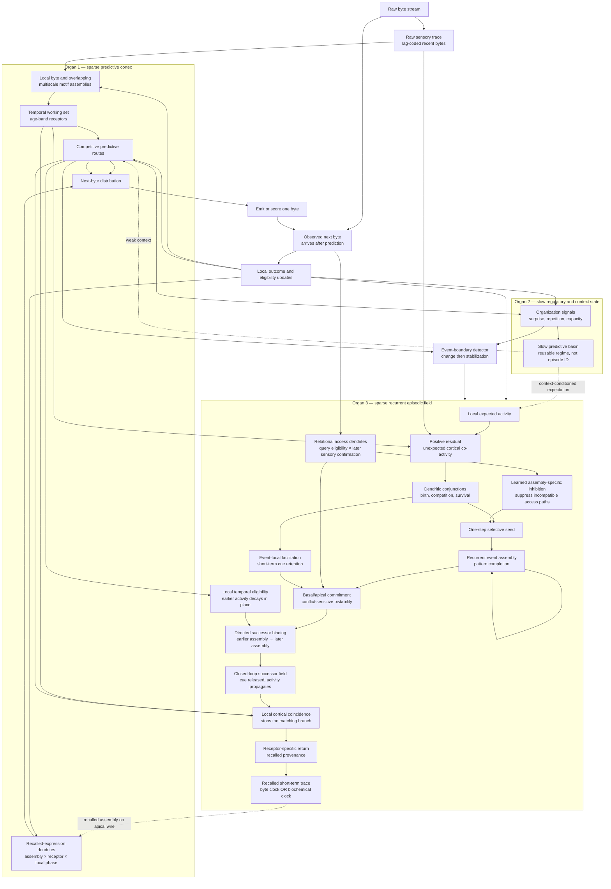
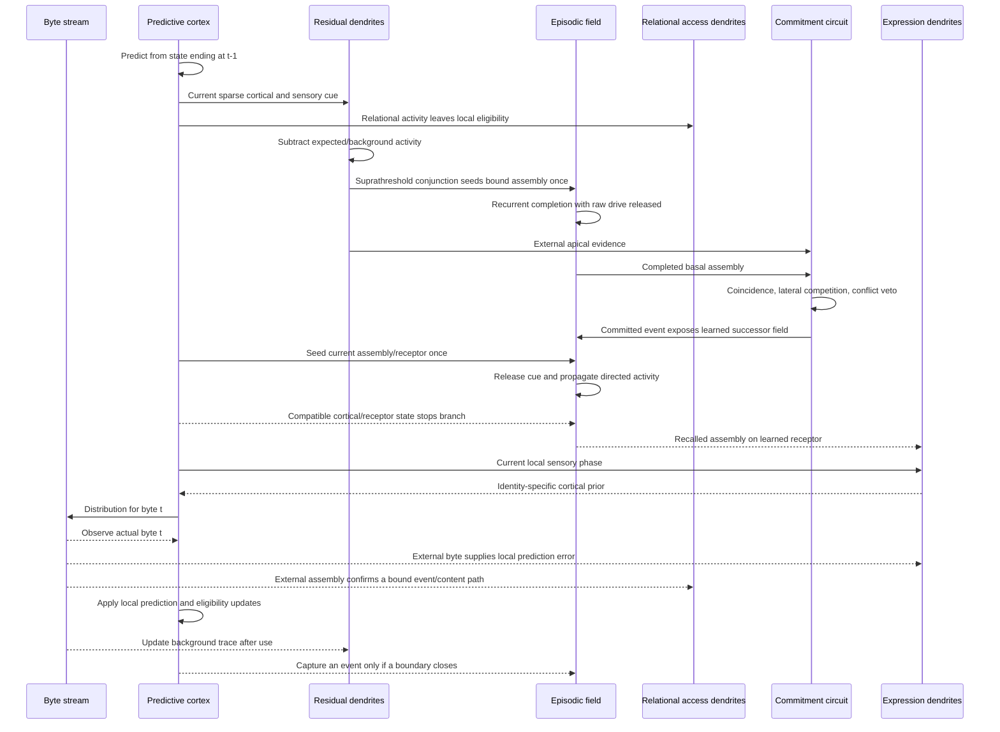

# ALM V1 Architecture

**Status:** experimental architecture, September 8, 2026

**Scope:** dendritic ALM only; this document does not describe production Sonic

**Input ontology:** an ordered stream of raw bytes; no tokenizer, language rules,
semantic slots, episode labels, or backpropagated gradients

ALM V1 is a bounded continual learner organized as three interacting organs:

1. A sparse predictive cortex learns reusable local assemblies and temporal
   routes.
2. A slow regulatory/context organ represents the current predictive regime
   and biases local computation without specifying the output.
3. A sparse recurrent episodic field captures events, retrieves them from
   partial cues, and uses local temporal eligibility to reinstate the
   context-appropriate successor through the receptor on which it was learned.

The central V1 result is that these organs do not need a symbolic memory lookup
or a global controller. Locally surprising cortical activity can select roughly
one old event, seed a sparse recurrent assembly, and let that assembly complete
itself. Commitment occurs only when the externally supplied dendritic evidence
and the internally completed memory coincide.

## Whole architecture



The solid forward path produces the next-byte distribution. Dashed paths carry
low-bandwidth context or recalled activity. None of the dashed paths directly
names the correct byte.

## The three organs

### 1. Sparse predictive cortex

The cortex is the durable statistical body of the learner. Raw byte activity
forms and strengthens sparse assemblies. Reusable motifs compete for a bounded
population, weak structures are pruned, and temporal receptors expose active
assemblies at several ages. Learned routes connect those temporally situated
assemblies to possible successors.

The cortex answers the local question:

> Given what is active now and what has recently been active, what is likely to
> happen next?

Its representation is deliberately reusable. The same assembly may participate
in many stories, conversations, images, sensor traces, or binary protocols.
That reuse is efficient, but it also creates a correlated shared subspace that
cannot uniquely identify a particular episode. The episodic field exists to
solve that separate problem.

The original cortex committed each byte to one surprise-delimited motif. Phase
81 showed why that is insufficient for memory: an assembly learned for a short
constituent may never reactivate when the same bytes occur inside a differently
segmented larger motif. The Phase 82 field adds overlapping recognition. Each
learned sensory pattern grows local synapses from lag-specific raw receptors;
current activity excites every connected assembly in parallel, and normalized
overlap determines which somata cross threshold. A short constituent and a
larger motif can therefore coexist without an exact string key or a privileged
delimiter.

### 2. Slow regulatory and context state

The regulatory organ observes modality-neutral disturbances such as predictive
surprise, repetition pressure, and anatomy pressure. Slow competitive dynamics
organize these signals into a small persistent state. This state describes the
kind of regime the organism is in; it is not a unique episode address and it
does not prescribe a surface action.

Conceptually, it supplies a low-dimensional condition `g(t)` to many local
circuits:

\[
a_i(t)=\pi_i\bigl(s_i(t),g(t)\bigr).
\]

Local circuits continue to solve their own problem, but their behavior can be
made mutually compatible by the shared condition. The current Phase 71 basin
is useful as a weak prior, though it is dominated by one basin on the present
language gates. ALM V1 therefore does not treat its discrete basin ID as an
episodic key.

### 3. Sparse recurrent episodic field

The episodic field separates four operations that earlier prototypes conflated:

- Event capture decides that a predictive regime changed, not whether the
  event will eventually matter.
- Residual dendrites determine which old event is specifically supported by
  the present cue.
- Recurrent memory completes the selected event assembly.
- Dendritic commitment determines whether that completion may alter cortex.

Phase 83 adds a fifth operation without changing capture or commitment:

- Relational access lets a present query leave a decaying local trace. If a
  later externally observed cortical assembly is already bound inside an
  event, their coincidence strengthens a reciprocal query-to-event-to-content
  path. Internally recalled activity cannot supply this confirmation.

An event is represented by a sparse assembly of memory units. Multiple frames
from the event bind to the same assembly, while their cortical content remains
in the cortex. The memory is therefore an index capable of reinstatement, not a
second copy of the predictor.

## One prediction cycle

The ordering is causal and is the same for language and arbitrary byte streams.



Phase 80 established that the receptor return cannot be treated as an ordinary
outgoing temporal route. That route answers “what followed this assembly?” and
therefore becomes useful only after the identity has already begun. The
receiving cortex needs a separate expression operation answering “what sensory
trajectory does this recalled assembly itself support?”

The Phase 81 prototype uses the smallest order-sensitive local version:

\[
z=(\text{recalled assembly},\ \text{receptor},\ \text{local phase cell}),
\qquad
\Delta w_{zb}=\eta a_z(\mathbf 1[b=x_t]-\hat p_z(b)).
\]

Recall onset supplies the first phase cell. Thereafter, the previously emitted
or observed raw-byte opponent supplies phase; there is no word-position
counter. A generated byte may advance this transient state, but only a later
external observation may update the synapse. Thus recall can participate
presynaptically in real sensory learning without becoming its own ground truth.
The receptor remains part of the physical dendritic coincidence rather than a
metadata label attached to a payload.

In more detail:

1. **Predict before observing.** The cortex produces
   \(P(x_t\mid x_{<t})\). During evaluation, the actual byte has not yet entered
   any state that can affect this prediction.
2. **Form the cortical cue.** Active motif routes, four lag-coded route frames,
   and a sixteen-byte raw sensory trace form a sparse distributed vector
   \(x_t\).
3. **Remove expected activity.** Dendritic access uses a positive residual,

   \[
   \tilde x_i=\max\left(0,\frac{x_i-\bar x_i}{x_i+\epsilon}\right),
   \qquad
   \bar x_i\leftarrow(1-\eta)\bar x_i+\eta x_i.
   \]

   The present working point is \(\eta=0.001\). A context-conditioned variant
   maintains \(\bar x_i(g)\) for each slow basin.
4. **Recognize conjunctions locally.** Three-synapse dendritic branches require
   at least two units of residual support. All memories are exposed in parallel;
   there is no key, candidate list, sorting operation, or exact lookup.
5. **Seed once.** Only branches crossing the local apical threshold seed their
   bound recurrent assembly. Subthreshold branches are electrically silent.
   The seed is removed after initialization.
6. **Complete recurrently.** Hebbian recurrent excitation reconstructs the
   remaining assembly while learned lateral inhibition and population
   normalization suppress competitors. Raw correlated cortical drive is not
   reapplied during these settling iterations in residual mode.
7. **Commit by independent coincidence.** Recurrent completion is basal
   evidence; the original residual branch response is apical evidence. A memory
   cannot authorize itself because recurrent or recalled activity cannot enter
   the external apical channel.
8. **Veto unresolved conflict.** Only suprathreshold apical branches recruit the
   pooled conflict interneuron. One supported assembly may commit; several
   incompatible assemblies suppress one another.
9. **Settle a successor trajectory.** Current cortical activity seeds the
   event-local directed field once and is then released. Activity propagates
   through locally learned earlier-to-later transitions. A cortical/receptor
   match can stop the compatible branch; a small fixed iteration ceiling only
   bounds diagnostic work and does not choose an item.
10. **Return through the learned receptor.** A committed assembly reinstates its
   stored cortical content through the same temporal/receptor route learned by
   cortex. It does not fabricate a recent sensory observation. Only routes with
   positive locally learned predictive utility are currently allowed to reach
   the byte head, and their influence is bounded by a return gain.
11. **Hold recall briefly.** The committed return remains in a distinct recalled
    compartment while a byte-count trace, an elapsed-time trace, or their
    layered OR remains active. This lets a memory selected at a word boundary
    influence the following content without relabeling recall as observation.
12. **Score or emit.** The cortex incorporates the recalled prior into its final
    distribution. Evaluation scores the observed byte; generation samples or
    selects a byte and then treats that emitted byte as the next real event in
    its own trajectory.

## How ALM V1 learns

ALM V1 has no single training pass and no global parameter update. Learning is
continuous tissue change at several timescales.

### Cortical assembly and route learning

Prediction errors leave local eligibility on the assemblies and temporal routes
that participated. When the next byte arrives, useful paths strengthen and
harmful paths weaken. New assemblies are born in a bounded nursery; persistent
weak or redundant structures lose competition and are pruned. The output of
this process is the reusable predictive cortex.

This is online next-event supervision. In standard language-model terminology,
evaluation on the observed history is teacher-forced conditioning because the
next cycle receives the true preceding byte. The important distinction is that
there are no teacher logits, sequence-wide gradients, or hidden correct bytes
supplied to earlier computation. The observed byte becomes available only after
the causal prediction it scores. During generation, the emitted byte becomes
the next observation instead.

### Event capture

The event detector combines generic changes in the organism's own dynamics:

\[
D_t = |S_t-S_{t-1}| + \text{route turnover}_t
      + \text{temporal disagreement}_t.
\]

A rising disturbance opens an event. Stabilization closes it. The capsule keeps
a few cortical/receptor frames and binds them to one sparse memory assembly.
This is deliberately overinclusive: V1 asks "did something happen?" at capture
and discovers usefulness later.

### Hebbian episodic binding

For cortical state \(x\), memory assembly \(h\), and receptor-bound content
\(r\), encoding uses local co-activity:

\[
\Delta W_{xh}\propto xh^\top,
\qquad
\Delta W_{hh}\propto hh^\top,
\qquad
\Delta W_{hr}\propto hr^\top.
\]

The first term makes partial cortical states capable of reaching the event. The
second creates its error-correcting recurrent basin. The third provides the
provenance-preserving return path.

### Dendritic branch birth, death, and reassignment

Each event frame grows a nursery of provisional conjunctions. Branches compete
for a small fixed number of dendritic sites. A branch firing during another
event is weakened heterosynaptically:

\[
w_{mk}\leftarrow w_{mk}
\left(1-\eta_{\mathrm{het}}r_{mk}(x_{\mathrm{other}})\right).
\]

Branches falling below the survival threshold die. Later event frames can reuse
the vacated site. The event assembly may remain stable while its access paths
continue adapting to experience.

Residual input is essential here. Without subtraction, language-derived
cortical states share so many common features that branches merely search harder
inside the wrong representation basis. With the running residual at
\(\eta=0.001\), the median number of eligible old events fell from eleven or
twelve to one on both TinyStories and SmolTalk.

### Recency, facilitation, and reinstatement

Capture and successful recall maintain separate decaying excitability traces.
Recent memories require slightly less cue energy, but recency cannot activate a
memory by itself. Shadow probes and denied recalls do not refresh accessibility.
Only a committed return changes the recall trace.

Two short-term traces solve different timing problems. Event-local dendritic
facilitation preserves repeated external apical evidence long enough for basal
completion and commitment. A separate recalled-output trace preserves the
committed receptor return long enough to cross byte/word boundaries. The latter
has three experimental modes: decay by processed bytes, decay by elapsed
milliseconds, and layered OR using the stronger surviving trace. The time arm
is deliberately hardware-sensitive and must always be reported with measured
throughput.

### Slow regulation

Predictive surprise, repetition, and tissue pressure supply local measures of
disorganization. Restorative outcomes change the value of participating states,
allowing a small persistent basin to form without receiving a semantic goal.
This is the current route toward goal-seeking: organization supplies the initial
preference; experience associates that preference with useful predictors and
actions.

## Memory and learning timescales

| Timescale | State | Function | Persistence |
|---|---|---|---|
| Immediate | Raw byte and active cortical assemblies | Current sensory evidence | Bytes |
| Fast | Residual branch response and memory seed | Select and start an episodic attractor | One prediction cycle |
| Short-term | Event-local dendritic facilitation | Preserve repeated selective apical support | Several bytes; current half-life 4 |
| Working | Temporal receptor traces | Preserve several active identities and their ages | Tens of bytes/events |
| Episodic | Recurrent sparse assembly and dendritic access | Event indexing and pattern completion | Until decay/replacement |
| Slow | Predictive/regulatory basin | Shared regime and organizational context | Story/task scale |
| Durable | Mature cortical assemblies and routes | Reusable learned structure | Continual body |

## Locality and provenance invariants

ALM V1 is defined as much by what it forbids as by what it contains.

- **No future leakage:** prediction and recall selection occur before the
  observed byte is applied.
- **No exact episodic key:** distributed activity addresses memory through
  overlap and dendritic coincidence.
- **No global ranked lookup:** branches and assemblies compete in parallel.
- **No semantic slots:** receptor identity is learned wiring, not a supplied
  `AGENT`, `OBJECT`, or language label.
- **No self-confirming recall:** recurrent completion cannot count as external
  apical evidence or a new observation.
- **No silent global veto:** subthreshold dendritic responses neither seed an
  assembly nor recruit conflict inhibition.
- **No recency-only activation:** recency changes excitability but cannot create
  a memory cue.
- **No unreported oracle:** oracle seeds and reconstructions are diagnostic
  interventions and never part of reported online performance.
- **No free memory:** episodic workspace, branch anatomy, background traces,
  and consolidation overhead count toward ALM footprint.

## Current V1 dimensions

These are experimental working values, not claimed biological constants:

| Component | Current setting |
|---|---:|
| Dendritic cortical expansion | 2,048 dimensions |
| Event assembly | 8 memory units |
| Provisional branches per frame | 80 |
| Surviving branches per event | 10 |
| Synapses per branch | 3 |
| Required branch support | 2 of 3 residual units |
| Heterosynaptic depression | 0.30 per conflicting activation |
| Branch survival floor | 0.12 |
| Background learning rate | 0.001 working point |
| Residual seed gain | 0.5 working point |
| Dendritic facilitation half-life | 4 bytes working point |
| Recalled-output byte half-life | 16 bytes diagnostic |
| Recalled-output time half-life | 250 ms diagnostic |
| Recurrent settling | 6 iterations |
| Directed successor settling | 4 iterations working point |
| Sequence stop compatibility | 0.5 working point |
| Commitment threshold | 0.7 |
| Diagnostic field | 2,048–4,096 memory units |
| Receptor return ceiling | 0.20 current diagnostic |

ALM size is reported in serialized bytes rather than parameter count. During
continual learning, nursery state, eligibility, counters, and episodic workspace
can substantially exceed the mature predictive body. A frozen deployment can
discard or compact much of that plastic workspace; an always-learning organism
must count it.

The working designation includes cortical concurrency: `ALM-1GB-12C` means an
organism in the one-gigabyte resident-memory class with twelve independently
stateful cortical columns. `C` describes anatomy, not an assumed hardware core;
runtime thread and device counts are reported separately. The size class refers
to the configured peak/body budget, while exact measured bytes remain mandatory
in results.

## What has been demonstrated

As of this version:

- The competitive-branch toy at 96 memories improved valid-cue commitment from
  7.5% to 40.75% at 100% precision while halving eligible competitors.
- Competitive branch survival roughly halved live branches on both live
  language probes, but raw correlated input still left eleven to twelve
  eligible memories.
- Residual dendritic input at \(\eta=0.001\) reduced median eligibility to one
  on both TinyStories and SmolTalk.
- In 706 TinyStories and 539 SmolTalk unique-candidate probes, briefly seeding
  one of eight units produced autonomous completion after release in 100% of
  cases. Mean terminal completion exceeded 0.998.
- Selective one-step seeding plus thresholded conflict produced a 0.958
  commitment state on TinyStories and 0.723 on SmolTalk.
- Event-local facilitation raised 2KB heldout commitments from zero to 241 on
  TinyStories and 168 on SmolTalk while retaining median eligibility one. A
  naive global feature buffer was rejected because it mixed events and raised
  median eligibility to 15–30.

The 10KB paired-corpus gate has now completed. Candidate selectivity persisted:
TinyStories held a median of one eligible memory with a 99th percentile of four,
and SmolTalk held a median of one with a 99th percentile of five. Retrievability
did not persist. TinyStories made one commitment during its 5KB development
half and none heldout; SmolTalk made none. BPB therefore remained exactly at
baseline in both arms. V1 has demonstrated selective, self-completing episodic
dynamics. The local facilitation correction subsequently fixed that coverage
failure, but exposed a silent return interface: the legacy temporal-trace shim
produced effectively zero change at the byte distribution.

A direct receptor-route return now provides the missing causal connection.
On 2KB shadow probes, allowing every extant route was harmful on both corpora.
Restricting return to routes whose cortical predictive utility was already
positive remained sparse: no effective TinyStories reads occurred in that
sample, while the SmolTalk arm produced positive total utility at each tested
gain and saved 0.36 bits at a 0.20 ceiling without catastrophic reads.

The first paired autonomous-generation probe used identical prompts and random
seeds with the return live versus shadow-only. In a 2KB-developed TinyStories
field, two effective returns changed one of four 400-byte trajectories, first
diverging at generated byte 311. The intervention did not improve identity in
that example; the shadow continuation retained `Lily` more successfully. The
SmolTalk field produced no effective generation-time return. This proves that
reinstatement can alter autonomous behavior, not that it improves it.

Qualitatively, the TinyStories-only checkpoint emits recognizable story-shaped
text, dialogue, common event sequences, and story-boundary markers, but loses
identity, grammar, and causal continuity. The mixed checkpoint additionally
switches between story and assistant/chat regimes. BPB is therefore retained
as a scientific compression metric, while paired generation and controlled
consistency probes are first-class behavioral gates.

Phase 77 added transient event capture during prompting and generation while
keeping durable cortex frozen. Four controlled cases test identity after a
distractor, reassignment, role-separated locations, and irrelevant-event
rejection. A three-way return-duration comparison used a 16-byte half-life, a
250 ms half-life, and layered OR. At roughly 42.7 processed byte-steps/s on
TinyStories and 49.3 on SmolTalk, all three modes were behaviorally identical.
Each changed one of twelve matched samples, but none produced the expected or
contrast filler and all forced-choice memory-margin deltas were zero.

The equality is informative rather than a null buffer result. A focused
TinyStories audit found 49 commitments and 19 effective distribution returns:
eight fresh and eleven available only through the short-term return trace.
Removing the trace reduced effective returns from 19 to eight, but generated
bytes remained identical at the present gain. Recalled content consisted of an
unordered mixture of event fragments such as `kite.`, `Lily went`, `gave the`,
and story-opening motifs. V1 can select, complete, hold, and deliver an event;
it does not yet preserve which recalled fragment is the natural next part of
the current relationship.

Simple temporal-output controls confirm that diagnosis. FIFO replay of captured
event frames and recurrent selection followed by FIFO replay were silent on the
reassignment smoke. Delayed-latest returns at 4, 8, and 32 bytes changed later
trajectory bytes but did not recover the requested filler; delay 16 was silent.
Allowing all extant receptor routes at a low 0.02 return ceiling gave delay 32 a
small mean forced-choice improvement of 0.0012 bits/byte on TinyStories and
0.0019 on SmolTalk, with three of four cases positive in each corpus. The effect
was too small and inconsistent to alter a generated target. Temporal order
contains weak signal, but neither a FIFO nor a fixed delay supplies the missing
relationship by itself.

Phase 78 replaces those external sequence controls with order-sensitive local
binding. Within each captured event, earlier cortical activity leaves a
decaying eligibility trace. Later activity strengthens only the corresponding
directed return synapse:

\[
\tau_e\dot e_i=-e_i+h_i,
\qquad
\Delta W_{j\leftarrow i}=\eta h_j(t)e_i(t^-).
\]

The recurrent field still selects and completes an event. Its output is now
conditioned by current cortical activity through the learned directed paths;
an `i` cue can return its experienced successor `j`, while `j` does not imply
`i`. The trace is event-local and decays as part of the tissue. It is not a
queue, timestamp, ranked candidate list, or external sequence controller.

The first sweep exposed and corrected a return-interface error: learned
transition strengths were flattened after item selection. Graded eligibility
now remains multiplicative through receptor projection and the recalled
short-term trace. TinyStories then improved three of four controlled relations.
At the best tested decay, 0.25 per event frame, ownership reassignment improved
by 0.00313 bits/byte, separated locations by 0.00155, and irrelevant-event
rejection by 0.00249. Identity after a distractor still regressed by 0.00534,
leaving a small positive four-case mean of 0.00046 bits/byte. Decays 0.5 and
0.75 were also positive but slightly weaker. SmolTalk remained effectively
flat to slightly negative at every decay. Local directionality now has a small
TinyStories signal, but it has not transferred across developmental corpora or
improved a controlled generated target.

Phase 79 closes the directional field into a locally settling sequence. The
current cortical pattern supplies only the initial seed. After that cue is
released, normalized activity follows the event's learned directed transitions
until a successor coincides with present cortical/receptor support or the local
integration budget expires. This turns a one-hop association into trajectory
completion without adding a FIFO, timestamp ranker, candidate list, or external
sequence controller.

An isolated fork test learned `A→B→C` and `A→D→E`; after release of
`A`, cortical compatibility with `C` stopped and returned the correct branch
without returning `E`. On the controlled four-case gate, four settling steps
were the smallest saturated depth. TinyStories improved three of four cases
with a mean +0.002735 bits/byte—about six times the Phase 78 one-hop mean—and
SmolTalk transferred with a +0.000735 mean. The TinyStories identity case still
regressed by -0.005341 bits/byte.

On fresh natural 2KB streams, the ungated field saved 0.534 bits over the 1KB
TinyStories heldout half (+0.000534 bits/byte) with no catastrophic read, while
SmolTalk lost 0.049 bits (-0.000049 bits/byte). The existing conservative risk
permission did not solve this: it vetoed every TinyStories completion and
admitted mostly output-neutral SmolTalk completions. In paired generation,
Phase 79 changed two of four TinyStories trajectories and one of four SmolTalk
trajectories, but still emitted none of the controlled fillers. We have crossed
from directional association to cross-corpus sequence signal; useful autonomous
content completion remains open.

Phase 80 isolates that last interface with evaluator-supplied expression
ceilings. The current return projection cannot affect the first discriminating
identity byte: it waits until the cortical motif prefix already overlaps the
recalled successor. In the TinyStories `red` probe, natural and maximum-strength
unaligned returns left `r` at rank 18 with a -5.46-bit greedy margin. The return
could improve later letters and lower suffix BPB, but generation never entered
the identity.

Aligning cortex to the beginning of the recalled successor and applying the
strongest correct learned route at gain 1.0 raised the intended first byte to
rank one in all three controlled cases whose identity assemblies existed, on
both checkpoints. It did not make the byte unique: the margin was exactly zero
against another tied successor, and exact greedy identity expression remained
zero. The pre-predecessor and post-identity phases were substantially worse,
while identity-swapped controls strongly suppressed the intended byte. When
only the correct first identity byte was externally supplied, the same return
completed the remaining identity in two of three cases on both corpora; the
swapped return completed zero. The unavailable puppy/kitten case was excluded
because those cortical assemblies were absent.

This establishes two separable expression failures. Natural return arrives one
cortical phase too late to choose identity entry, and even a phase-aligned
correct route pools several correlated successors rather than uniquely
expressing the recalled assembly. More settling or longer persistence cannot
repair either failure by itself.

Phase 81 resolves the expression ceiling with a separate locally calibrated
receiving path. At gain 0.5, the correct recalled identity generated the exact
target in all three available cases on both corpora; the identity-swapped
control generated zero. Mean first-byte margin was +2.42 bits on TinyStories
and +2.65 bits on SmolTalk. Natural return remained zero because the transient
field had not bound the target identity assembly at any receptor. The event
capsules did preserve the corresponding raw sensory sequences, so the loss is
specifically between detailed event capture and reusable cortical content.

Phase 82's overlapping motif field and diversity-preserving event compaction
made the target identity physically available in two of three TinyStories
cases and all three SmolTalk cases. Phase 83 then closes the remaining causal
path on every case with such a binding. After one externally observed answer,
replaying the same relational query returned and exactly generated the intended
identity in 2/3 TinyStories cases and 3/3 SmolTalk cases. Teaching the matched
contrast identity instead returned that contrast in 3/3 cases on both corpora
and returned the intended target in 0/3. Untreated natural retrieval remained
0/3. This is controlled second-exposure acquisition, not yet heldout relational
generalization, but it demonstrates that capture, learned access, commitment,
receptor return, and cortical expression can now form one working causal chain.

Phase 84 shows that enabling every one-observation access path is not the
deployment rule. Online access altered 12/16 TinyStories and 11/16 SmolTalk
free-generation pairs, but solved zero controlled fillers and increased
fragmentation and repetition. The anatomy can now influence speech; it does not
yet know when that influence deserves to become live. Access proposal,
competitive survival, and expression permission must therefore remain separate
operations.

Phase 85 shows that this repetition does not require plasticity during
generation. Frozen access/expression anatomy and protected online plasticity
produced byte-identical samples, unchanged anatomy fingerprints, and zero
generated-byte confirmations. A local use-dependent depression with an 8-byte
half-life restored maximum repetition to the recall-disabled baseline on both
corpora and raised 4-gram diversity slightly above it. This adaptation belongs
on the return pathway; it prevents immediate perseveration but does not decide
whether the recalled relationship is useful.

## Next gates

1. **Surprise-restoration access proposal:** let prediction disorder propose an
   eligibility trace, and let only a later externally measured restoration
   reinforce it. Ordinary predictable coactivity must not create a live path.
2. **Access probation and competitive survival:** keep one-observation paths in
   shadow; make live influence require repeated positive evidence, conservative
   utility, and survival against correlated alternatives.
3. **Relational access generalization:** test whether surviving conjunctions
   transfer to new fillers and episodes rather than merely recognizing a
   repeated query.
4. **Occurrence disambiguation:** when several episodes contain the same
   identity, use current relational context and learned assembly-specific
   inhibition to select one occurrence without treating the structural basin
   as an episode ID.
5. **Online expression acquisition:** replace diagnostic replay calibration
   with local sensory eligibility while preserving the achieved correct-versus-
   swapped identity dissociation.
6. **Natural identity availability:** show that the selected field can return
   the relevant identity assembly before its first discriminating byte, not
   merely after a prefix has supplied the answer.
7. **Locally calibrated sequence stopping:** replace the ineffective inherited
   risk classes with confidence learned from the trajectory's own completion,
   cortical compatibility, and realized local utility.
8. **Return coverage without unsafe routes:** increase the overlap between
   committed memories and positively predictive receptor routes while keeping
   the broad harmful-route population silent.
9. **Heldout causal utility:** live receptor returns must save aggregate bits on
   unseen TinyStories and SmolTalk bytes without a catastrophic-loss tail.
10. **Autonomous usefulness:** move beyond the achieved distribution/trajectory
   intervention and improve controlled identity/event consistency across seeds.
11. **Two-arm development:** compare TinyStories-only development with
   TinyStories/SmolTalk interleaving under the same byte and anatomy budgets.
12. **Bounded scaling:** cap the organism by serialized body size, beginning with
   ALM-64MB before larger body classes.
13. **Goal-conditioned retrieval:** once episodic return is useful, test whether
   the slow organizational basin can bias which valid memory or subgoal becomes
   active without directly prescribing output.
14. **Planning:** test maintenance and revision of intermediate attractors on
   modality-neutral blocked-route tasks before attributing reasoning to story
   generation.

Candidate selection, recurrent basin stability, successor settling, and the
Phase 81 receiving path should remain frozen. The next experiment belongs at
the event-to-cortex interface: can a selected event regenerate the richer
sensory/cortical pattern that its sparse output binding discarded, without
letting internal reconstruction manufacture its own confirmation?

## Implementation map

- `src/manifoldflow/dendritic_basin/routed_event_memory.py` — continual sparse
  byte cortex, temporal routes, regulatory organs, and body accounting.
- `src/manifoldflow/dendritic_basin/event_capsule.py` — boundary-triggered event
  capture and transient capsule lifecycle.
- `src/manifoldflow/dendritic_basin/recurrent_episodic_field.py` — residual
  dendrites, competitive branches, recurrent assemblies, commitment, and
  receptor-specific return.
- `src/manifoldflow/dendritic_basin/recalled_expression.py` — sparse receiving-
  cortex expression synapses, local phase progression, and externally taught
  prediction-error updates.
- `src/manifoldflow/dendritic_basin/multiscale_assembly.py` — overlapping
  content-addressed motif activation and byte-clock excitability traces.
- `src/manifoldflow/dendritic_basin/relational_access.py` — delayed query
  eligibility, externally confirmed access synapses, and receptor-bound return
  preferences.
- `src/manifoldflow/dendritic_basin/goal_attractor.py` — homeostatic goal and
  slow predictive basin dynamics.
- `src/manifoldflow/experiments/dendritic_basin_phase76_recurrent_field.py` —
  paired causal evaluation and attractor interventions.
- `src/manifoldflow/experiments/dendritic_basin_phase76_generation.py` — paired
  live-return versus shadow-only autonomous generation with matched randomness.
- `src/manifoldflow/experiments/dendritic_basin_phase77_generation_quality.py` —
  controlled relational continuations, forced-choice margins, and three-clock
  short-term-return comparisons.
- `src/manifoldflow/experiments/dendritic_basin_phase80_expression_ceiling.py` —
  matched natural, phase-swept oracle, and identity-swapped cortical expression
  diagnostics at discriminating output bytes.
- `src/manifoldflow/experiments/dendritic_basin_phase81_cortical_expression.py`
  — matched direct-identity, identity-swapped, natural-return, and gain-sweep
  diagnostics for the locally calibrated receiving path.
- `src/manifoldflow/experiments/dendritic_basin_phase82_multiscale_capture.py` —
  multiscale constituent recognition, diversity-preserving event capture, and
  natural target-reachability diagnostics.
- `src/manifoldflow/experiments/dendritic_basin_phase83_relational_access.py` —
  correct-versus-swapped delayed access acquisition and replay diagnostics.
- `src/manifoldflow/experiments/dendritic_basin_phase84_access_generation.py` —
  paired online-access live versus shadow free generation and qualitative
  degeneration gates.
- `src/manifoldflow/experiments/dendritic_basin_phase85_generation_credit_ablation.py`
  — matched recall-disabled, frozen, protected-online, and use-adapted causal
  generation conditions.
- `src/manifoldflow/experiments/dendritic_basin_phase86_context_recruitment.py`
  — matched basal, averaged-apical, and surviving-branch context recruitment
  during frozen, use-adapted generation.
- `src/manifoldflow/experiments/dendritic_basin_phase87_contextual_successor.py`
  — context-recruited immediate succession versus direct content return.
- `src/manifoldflow/experiments/dendritic_basin_phase88_aligned_successor.py`
  — locally learned query-to-old-predecessor phase alignment.
- `src/manifoldflow/experiments/dendritic_basin_phase89_content_successor.py`
  — learned contextual assemblies used as seeds for existing outgoing edges.
- `src/manifoldflow/experiments/dendritic_basin_phase90_contextual_successor.py`
  — occurrence-conditioned source/context conjunctions and successor return.
- `src/manifoldflow/experiments/dendritic_basin_phase91_developmental_successor.py`
  — bounded branch development followed by frozen causal suffix and generation
  probes on TinyStories-only and mixed TinyStories/SmolTalk organisms.
- `competitive_branch_survival_toy.py` and `dendritic_commitment_toy.py` —
  isolated mechanistic reference experiments.
- `src/manifoldflow/dendritic_basin/contextual_competition.py` — shared-pool
  normalized competition (`d_i = (A_i E_i)^n`, `r_i = d_i/(kappa+sum_j d_j)`),
  with an exact softmax identity at `kappa = 0`.
- `src/manifoldflow/dendritic_basin/temporal_difference_credit.py` —
  bootstrapped consequence credit (`delta_t = u + gamma V(x') - V(x)`) over a
  local per-context value table.
- `src/manifoldflow/dendritic_basin/causal_attribution.py` — streaming
  two-cause Bayesian felt-agency estimate, `P(C=self | d)`, calibrated only
  from externally confirmed cases.
- `src/manifoldflow/experiments/dendritic_basin_phase153_context_competition_consequence_agency.py`
  — wires all three into the closed generation loop and compares against the
  pre-existing "hold"/"relation_conditioned" arms on TinyStories-solo and
  mixed streams.

The experimental history and biological rationale remain in
`docs/ManifoldFlow_ALM_Journal.md` and
`docs/ALM_Long_Range_Coordination_Reference.md`.

## Context recruits; surprise does not choose speech

Surprise remains upstream. It marks prediction-regime change, opens event
capture, and drives competitive survival of dendritic conjunctions. It is an
organizational pressure and a primitive regulatory goal. It is not interpreted
as evidence that a particular old assembly should control the next output.

Phase 86 adds a separate local coincidence at retrieval:

```text
learned relational access proposal
                 x
present support on an existing cortical/dendritic branch
                 x
temporary use-dependent availability
                 |
                 v
      permitted recurrent reinstatement
```

The first two endpoints expose why an intermediate operation is required.
Ordinary cortical-to-engram current is highly correlated across proposed
events and therefore recruits almost everything. Averaging across every
surviving discriminative branch attached to an event recruits nothing: a
single relevant branch is diluted by branches representing the event's other
contexts. Allowing the strongest presently supported surviving branch to
participate creates sparse recruitment without a ranked candidate list.

That branch-local version suppresses about 89% of learned access proposals on
both TinyStories and SmolTalk while preserving the Phase 85 anti-perseveration
behavior. It changes autonomous trajectories and slightly improves diversity,
but does not produce any controlled requested identity. The current access
path still returns its confirmed filler directly; when `access_content` is
present it bypasses the engram's order-sensitive successor settling. Thus
Phase 86 can answer *which old event is compatible with now* more safely, but
not yet *which assembly inside that event naturally follows now*.

The next anatomical correction is to separate those decisions. Contextual
branch coincidence should recruit an event or local sequence neighborhood.
The already learned successor branches should then compete to continue from
the present cortical state. A relational access synapse may seed that process,
but should not itself act as the final content readout.

## Successors need occurrence-conditioned dendrites

Phases 87–89 test three ways to enter the existing directed sequence tissue:

```text
Phase 87: current assembly -> old successor row
Phase 88: query -> old predecessor phase -> successor row
Phase 89: query -> analogous old context -> its outgoing successor row
```

Phase 87 proved that immediate one-step succession is the relevant timescale;
four-step settling often walked past a useful next assembly. Its source
coverage was nevertheless only 30.1% on TinyStories and 0.8% on SmolTalk.
Phase 88 learned the missing phase bridge from external temporal coincidence,
raising source availability to 82.6% and 100% in the short corpus panels.
After every reachable familiar successor was given the same diagnostic
expression ceiling, aligned returns reached cortex at the same rate as direct
returns and retained baseline repetition behavior.

Exact forced-choice interventions then exposed an off-by-one interpretation.
Predecessor alignment reinstated context phrases such as `opened her`,
`read a b`, and `favorite` rather than the requested filler. Phase 89 therefore
used the learned contextual item as the present sequence state and asked its
existing outgoing edge to speak. This made the remaining defect explicit:
TinyStories reinstated competing successors (`blue` and `kitt`) while hurting
the intended suffix; SmolTalk remained silent in all four controlled probes.

The sequence table currently uses a reusable cortical item as its entire source
key. Repeated occurrences of a form such as `her` therefore accumulate many
outgoing targets learned in different situations. Event-level branch selection
cannot recover information already discarded inside that row. The next version
must preserve reuse and occurrence together:

```text
(source assembly, sparse contextual conjunction)
                         |
                         v
               local successor branch
                         |
                         v
                 target assembly
```

These branches should be born from the same temporally asymmetric eligibility
trace as the present sequence edges. Competitive branch survival should remove
context conjunctions that also fire for incompatible occurrences. At recall,
the source assembly supplies basal eligibility while current context supplies
apical support; their coincidence recruits the appropriate successor locally.
This is the sequence analogue of Phase 86, not a semantic planner or ranked
candidate list.

## Bounded occurrence-conditioned succession

Phase 90 implements that occurrence distinction without adding a semantic key
or output head:

```text
previous cortical assembly on its native receptor (basal source)
                             x
positive context residual on a surviving conjunction branch (apical address)
                             |
                             v
              coactive successor frame in the same engram
                             |
                             v
                 existing cortical expression pathway
```

The first one-shot prompt probe was active but negative. It produced more
returns than the source-only Phase 89 control, yet generated none of the four
requested identities and sometimes favored an unrelated contextual successor.
It also revealed uncontrolled anatomical growth: a single prompt could leave
1,250--2,150 provisional branches because the limit applied per source, not per
engram.

The corrected nursery permits at most four branches per source and 256 branches
per engram. Competing branches that fire for an incompatible successor acquire
false-response evidence and lose strength; weak branches die, and whole-engram
competition retains the most selective, strongest survivors. Branch birth and
recall both use the same positive prediction residual that solved the
correlated-code eligibility problem. Raw/common cortical structure remains in
the recurrent and source pathways and cannot dominate the apical address.

Phase 91 is the first developmental test of this bounded anatomy. It grows
branches during ordinary corpus exposure, freezes persistent association and
expression updates during generation, clears all fast episode traces before
each controlled story, and compares recall-off with contextual-successor
return. Expected and contrast suffixes are replayed from identical frozen
states to measure exact saved bits. The two developmental arms are a
TinyStories-only control and a 256-byte-chunk TinyStories/SmolTalk interleave.

Both 2 KB pilots are negative, but in different ways. TinyStories-only tissue
remained easy to activate: recall changed three of four trajectories, but cost
1.19 bits on intended suffixes and produced no requested identity. Mixed tissue
was mostly silent on the intended suffixes: recall changed two trajectories,
had exactly zero intended-suffix utility, and again produced no target. Thus
bounded residual survival creates differentiated anatomy but does not make an
original source context a useful address for what belongs after a later query.

The next diagnostic traces the exact returned assemblies at every expected
suffix byte. The remaining possibilities are now separable: the intended
assembly is never recruited, it is recruited alongside a stronger competitor,
or it reaches cortex in a phase that predicts around the identity instead of
expressing it.

The exact trace and follow-up competition close this candidate. TinyStories
did recall the intended identity components in one case, but only inside a
larger shared/contextual superposition that harmed the suffix. Sharpening by
transition frequency removed the rare identity component first. Weighting
targets by their encoding-time prediction residual then made TinyStories
silent and mixed exposure harmful. The original occurrence context is useful
for distinguishing stored episodes, but it is not a transferable address for
which stored relation a later query needs.

The architectural boundary is now clearer: episodic succession stores content
and order; query-conditioned access decides present relevance. Competitive
residual conjunctions belong on the latter pathway, where a later external
outcome can teach their usefulness locally. Further successor gain, capacity,
or pruning is not justified by these results.

## Residual return and signed access correction

The receiving cortex already learns recalled assembly-to-byte effects with an
externally taught signed prediction error. Its original inference path,
however, normalizes each returned row before combining rows. This lets common
context consume the same bounded return budget as identity-specific current.
Phase 95 tests receptor-and-phase-local background cancellation before versus
after normalization while freezing every upstream decision.

Pre-normalization cancellation improves the first red-ball discriminating-byte
margin, confirming measurable shared-current dilution, but the identity remains
nearly five bits behind the winning byte and aggregate suffix utility worsens.
Explicit current-norm limits do not rescue it. Return cancellation is therefore
a useful receiving-path primitive only if upstream access becomes sufficiently
discriminative; it is not a substitute for that discrimination.

The existing relational access update is not signed. It only adds eligible
query activity to externally confirmed rows and caps positive weights. Phase 96
adds an optional delta rule to those same synapses:

```text
centered query eligibility e = q - running_background
predicted memory activity   = W e
external memory activity    = h
local update                = eta * e * (h - predicted)
```

Incorrectly predicted rows are depressed at the same external consequence that
strengthens the confirmed row. Query-energy normalization keeps a one-step
correction bounded; absolute predicted activity is preserved at retrieval so
depression cannot disappear through row normalization. The test remains direct
access with fixed anatomy--no new conjunction unless the available cortical
query code later proves unable to express the necessary interaction.

The first live signed-access test does not reproduce the synthetic access
regime. With matched 512-byte exposure, positive Hebbian direct access is
silent; signed access becomes active but returns only ` her@0` during the
red-ball suffix. The requested `red` and `ball` assemblies are absent, not
merely diluted. Residual return cancellation consequently cannot rescue the
identity.

This localizes the next interface to temporal teaching credit. The access rule
can now weaken unsupported memories and preserve absolute confidence, but the
external confirmation arriving nearest the query dominates the update. Before
adding conjunction anatomy, ALM V1 should measure how query eligibility across
controlled delays attaches to the correct later assembly and whether repeated
external outcomes move the existing signed row toward the intended identity.

## One-shot access and phase-correct expression

Phase 97 corrects an implementation mismatch in signed access learning. The
external cortex often activates several assemblies at one instant. Teaching
those assemblies sequentially as separate one-hot targets caused each correct
assembly to depress the others. `confirm_many` now presents their union as one
simultaneous external activity vector, so only rows outside that vector receive
negative prediction error. This correction is required by the local delta rule,
although it does not change the original 512-byte live result: the naturally
available temporal credit still selects nearby `her`, not the distant identity.

Phase 98 then asks a narrower oracle question. It freezes the actual final
red-ball query and externally confirms the already existing `red ` and `ball`
assemblies after 0, 4, 16, or 64 access-eligibility steps. One presentation is
enough. In both developmental arms the two intended rows become 100% of active
access support; additional presentations do not improve them. The normalized
delta update makes update magnitude invariant to trace amplitude while the
trace remains nonzero, so this establishes survival through 64 simulated access
steps, not equal biological strength at every delay.

The downstream result separates access from expression. TinyStories-only
suffix utility moves from -0.29 to -0.27 bits and remains slightly harmful.
Mixed TinyStories/SmolTalk development moves from -1.17 to +0.44 bits. Thus the
same query code and signed synapses can learn a useful one-shot association,
and one receiving cortex can already exploit it, but simultaneous return is not
a reliable way to express a multi-part identity.

Phase 99 supplies only the missing temporal organization as an evaluator-side
ceiling. The ordinary cortex must produce the leading space. It then receives
the actual access-retrieved `red ` assembly through its learned local phases,
followed by the actual `ball` assembly through its own phases. Persistent
learning remains frozen and internally generated activity is not accepted as
external evidence.

Both developmental arms greedily emit the exact continuation ` red ball`.
TinyStories-only scores 0.53 BPB and the mixed arm 0.66 BPB on those nine bytes;
all nine required-byte margins are positive. Their recall-disabled controls
emit ` mom said`. Activating the same two correct assemblies concurrently emits
` mom sall`, despite improving teacher-forced BPB. Correct content therefore
exists, reaches cortex, and can dominate every output decision. The remaining
failure is specifically the handoff between completed assemblies.

The next primitive must not be a language timer or external FIFO. Each recalled
assembly already traverses locally learned sensory phases. A phase with no
learned continuation provides a local completion/termination signal, while the
episodic field already contains asymmetric directed transitions such as
`red -> ball`. The next experiment should teach the query only the entry
assembly, allow that assembly to express until its local trajectory terminates,
then release activity into its learned episodic successor. In shorthand:

```text
query residual -> entry assembly
entry assembly -> learned cortical phase trajectory
terminal phase -> local release into episodic successor
successor assembly -> next cortical phase trajectory
```

The causal controls are an edge reversal, an identity swap at fixed receptor
and gain, and removal of terminal-phase release. Success requires autonomous
exact identity generation without evaluator-supplied duration, without treating
recall as observation, and without opening unrelated-cue overwrite.

Phase 100 removes evaluator-supplied order and duration. The one-shot access
consequence supplies an exact receptor-bound pool containing `red ` and `ball`.
Asymmetric transitions inside the selected engram settle the entry as `red `.
That assembly remains active while its onset/previous-byte expression rows have
evidence. When the current row has no learned continuation, a local terminal
condition releases the learned `red -> ball` successor. Both arms greedily emit
exact `red ball` with one handoff: 0.579 BPB for TinyStories-only and 0.715 BPB
for mixed development, with all eight required-byte margins positive. The
simultaneous controls emit `ballllll`.

An honest one-demonstration probe exposes the remaining upstream boundary.
After externally showing the complete answer once and clearing only fast state,
TinyStories access recalls the tail `ball` plus overlapping ` ball`/`all`
assemblies, not the entry `red`; mixed access is silent. Phase 100 solves
ordered expression after an appropriate access consequence. It does not yet
solve which temporal portion of a naturally observed consequence should bind
to the original query.

The next access experiment uses a local refractory rule. The first external
assembly vector that commits an eligible query consumes that eligibility trace.
Subsequent sensory activity opens traces from the new cortical state rather
than repeatedly rewriting the original relation. This is a dendritic
commit-and-close operation, not a relevance gate. It is optional until the
one-demonstration test shows that it recovers the entry without increasing
unrelated-cue intrusion.

The simplest versions fail. A latched trace still recovers the tail `ball`.
Opening that latch with scalar prediction-change thresholds 0 and 1 either
retains the tail plus unrelated `Lil` activity or removes the identity while
leaving the unrelated activity. Surprise can indicate that a regime changed;
it cannot specify which earlier distributed state deserves credit.

A leaky additive eligibility trace preserves all recent local activity instead
of retaining a dimension-wise maximum. Alone, it still recovers only the tail
because every later outcome supplies negative evidence against earlier valid
parts. Combining additive eligibility with commit-and-close moves recall earlier
to the partial assembly ` re`, alongside weaker tail activity. This identifies
the next missing datum: the access path stores assembly and receptor but not the
phase at which the reconstructed cortical trajectory should resume. Recalling
` re` at onset repeats its already observed leading space; entering at its
learned space phase would predict `r`, then `e`, before local successor release.

The next test should therefore preserve phase as anatomy, not metadata: the
currently matching sensory/cortical prefix activates the corresponding learned
expression compartment, and that compartment's terminal state releases the
episodic successor. The controls must hold assembly and receptor fixed while
changing only the reinstated phase.

Phase 102 combines phase alignment with additive eligibility and
first-consequence consumption in an honest show-once/ask-again test. After only
64 developmental bytes, TinyStories access recovers ` re`. The current trailing
space activates that assembly's space compartment; local terminal release and
prefix coincidence then traverse ` re -> red  -> red b ->  ball`. Greedy output
is exact `red ball` at 0.579 BPB, with every target margin positive. No oracle
supplies the association, order, duration, or phase during recall.

The result is not yet stable. Mixed 64-byte development selects ` he -> her `.
At 512 developmental bytes both arms select the answer tail `ball`/` ball`.
Phase coincidence prevents an incompatible `ball` assembly from entering when
its prefix is absent, but ` ball` legitimately matches the current space and can
still intrude. A bank of independent parallel eligibility traces does not fix
this: it preserves an old ` sh` access occurrence and phase-correctly completes
the wrong `shiny ca...` trajectory.

The remaining averaging occurs inside access storage. One sparse weight row per
memory item superposes many query occurrences. The next anatomy is therefore a
bounded nursery of query-to-memory dendritic branches: each occurrence preserves
its own residual conjunction, all branches integrate the current query in
parallel, phase coincidence supplies commitment, and competitive survival later
removes branches that respond across incompatible consequences. This is the
same branch primitive moved from failed source-event succession to the causal
query-access interface identified by Phases 98--102.

Phase 103 implements that nursery. A receptor-bound memory item may own several
bounded `AccessBranch` objects rather than one averaged query row. Each branch
stores a sparse prediction-error conjunction from one query occurrence. Four
independent dendritic compartments must all receive support; their normalized
responses combine geometrically. Branches that fire for another externally
observed consequence lose strength, weak branches die, and global/per-row caps
keep the tissue bounded. There is still no key lookup or ranked candidate list:
all surviving branches receive the current cortical residual in parallel.

The first mixed-stream trace exposed a causal timing error rather than a capacity
error. With zero delay, the final prompt state immediately confirmed its own
familiar completion ` her ` and consumed the query eligibility before the answer
assembly could arrive. Letting every trace decay without commitment bound the
same queries to too many later consequences and erased useful phase-compatible
access. A one-step maturation delay is the minimal asymmetric solution:

```text
simultaneous cue completion       -> trace is still immature -> no binding
first subsequent cortical outcome -> trace is mature          -> bind + consume
later outcomes                    -> must recruit new traces
```

On the identity-after-distractor show-once/ask-again probe, this produces exact
greedy `red ball` on TinyStories-only and mixed TinyStories/SmolTalk development,
at both 64 and 512 developmental bytes. The learned chain is approximately
` re -> red -> red b -> ball`; all required output margins are positive. At
TinyStories 512 B the access anatomy occupies about 408 KB, with 142 rows and
271 surviving branches after 330 births and 59 competitive deaths.

This is a narrow success, not general episodic language competence. On the other
three controlled relations, only mixed-stream irrelevant-event rejection is
exact. Ownership reassignment and separated-location probes enter generic
assemblies such as `the` or `put`; TinyStories-only irrelevant-event recall enters
at the answer tail. The correct entry is absent from the compatible access
population in these failures. The one-step window therefore solves immediate
self-association and proves learned end-to-end recall/expression for some
relations, while variable-delay relational credit remains open.

Expression ceilings divide those failures further. TinyStories can emit an
evaluator-supplied `blue kite` exactly at 0.60 BPB and both arms can emit an
evaluator-supplied `red ball`; those are access failures. Neither arm correctly
expresses its existing `puppy` assembly (`py to`), so that probe is blocked in
the receiving cortex. The mixed arm does not currently contain assemblies that
tile `blue kite` exactly. Retrieval capacity, memory selection, and cortical
expression must therefore remain separately measured.

The ownership trace also shows why one initial memory activation is not a full
plan. A boundary-spanning assembly `the b` is learned at the first answer byte.
Allowing the observed suffix `the ` to select its corresponding dendritic phase
makes both arms begin with `blue`; after `blue`, however, a static transition
chooses `the` rather than `kite`. ALM's next closed-loop primitive is to let the
new cortical state query the episodic field again at local assembly termination.
Long-range coherence should arise from repeated state -> local action -> state
cycles, not from requiring the first recalled assembly to encode the whole
continuation.

Phase 104 closes that loop. When an active recalled assembly reaches a terminal
expression compartment, its local episodic successor and a fresh distributed
access response compete. The re-query is computed from the newly evolved raw
and cortical state. Previously recalled items are locally adapted out, and a
short return-path refractory interval prevents memory from interrupting the
trajectory it just recruited. Recalled activity remains state, not external
confirmation.

An interval of two bytes recovers `kite` but interrupts mixed `red ball` too
early. Four bytes is stable on both diagnostics. TinyStories ownership
reassignment follows `the b -> blue -> blue  -> kite`, uses one long-range
handoff, and greedily emits exact `blue kite` at 0.628 BPB with all nine margins
positive. Mixed identity retention follows its existing local red-ball chain,
performs no unnecessary long-range handoff, and remains exact at 0.715 BPB.

The control loop is therefore:

```text
partial cortical state
        -> sparse dendritic access + phase coincidence
        -> local cortical trajectory
        -> terminal/adaptation state
        -> renewed access from the evolved cortex when needed
        -> next local trajectory
```

This realizes the low-dimensional biological planning hypothesis in primitive
form: persistent organization constrains successive locally solved steps rather
than precomputing a complete continuation. It does not repair missing cortical
representations or an expression pathway that cannot emit a correctly supplied
assembly; those remain independent developmental limits.

Phase 105/106 refine branch survival with the organism's existing disorder
signal. Each query eligibility now carries the boundary/surprise magnitude that
recruited it. A branch is heterosynaptically weakened by a conflicting query only
when that query is at least as surprising as the branch's capture cue. Quiet
successors therefore cannot erase the earlier organization that made them
possible, while a genuinely stronger regime change can still reclaim the
dendritic territory. This is a local comparison, not a semantic importance
label or delayed global reward.

The diagnostic failure made the need concrete. Tiny irrelevant-event learning
did contain a correct `red ` branch, but four later comparisons reduced its
strength from 1.0 to 0.316 while the answer tail remained at 1.0. A fixed grace
period of four to eight bytes rescued `red ball`, but overprotected competing
mixed-stream branches. Surprise-relative survival preserves the early branch
without permanently protecting every recent event.

Onset is now treated as a real receptor compartment rather than receiving an
arbitrary score penalty. A conjunctive conflict rule keeps this safe: when any
candidate is supported by a boundary-spanning prefix of at least three observed
bytes, onset-only candidates remain subthreshold. Otherwise, learned access
strength may recruit an onset assembly. This lets `the b` control ownership
reassignment while allowing `red` to start after a generic prompt-final space.

With surprise-relative survival, onset anatomy, conjunctive conflict, and the
four-byte return refractory interval, every controlled case whose required
cortical tissue is presently usable succeeds after one demonstration:

- TinyStories identity retention: exact `red ball`, 0.579 BPB.
- TinyStories ownership reassignment: exact `blue kite`, 0.628 BPB.
- TinyStories irrelevant-event rejection: exact `red ball`, 0.560 BPB.
- Mixed identity retention: exact `red ball`, 0.715 BPB.
- Mixed irrelevant-event rejection: exact `red ball`, 0.724 BPB.

Separated-location `puppy` remains blocked by cortical expression even under an
oracle return, and the mixed arm still lacks an exact `blue kite` assembly tiling.
Those are not counted as retrieval failures. The next milestone is to move this
validated loop from the controlled harness into ordinary autonomous generation,
retain the same provenance protections, and measure qualitative continuation
without a known evaluator suffix.

Phase 107 performs that autonomous test and adds the missing fast timescale.
The original expression pathway used the previous byte as its phase signal.
That cannot distinguish the first and second `l` in `ball`, so a correct recall
fell into `ballllll...`. Externally observed transitions now recruit local phase
cells. The same byte may occupy different phases, generation follows those
learned transitions, and an unseen internally generated transition is terminal
rather than self-confirming. This fixes repeated-symbol order without a counter,
tokenizer, evaluator-supplied length, or generated-data learning.

Unbounded episodic successor chaining then exposed a second timescale error.
The memory correctly supplied `red ball` or `blue kite`, but continued seizing
the output through overlapping fragment assemblies. One assembly was too short
(`red`); an unlimited chain was too long. A bounded four-handoff burst is the
first working short-term buffer: memory retains control long enough to compose
the missing object, locally adapts, and then yields to the ordinary cortex.

On 128-byte greedy probes after 512 developmental bytes:

- TinyStories identity begins `red ball. They were so happy...`; recall-off
  begins `mom said...`.
- TinyStories reassignment begins `blue kite and said, "I want...`; recall-off
  loops on `box and the box...`.
- Mixed TinyStories/SmolTalk begins `red ball. The boy was so happy...`;
  recall-off begins `mom said the best...`.

All three recalled arms preserve the exact requested prefix. Their later loops
are also present in the tiny 2 KB-development cortical baseline; the episodic
organ no longer corrupts the identity before release. The fixed four-handoff
limit is diagnostic anatomy, not the final biological rule. The next primitive
should let local completion, refractory adaptation, and cortical uncertainty
determine burst duration without an externally selected count.

Phase 109 replaces that count with a local facilitation trace. A grounded access
event recruits commitment at one; each subsequent activity step multiplies it
by a fixed decay; recalled or generated activity can consume the trace but can
never refresh it. Successor handoff is permitted only while the trace remains
above extinction, and extinction is inspected only at an assembly terminal.
Thus the trace contains no target length and cannot cut through an active local
trajectory.

```text
external partial cue
        -> sparse access settles
        -> recruit transient commitment
        -> local expression + successor completion
        -> commitment decays on every state transition
        -> terminal with commitment alive: continue locally
        -> terminal with commitment extinct: release to cortex
```

A half-life of five activity steps creates a stable operating region. Extinction
thresholds 0.30, 0.31, and 0.32 produce identical 128-byte openings on all five
currently expressible Tiny-only and mixed-development probes. Shorter effective
lifetimes under-complete into `red balloon`; longer lifetimes overstay and
re-enter episodic fragments. In the stable region, Tiny identity and irrelevant
event probes begin `red ball.`, Tiny reassignment begins `blue kite`, mixed
identity begins `red ball. The boy...`, and mixed irrelevant-event begins
`red ball is a great idea...`. The last sample is particularly diagnostic:
after identity restoration, the SmolTalk-shaped cortex resumes conversational
generation rather than being overwritten by a stored story schedule.

## Execution anatomy: continuous cortex, sparse long-range metabolism

ALM V1's scientific organs do not imply that every organ must execute for every
input byte. The intended schedule is dual-rate:

```text
continuous byte stream
        |
        v
packed local cortex (chunk path; always active)
        |
        +---- ordinary prediction ------------------------------> output
        |
        +---- sparse regime-change / assembly event
                         |
                         v
              capsule + dendritic access update
                         |
                    quiescent until queried
                         |
        partial cue ---> recurrent completion ---> transient return
```

External encoding and internal retrieval are separate phases. During ordinary
teacher-forced development, the cortex produces the prediction and locally
available write trace; recurrent recall cannot change the externally scored
prediction and remains inactive. A closed event applies competitive dendritic
branch survival once after its retained frames have accumulated. During a real
query, access, recurrent completion, receptor-preserving return, and transient
commitment execute normally.

Dense NumPy arrays used to integrate current are metabolic mirrors of sparse
synapses. They are reconstructed from anatomy after loading and are excluded
from embodied-byte measurements. They do not add learned parameters or alter
the definition of an ALM size class.

The first Phase 110 smoke improves the complete research harness by roughly
2.7--2.9x while preserving exact TinyStories-only and TinyStories/SmolTalk
identity generation. Its roughly 147 B/s developmental throughput is still a
failed scale gate. The production implementation must fuse the packed cortex
with event-summary delivery so that bytewise Python orchestration is removed;
the validated Phase 109 behavior remains the regression oracle while that port
is performed.

Phase 118 supplies the measured resident execution topology. A 1 GB-class
organism uses twelve resident packed cortical columns and one coherent slow
episodic organ. Independent dendritic branches are parallelized inside that
organ rather than splitting one memory into inference-incompatible lobes:

```text
12 packed cortical columns (continuous, parallel; 12 workers)
        |   |   |                 |
        +---+---+-- sparse 24-frame event summaries
                              |
                              v
                  one coherent episodic organ
                  (branch-parallel; 3 threads)
                              v
          receptor-specific transient reinstatement
```

The 1,088,576,615-byte layout uses at most 15 hardware threads and leaves one of
the requested 16 free for the system. Its workers remain resident and actually
exchange events through process queues; the measured number is not a sum of
separately timed kernels. Across 18,432,000 unique bytes it sustains 1.018 MB/s
during the live always-on pipeline. Charging the one-time 0.342-second worker
shutdown yields 999,465 B/s. It retains all 72 selected events and records
1.247823718 BPB, identical to the same cortical stream before the scheduling
change.

Competitive branch survival is compiled as one ordered local kernel. It does
not use fast-math or reassociate the identity-bearing residual return. A
pure-Python oracle verifies exact branch strengths, false-response counts, and
survival decisions. The cortical work is emitted in 128 KB scheduling quanta
while the event refractory interval remains 256 KB. This removes pipeline idle
time without increasing event density or weakening recall.

Packed-cortex generation uses two receiving compartments. The episodic cortex
retains the assembly/receptor identities required by the learned index; the
packed cortex supplies the ordinary next-byte distribution. Reinstatement
modulates that distribution and both cortices advance on emitted bytes.
Generated activity advances transient phase and history but cannot create a
durable capsule or confirm its own access path. A local transition-refractory
trace prevents immediate re-entry through an equivalent assembly.

All five original Phase 109 TinyStories and SmolTalk-shaped controls remain
byte-identical after the compiled and branch-parallel execution changes. Against the packed
TinyStories cortex, identity, reassignment, and irrelevant-event probes recover
exact `red ball`, `blue kite`, and `red ball.` prefixes at 1.13--2.41 KB/s.
An equivalently developed packed mixed-data cortex remains a separate dataset
run; feeding a TinyStories-only cortex into the SmolTalk probe would not be a
valid modality-generalization test.

## Wake/sleep cortical lifecycle

Parallel columns are retained for developmental throughput, but current evidence
does not support leaving their knowledge permanently isolated. Uniform output
pooling recovers some complementary evidence, while exact anatomical
consolidation is both smaller and substantially better in BPB. The current V1
lifecycle is therefore:

```text
consolidated mature ancestor
        |
        +--> clone into C awake cortical territories
        |       each learns a disjoint continuous stream
        |       each journals only touched synapses/paths
        |
        +--> one shared episodic organ receives sparse events
        |
        v
sleep boundary
        |
        +--> discard unconfirmed nursery material
        +--> merge post-ancestor deltas exactly once
        +--> compact/checkpoint new mature ancestor
        v
next wake generation
```

This is not periodic repacking. Packed integer context addresses remain mutable
during wake. Sleep removes provisional anatomy and consolidates evidence. On the
mature Phase 36 cortex, four 250 KB descendants consolidate to the exact same
71,630,226-byte anatomy and 1.146557462 BPB as sequential replay. A sparse
mutation journal makes that merge 1.9x faster than replaying the source bytes.

An `ALM-1GB-12C` continual learner may consequently yield a much smaller `1C`
inference phenotype after sleep. Both names report actual resident body and
column count; they should not imply an equal number of unique learned facts.

The first bounded application of this lifecycle is `ALM-64MB-4C`. Four empty
packed cortical lineages receive disjoint quarters of one complete raw-byte
developmental stream. Sleep consolidates their counts once, sheds unconfirmed
nursery paths, and lets weak mature paths compete until the exact embodied body
is at most 64,000,000 bytes. The four columns are wake-time acquisition
anatomy; the saved inference phenotype is one consolidated cortex. The full
TinyStories and matched TinyStories/SmolTalk arms use identical byte, anatomy,
evaluation, and generation budgets.

## Contextual competition, consequence-sensitive learning, and closed-loop agency

The shared-cortical-assembly line closed on an explicit gap: raw relation
support cannot decide whether an internally emitted word assembly should
keep shaping generation, because the present cortical representation does
not express that support strongly enough to regulate continuity on its own
(the "relation-conditioned internal recruitment ablation" -- requiring the
signal simply recreated silence). Three general-purpose mechanisms were
added to give that decision a better foundation, each replacing an existing
ad hoc stand-in with a named, testable equation rather than adding a new
subsystem:

1. **Shared-pool normalized competition**
   (`src/manifoldflow/dendritic_basin/contextual_competition.py`). Every
   earlier competitive mechanism in this package (kWTA thresholds, top-K
   depression, `SharedCorticalAssemblies`'s independent per-assembly
   clipping plus a fixed `min(0.25, total / (total + 4))` vote blend) picks
   winners its own way, with no single shared denominator expressing "how
   much influence does this activity have relative to everything else
   competing for the same effect." `normalized_competition` gives that
   quantity one general form, `d_i = (A_i E_i)^n`,
   `r_i = d_i / (kappa + sum_j d_j)`, with `A_i` contextual gain, `E_i`
   incoming drive, `n` competitive sharpness, and `kappa` a semisaturation
   baseline so weak total drive yields weak total influence rather than
   forcing the pool to sum to one regardless of how little is actually
   happening. `kappa = 0` with `d_i = exp(logit_i)` is an exact ordinary
   softmax, verified as a regression identity in
   `tests/test_dendritic_basin_contextual_competition.py`. This is an
   attention mechanism in the normalization-model sense (Reynolds & Heeger),
   not a transformer layer; the identity above is what makes that connection
   precise rather than a loose analogy.

2. **TD-bootstrapped consequence credit**
   (`src/manifoldflow/dendritic_basin/temporal_difference_credit.py`). Every
   calibrated pathway before this (`risk_permission.py`,
   `TemporalRelationalEligibility.confirm`) taught eligible connections from
   a single-step observed utility only -- how much better or worse the very
   next byte was. `delta_t = u_{t+1} + gamma * V(x_{t+1}) - V(x_t)` adds the
   missing bootstrap term, with `V` a local, table-based value estimate
   keyed by a hashable context (no backprop, no function approximation
   beyond a per-key running average, matching every other local learner
   here). `gamma = 0` collapses this exactly to the pre-existing one-step
   signal, verified as a regression identity. The template this feeds,
   `Delta w_ij = eta * e_ij * delta_t`, was already present in
   `TemporalRelationalEligibility.confirm`; what was missing was ever
   handing it a `delta_t` that looked past one step.

3. **Bayesian felt-agency attribution**
   (`src/manifoldflow/dendritic_basin/causal_attribution.py`). No prior
   experiment estimated authorship -- whether an observed effect on
   generation is better explained by this organism's own recalled activity
   than by anything else that could have produced it. `SelfCausalAttribution`
   is a small streaming two-cause Bayesian update,
   `P(C=self | d) = p(d | self) P(self) / sum_c p(d | c) P(c)`, over a
   non-negative effect-size scalar `d` (the same total-variation quantity
   the shared-assembly experiments already compute), with each cause's
   half-normal scale learned online. Critically, that learning is calibrated
   only from real, subsequently observed external bytes during
   teacher-forced development -- generated or recalled activity is never
   permitted to confirm its own contribution, preserving the invariant every
   prior phase in this line has enforced.

`src/manifoldflow/experiments/dendritic_basin_phase153_context_competition_consequence_agency.py`
wires all three into the existing closed generation loop (predict, emit,
advance transient/committed state, predict again -- unchanged from the
"autonomous internal-evidence closure" phase) as a direct A/B/C/D
comparison against the pre-existing "recall off," unconditional "hold," and
"relation-conditioned" arms, on both TinyStories-solo and matched
TinyStories/SmolTalk streams, using the same paired-generation and
diagnostic methodology (matched randomness, unique-word fraction, repeated
4-gram fraction) as every earlier phase in this line so results are directly
comparable. Numeric results are recorded in
`docs/results/alm-phase142-143-receptor-complete-relational-credit.md` under
its Phase 153 entry, not duplicated here.

The closed-loop organization itself (`a_t = G(x_t)`, `b_{t+1} = B(b_t, a_t)`,
`x_{t+1} = F(x_t, S(b_{t+1}))`) was already substantially present in this
codebase before this work: byte emission changes committed/transient
assembly state, and that state constrains the next prediction. What Phase
153 changes is not the loop's existence but what regulates persistence
inside it -- replacing an unconditional hold or a raw-support threshold with
the calibrated causal-attribution gate above.

### Same equations, ported into the bulk GB-scale packed cortex

Phase 153's mechanisms above run on the small, KB-scale relational-access
"arm." The 64MB-4C bulk corpus harness (`dendritic_basin_phase122_full_corpus_4c.py`
/ `phase126_three_epoch_generation.py`) trains an entirely different,
throughput-optimized class, `SequenceCortexOpponentLearner`
(`src/manifoldflow/dendritic_basin/opponent_byte_stream.py`), which had no
attachment point for any of this. Two integrations were added directly into
that class rather than bolted on separately:

- **Contextual competition, for real.** `ContextualOpponentAttractorLearner`'s
  hierarchical backoff (`distribution = (parent_strength*parent + child_counts)
  / (child_total + parent_strength)`, recursively applied across context and
  sequence-bank depth) turns out to already be an exact instance of the boxed
  competition equation -- the parent prediction and the freshly grown context
  are two competitors, `parent_strength`/`child_total` are their drives,
  `kappa = 0` makes the pair an exact partition. `_backoff_weights` now
  computes this via `contextual_competition.normalized_competition` and
  exposes a `competition_exponent` parameter; at the default `1.0` it
  short-circuits to the original fused arithmetic verbatim, bit-identical to
  every pre-existing oracle test (verified: all 57 pre-existing
  `opponent_byte_stream` tests plus every phrase/motif/episodic/routed
  subclass test still pass unchanged).
- **Consequence-sensitive trust + felt-agency gate, for real.** An opt-in
  `adaptive_competition` flag adds a per-context learned trust value -- the
  equation's `A_i` contextual-gain term, previously fixed at 1.0 -- updated
  from a genuine one-context-visit-delayed TD(0) signal
  (`temporal_difference_credit.LocalValueEstimate`, gamma-bootstrapped
  across successive visits to this exact backoff level) and gated by
  `causal_attribution.SelfCausalAttribution`: trust only updates when the
  observed effect size is more consistent with a genuinely useful context
  than with this learner's own accumulated noise floor. Off by default
  (bit-identical); on, it is reachable end-to-end from real TinyStories data
  (751 learned trust entries and ~2M attribution observations from a 2MB
  cold-start smoke).

Both `SequenceCortexOpponentLearner.observe_chunk_probabilities`'s
hand-fused bulk loop and its `_observe_probability_only` byte-by-byte path
hardcode the original fixed arithmetic for speed and cannot safely host the
general equation inline; both now fall back to the slower but fully correct
per-byte dispatch (`_observed_probability` -> `_backoff_weights` ->
`_credit_context_trust`) whenever `competition_exponent != 1.0` or
`adaptive_competition` is set, so the mechanism is never silently ignored.
That fallback measured roughly a 3.5x throughput cost on a cold-start 2MB
sample (172,892 B/s to 48,999 B/s) and a small BPB regression at these
un-tuned settings (1.568267 to 1.571381) -- an honest, expected cost of a
first, uncalibrated integration, not evidence the mechanism doesn't work at
scale.

A checkpoint saved before `adaptive_competition` existed lacks the new
attributes entirely (pickle restores exact prior state rather than re-running
`__init__`), so `dendritic_basin_phase126_three_epoch_generation.py` gained
`_apply_competition_settings`, which backfills them once per epoch right
after loading the ancestor -- letting a lineage that predates this equation
continue under it. New CLI flags: `--adaptive-competition`,
`--competition-exponent`, `--trust-gamma`, `--trust-learning-rate`,
`--attribution-gate-threshold`; their defaults reproduce the Phase 153
experiment's own configuration (`gamma=0.5`, learning rate `0.2`, gate
threshold `0.5`, exponent `1.0`) so `--adaptive-competition` alone matches
Phase 153.

Two matched 10-hour continuations were launched on this basis, each an
8-column continuation of an existing `ALM-64MB-4C` lineage with
`--adaptive-competition` and the settings above: `runs/alm_phase153_packed_tiny_10h/`
(continuing `alm_phase122_tiny_full_64mb_4c`, TinyStories only) and
`runs/alm_phase153_packed_mixed_10h/` (continuing `alm_phase122_mixed_full_64mb_4c`,
replaying the exact original interleaved TinyStories/SmolTalk binary rather
than remixing). Both keep the established `sleep_bytes = 256,000,000` sync
cadence from Phases 122/124 so columns still merge every generation.
Results are recorded in
`docs/results/alm-phase142-143-receptor-complete-relational-credit.md` once
available, not duplicated here.

## A C++ core for the packed cortex (`cpp/`)

Phase 123's own conclusion was that the packed cortex's remaining ceiling is
"irreducibly sequential Python dictionary work within a column," needing "a
persistent compiled sparse-map representation, not additional
micro-optimizations." `cpp/` is that representation: `SequenceCortexOpponentLearner`
reimplemented over flat open-addressing maps (`alm/hash_map.hpp`) and one
shared row arena (`alm/row_arena.hpp`, SSE2-scanned sparse rows promoted to
dense only past a real threshold) instead of a dict of dicts of dicts, with
two bodies matching the wake/sleep lifecycle: `GrowableCortex` (develops)
and `PackedCortex` (frozen, no spare capacity, one contiguous block per
level).

The contract is bit-exact, not approximate: every probability equals the
Python reference's IEEE-754 bits exactly (no fast-math, no FMA
contraction), verified in `tests/test_native_cortex_matches_python.py`
across development, frozen scoring, nursery eviction under a tight cap
(FIFO order matters for which paths mature), and dense-row promotion.
Measured on 5 MB of real TinyStories: development 16.6-51.8x faster,
frozen scoring up to 69.7x faster, packed body 52.5% the size of the
growable one. `python -m manifoldflow.experiments.native_cortex_benchmark`
reproduces this.

The full wake/sleep lifecycle is ported, not just single-column
development: `consolidate_delta` (`alm/consolidate.hpp`, using the same
`begin_lineage_tracking()` touched-key sets Python uses to keep a merge
cheap on a multi-million-path body), native checkpoints
(`alm/serialize.hpp`, pickle-transparent via `__reduce__` so they drop into
existing `_atomic_pickle`/`_load_cortex` call sites unchanged), and
`consolidate_to_byte_budget` (`alm/sleep.hpp`, the sleep/prune step --
sheds nursery, then prunes the weakest sequence paths by Python's exact
ranking order until the body fits). One departure, disclosed rather than
hidden: the byte budget is measured against the native checkpoint's own
serialized size, not a Python pickle byte count, so a native body at a
given cap holds more learned paths than a Python body at the same cap.

This also closed a real gap discovered mid-port: the adaptive-competition
mechanism (contextual-competition backoff weighting, TD-bootstrapped trust
credit, Bayesian felt-agency gating -- see the "Contextual competition,
consequence-sensitive learning, and closed-loop agency" section above) had
no native implementation, so importing a real checkpoint with learned trust
values initially produced a small but real mismatch (3,497/500,000 bytes).
It is now ported (`alm/adaptive_trust.hpp`) and confirmed bit-exact on that
same checkpoint, all 773 learned trust values intact.

`dendritic_basin_phase126_three_epoch_generation.py` now takes a `--native`
flag: it converts an existing checkpoint once, then runs every epoch
through `NativeGrowableCortex`. `dendritic_basin_phase122_full_corpus_4c.py`
still constructs `SequenceCortexOpponentLearner` directly -- not yet
threaded there. See `cpp/README.md` for the build, the full measured
numbers, and what remains.

## A second, separate C++ port: the growing-vision organism (`cpp/vision.hpp`)

ALM's claim is to be modality-agnostic, so the multimodal direction needs
real infrastructure eventually, not just the byte cortex. `cpp/vision.hpp`
(plus `vision_c_api.h`, and a deliberately **separate** `alm_vision` DLL --
the byte-cortex DLL stays loaded inside long-running processes and Windows
locks a DLL file while any process holds it, so a shared target would fail
to link, or force killing a live run, on every change to either module) is
a port of `continual_vision.py`'s `ALM64MB4CGrowingVision`: the sparse,
growing visual-assembly system behind the CLEAR-10 continual-vision
benchmark. Image decode/resize stays in Python (PIL, already-optimized C);
this module owns the receptor math, per-assembly activation/voting,
growth, local weight updates, relation-sketch bookkeeping, and the
sleep/merge lifecycle.

The correctness contract here is a genuinely different, narrower shape than
the byte cortex's, and worth stating precisely because it was not obvious
going in. It is disclosed as numerically-close rather than bit-exact (as
the byte cortex is), for the same reason as always -- PyTorch's reduction
order and `topk` tie-breaking are not a portable target. What building the
correctness test surfaced, though, is that "numerically close" does not
imply "same decisions" beyond a short horizon: growth selects 128 strongest
synapses out of ~2,880 dimensions by top-k, and routing selects the top-16
assemblies by activation, also top-k. Both are discontinuous in their
input, so a ~1e-7 float32 rounding difference between this port and
PyTorch's reduction order can flip which candidate wins a near-tie -- and
that flip changes what gets *stored* (a different synapse at birth, a
different learned row), not just one step's output, so it compounds for the
rest of a run. Confirmed directly: with the evidence-computation bug fixed
(below), `evidence()` matches the Python reference to the float32 noise
floor (~1e-7/1e-8) on every single step, yet per-step grow/update decisions
still diverged later in a stream across multiple seeds and texture levels
-- and not one-sidedly (native was not consistently better or worse),
which rules out a residual directional bug and confirms this is inherent
chaotic sensitivity in any non-bit-exact reimplementation of a top-k-routed
growing system. The bar actually enforced (`tests/test_native_vision_matches_python.py`):
`evidence()` matches tightly and deterministically; aggregate quality (mean
accuracy over many independent streams, growth staying in the same
ballpark) tracks the reference within a wide-but-meaningful band. Per-step
lockstep tracking is not claimed and should not be expected.

A real bug was found and fixed along the way: `evidence()` normalizes the
receptor's basal vector once (inside the receptor itself), concatenates it
with the slow apical trace, and normalizes the *combined* vector a second
time -- but the trace update afterward must use the original,
once-normalized basal value, not the twice-normalized combined vector's
basal slice (`continual_vision.py` keeps `basal` in a separate variable for
exactly this reason). The first port reused one buffer for both values, so
the trace silently drifted from a rescaled value instead of the original.
Fixed by saving the original basal vector to a separate buffer before the
second normalization overwrites it in place.

Wired into `dendritic_basin_continual_vision_benchmark.py` (`--native`) and
run against real CLEAR-10 photos, which surfaced two things a synthetic-only
test hadn't: first, `activations()` -- computed for every live assembly on
every call -- is O(live_assemblies * synapses), and live_assemblies grows
toward `maximum_visual_assemblies` over a real run, so the early "4-10x
faster" synthetic-benchmark number collapsed toward parity with the PyTorch
reference as the population grew (JPEG decode, a fixed cost for both
backends, no longer dominated). Fixed by rewriting `activations()` with
AVX2 gather (`_mm256_i32gather_ps`) and float32 accumulation instead of a
scalar double-precision loop -- this module's contract is already
numerically-close rather than bit-exact, so the reassociation stays within
the already-measured float32 noise floor. Restored a real, scale-resistant
speedup: 2.8x over PyTorch at a realistic population (~1,000 assemblies
grown from real images), degrading much more gracefully at larger
populations than the original loop did. Second: the harness's official
CLEAR "streaming" protocol evaluates each bucket on the same images it was
just trained on (the paper's own convention -- confirmed against
`tmp/avalanche-official/examples/clear.py`'s `EVALUATION_PROTOCOL =
"streaming"  # trainset = testset per timestamp`), which is not a
genuinely held-out signal; the harness was changed to train only on
`train_only` and evaluate only on the disjoint `test_only` split instead.
Full per-experience evaluation is expensive (rescans every held-out
bucket), so it now only runs every experience during pass 1 (needed for a
valid first-pass accuracy matrix) and every Nth pass afterward
(`--full-eval-every-n-passes`). See `cpp/README.md` for full detail and the
measured numbers.

Not yet done: a throughput benchmark against the PyTorch CUDA reference
(only CPU compared so far), and validation against the full CLEAR-10
retention/forward-transfer numbers over a long multi-pass run (in
progress -- the open question being whether repeated passes improve
quality enough to outweigh the top-k tie-break divergence documented
above).

## Deep bands: long-range dense context, and why it plateaus

`cortex.hpp`'s `GrowableCortex` extends the ordinary sequence banks with
**deep bands** (`long_range_bands=true`): a fixed set of rolling-hash
context depths (12, 16, 24, 32 bytes in the phase156 configuration),
open-addressed and tiered exactly like the rest of the body -- nursery
(unconfirmed), mature (tier 2, ordinary FIFO-evictable), consolidated
(tier 3), and permanent (tier 4, promoted past
`long_range_permanent_recurrence_threshold` recurrences, capped at
`long_range_permanent_max_entries`). Each band is a dense, exact-match
associative memory: the key is the literal preceding N bytes, rolling-hash
updated one byte at a time, and the deepest band's 32-byte reach is a hard
architectural ceiling -- durability (which tier a key sits in) and reach
(how far back a query can see) are orthogonal; no amount of promotion
extends a query past 32 bytes.

A time-matched head-to-head against a from-scratch ~99M-parameter
Llama-architecture transformer (same corpus, one hour each, RTX 5080 vs.
one CPU core) found a real split: the transformer won BPB decisively
(1.487 vs. 1.88-1.90 bits/byte) despite processing under half the bytes,
while ALM's deep-band-equipped cortex produced markedly more coherent
generation at that checkpoint -- the transformer's samples were fully
degenerate (broken token loops, repeated punctuation) on both greedy and
sampled decoding. The resource asymmetry (~15-20x power/hardware cost
favoring ALM) is the sharper part of that story; capability parity with
transformers is not the claim deep bands are meant to support.

### Attractor collapse: diagnosed to tier 2 and to corpus position, not capacity

Extended training (`dendritic_basin_phase156_conversational_prototype.py`,
mixed wiki/lmsys/smoltalk corpus) surfaced a real failure mode: greedy (and
often sampled) generation collapses onto one dominant completion regardless
of prompt content, within context-shape clusters (single-turn chat prompts
share one attractor, multi-turn prompts share another, story prompts a
third). A scan of every saved epoch's own generation diagnostics (164
epochs) found this is the *majority* behavior, not an edge case: 63% of
epochs show real repetition-loop degeneration in greedy mode, 34% don't,
with no fixed period.

Two ablations, run by adding a debug-only runtime flag
(`debug_ignore_tier_at_or_above_` in `cortex.hpp`, not part of
`Config`/`serialize.hpp` -- a generation-time-only toggle that treats a
deep-band match as a miss once its tier crosses a threshold) isolated the
cause precisely:

- Blocking tier 4 only, then tiers 3+4 together, produced **byte-identical**
  generation both times, despite the checkpoint holding real permanent-tier
  members (confirmed nonzero via a paired `deep_permanent_member_count()`
  debug export) -- ruling out the permanent/consolidated tiers'
  eviction-immunity as the cause.
- Blocking every deep-band match (tier >= 2) *did* change the output, and
  the positive control is informative on its own: with deep bands out
  entirely, greedy generation fell back to a shallower mechanism that
  degenerated into a literal token-loop (29 repetitions of a 13-byte
  block) -- the classic small-transformer failure mode. Deep bands are
  therefore not just the source of the current collapse; they are also
  what suppresses that more familiar repetition-loop degeneration when
  they're present.

Net: **tier 2 (ordinary, FIFO-evictable, zero durability protection)**
drives the observed collapse, confirmed rather than inferred. A second,
independent finding sharpens this further: the original (500MB-cap) and a
5x-larger-capacity (2.5GB-cap) run of the same corpus, at the same epoch
number, produced *word-for-word identical* dominant completions -- one run
already at its capacity cap under active eviction, the other still growing
with no eviction pressure at all. Since both runs read the identical
corpus file in identical sequential order, this shows the winning
attractor is a function of **corpus position/recency**, not of capacity or
eviction-bookkeeping state. The indicated fix is corpus composition and
ordering (reducing lmsys-boilerplate density, shuffling/interleaving
rather than reading a fixed sequential order) -- not a tier-threshold or
capacity change.

### A proposed sparse episodic layer: content-addressed, distance-independent recall

Deep bands answer "given the last N bytes exactly, what comes next" --
the right shape for local fluency, wrong shape for "was something like
this said earlier in this conversation," which needs reach far beyond 32
bytes without paying a transformer's O(n) attention cost. The core idea,
prototyped standalone (not yet integrated into `cortex.hpp`) in
`episodic_bench.cpp`/`episodic_bench2.cpp`/`episodic_bench3.cpp`: address
memory by *content*, not position, so recall cost is O(1) regardless of
how far back the matching content sits.

A first attempt used a minimizer (minimum-hash) over a large (128-512
byte) span to pick a cache/recall-friendly anchor -- this is exactly right
for the *cache-locality* problem (consecutive, heavily-overlapping
contexts, where the shared content dominates the window) but wrong for
*episodic recall* (a short marker embedded in mostly-different surrounding
text): the minimum is dominated by whatever's around the marker, which
differs at each occurrence, so the same marker rarely re-selects the same
anchor. Measured directly: recall collapsed to 0% at every tested distance
once cross-probe contamination was ruled out, with the diagnostic showing
zero anchor coverage, not corrupted matches.

The fix is **closed syncmers** (context-defined k-mer selection from k-mer
indexing/deduplication literature: a k-mer is selected iff its minimal
s-mer sub-hash falls at either end of the window) -- deterministic on the
k-mer's own bytes alone, independent of anything outside it. Measured on a
real 500MB mixed-corpus slice (`k=14, s=6`): **22.35% selection density**,
matching the ~20% measured on synthetic random bytes almost exactly (the
technique's density is governed by k/s, not sensitive to real-vs-random
text statistics). Recall against a needle-in-haystack test (distinct
planted phrase + payload, recurring later at controlled distances,
real corpus text in between) was **100% at every distance from 1KB to 200
million bytes** (n=10), with every miss traced to zero anchor coverage
(the short phrase never producing a selected k-mer at that density) and
zero cases of a write happening without a later correct hit -- i.e. no
false negatives once an anchor exists, and no distance-dependent
degradation at all. The mechanism's real limit is capacity/interference
(bucket eviction under load), not distance -- an entry can be evicted
after 1KB if its bucket is busy, or survive 200M+ bytes untouched if it
isn't, which is a materially different (and more favorable) failure shape
than either a hard context window or attention's O(n) cost.

A 2-anchor quorum commit (require >=2 independently-selected anchors to
agree before treating a lookup as a hit, rather than trusting any single
match) was tested for corruption robustness on n=100 planted phrases at a
fixed 50,000-byte distance, with 0-4 bytes of the trigger phrase randomly
corrupted:

| bytes corrupted | quorum=1 | quorum=2 | quorum=3 |
|---|---:|---:|---:|
| 0 | 100% | 100% | 100% |
| 1 | 97% | 88% | 53% |
| 2 | 76% | 53% | 23% |
| 3 | 56% | 30% | 12% |
| 4 | 42% | 19% | 1% |

Degradation is graceful (not a cliff) at every quorum level, and zero false
commits were observed at any quorum setting in these runs -- the quorum
knob trades recall-under-corruption against stricter agreement, not a
free win in both directions; at this test's scale, no false-positive
benefit from higher quorum was directly observed (would need a larger/more
adversarial test to surface one).

This is additive to the existing bands, not a replacement: the ablation
above already shows dense local matching is load-bearing for fluency
(removing it produces classic repetition loops), and the toy benchmark
deliberately supplies an externally-known "this is worth remembering"
signal at the planted phrase's own position -- exactly the open question
the proposal itself identifies. Whether ALM's own local dynamics can
produce that stabilization signal organically (without an external label)
is untested by either this or the original synthetic validation it was
checked against.

### Instrumenting the real stabilization rate

A real per-band promotion rate is needed to size any future
stabilization-gated write policy, and a first attempt to get one from
existing checkpoints failed instructively: `deep_band_mature_count()` (a
live snapshot) read exactly 200,000 -- precisely
`long_range_band_max_entries (50,000) x 4 bands` -- in *both* a 500MB-cap
run after its full 20GB/200 epochs and a 2.5GB-cap run after only 3.3GB;
the count is a saturated ceiling, not a rate, and checkpoints only retain
the latest snapshot so an earlier, pre-saturation data point cannot be
recovered after the fact.

Fixed with a genuine cumulative counter,
`deep_band_total_promotions_` (incremented at all four nursery->mature
promotion sites in `cortex.hpp`, both rolling-hash and exact-key backends,
main and affective-intensity-replay paths; exported as
`ALM_STAT_DEEP_BAND_TOTAL_PROMOTIONS` / `alm_cortex_stat(..., 13)`, wrapped
as `NativeGrowableCortex.deep_band_total_promotions` in
`native_cortex.py`). Deliberately not added to `serialize.hpp` -- it is
runtime-only and resets to zero on load, so it measures promotions *since
the process started*, not lifetime history. Now logged in
`dendritic_basin_phase156_conversational_prototype.py`'s per-epoch
`report.json` going forward, so the real stabilization rate (promotions
per MB of real, diverse mixed-domain text) can be read directly from
future epochs rather than inferred from a saturated snapshot.

## Anchor-gated sparsity, episodic tuning, and a validated multi-megabyte context window

The episodic layer above was designed and validated standalone; this
section covers wiring it (and a matching sparsity idea for deep bands)
into the actual production training loop, the real bugs that turned up
doing so, and the resulting context-length measurement -- the most
consequential single result of this phase.

### Where the per-byte cost actually goes

Deep bands were the obvious place to look for throughput next, since the
episodic layer's own syncmer gating already proved the pattern works.
Isolated A/B measurement on real corpus text (identical config, only
`long_range_band_count` varied) found deep bands account for **77% of
total wall time** at the default 4 active bands -- 3.59M bytes/sec with
bands off, 825k bytes/sec with all 4 on. This dwarfed the episodic layer's
own overhead (measured separately at 13.7%), making deep bands the actual
lever, not episodic.

The same closed-syncmer gate episodic uses generalizes here for a
specific, checkable reason: syncmer status is a deterministic function of
only the trailing k bytes, so if the *same* N-byte deep-band window
repeats anywhere in the corpus, the syncmer decision at any given offset
within it is identical both times -- gating lookup/grow to fire only at
anchor positions cannot make two occurrences of the same window disagree
with each other, it can only make both agree to skip. The one subtlety:
episodic's own k=14 exceeds the smallest default band depth (12 bytes),
which would break that guarantee for that specific band, so deep-band
gating uses a **separate, narrower k=6/s=3 test** (`debug_deep_band_anchor_gate_*`
in `cortex.hpp`), sized to stay below every configured band depth, with a
runtime check that throws if it wouldn't. Only `deep_band_mature_lookup`/
`deep_band_grow` (the hash-table-touching calls) are gated; the O(1)
rolling-hash history update (`advance_deep_band_history`) stays dense
every byte, since it must for the anchor test itself to stay consistent
with the band's own hash state.

Validated on real corpus text with a synthetic planted repeat (40/40
trials still recalled it after gating, confirming the anchor argument
above empirically, not just algebraically) and then at production scale
(40MB, full config): a width sweep from k=6 to k=12 gave 1.53x-2.02x
throughput for a training-bpb cost of +0.069 to +0.104 bits/byte -- but
eval bpb barely moved across the *entire* sweep (+0.0007 to +0.0022,
noise-level), meaning the cost is concentrated in same-corpus
memorization, not genuine generalization. k=12/s=6 was chosen and wired
into `dendritic_basin_phase156_conversational_prototype.py` as
`--deep-band-anchor-gate`, off by default. Confirmed at real production
scale on the live runs: ~1.55x-1.64x wall-clock speedup at epoch 9,
eval bpb a wash (1.9077 vs 1.9095).

### A configuration-persistence bug found by chasing a null result

An episodic recall probe against a live, real, multi-epoch production
checkpoint (not a fresh standalone cortex) came back with **zero** signal
at every tested distance -- byte-identical completions regardless of the
planted content. Root cause, found by progressively eliminating simpler
explanations (alignment off-by-one, wrong marker phrasing): `episodic_enabled`/
`episodic_k`/`episodic_s`, `trust_delta_clip`/`floor`/`ceiling`, and
`long_range_allow_permanent_tier` are **not part of `serialize.hpp`**.
`dendritic_basin_phase156_conversational_prototype.py`'s training loop
only passes these to a freshly-constructed cortex (`current_checkpoint is
None`, i.e. epoch 1); every subsequent epoch calls `_load_any_cortex` on a
checkpoint that silently reverts all of them to `CortexConfig`'s compiled
defaults. This almost certainly affected every prior multi-epoch run this
phase -- the tuned trust clip and the permanent-tier opt-in were very
likely only active for each run's first epoch, not the epochs the
generation-quality checks were actually reading.

Fixed with three new setters on an already-constructed cortex
(`configure_episodic_layer`, `set_trust_dynamics`,
`set_long_range_allow_permanent_tier`, plus `set_episodic_strength` below),
mirroring the retrofit pattern `enable_episodic_layer` already
established for resuming old checkpoints -- except these *always*
reapply (not no-op-if-already-set), since the whole point is correcting
silent drift on every single resume, not opting in once. The training
loop now calls all four every epoch, unconditionally.

### Episodic anchor density and blend strength: two knobs, two very different shapes

With the persistence bug fixed, the episodic layer's own tuning could be
measured for real. Two parameters matter: **k/s** (anchor density, how
often a position gets tested at all) and **episodic_strength** (how much
a single real observation outweighs the pre-existing basal/deep-band/trust
prior when it does).

Density first, on real corpus text (fresh cortex, 20MB warmup, planted
marker+digit-code probes, per-byte probability-boost hit rate as the
recall metric): hit rate tracks window width `w = k-s+1` almost exactly as
`~2/w` (a correction to the closed-syncmer density estimate used
elsewhere in this doc, which had used `2/(w+1)`) -- w=5 measured 40%, w=3
measured ~67%, and **w=2 measured 99%**, which is not approximate: with
only 2 sub-positions in the window, the minimum is *always* at one of the
two boundaries, by construction. Throughput cost across this whole range
was flat (episodic's total overhead is small to begin with, so its
density barely matters) until w=2 specifically, which cost ~20% versus
the w>=3 range -- the first width where the cost showed up at all. Wired
as `--episodic-k`/`--episodic-s`, live runs switched to k=6/s=5 (w=2).

Strength was the bigger surprise. `episodic_combine`'s blend is the same
pseudo-count-prior shape as `basal_strength`/`parent_strength` elsewhere
in `cortex.hpp` (`out[t] = (prior*strength + count[t]) / (total+strength)`),
which means *lower* strength lets a real observation dominate *more* --
the opposite of what "strength" suggests, and initially stated backwards
in-session before the formula was checked. A full end-to-end test (plant
a 6-digit code, prime with `learn=False` exactly as `generate_bytes`
does, greedy-decode the completion, require an exact match) at w=2 found
not a gradual tradeoff but a **sharp threshold**: the old default
(strength=4.0) gave 0/20 exact matches; *every* tested value <=1.0 gave
20/20, with throughput completely flat across the whole sweep (pure blend
arithmetic, no control-flow change). The algebra explains the cliff: with
a single occurrence (`count=1`, `total=1`), the boosted probability is
`(prior+1)/(1+strength)` -- at `strength<=1.0` that is `>=0.5` always,
which the combined mass of every *other* candidate (squeezed to `<=0.5`
by the same renormalization) cannot beat. Wired as `--episodic-strength`
(default unchanged at 4.0); live runs switched to 0.1.

### Effective context length: at least 8MB, constant memory, no quadratic cost

With w=2 and strength=0.1 fixed, a full needle-in-haystack sweep (plant a
6-digit code, real corpus text as the gap, greedy-decode and require an
exact match, 15 trials per distance) gave a clean, sharply-bounded
answer:

| gap | exact-match rate |
| --- | --- |
| 10KB - 8MB | **100%**, every distance tested |
| 16MB | 60% (degrading) |

Reliable recall held with **zero** degradation across three full orders
of magnitude (10KB to 8MB) before falling off between 8MB and 16MB. The
mechanism behind the eventual falloff is a known, tunable capacity limit,
not a distance effect: the episodic bucket table is `2^episodic_bucket_bits`
buckets (default bits=20, ~1.05M buckets) x 4 chain slots, and at w=2's
~100% anchor density essentially every gap byte writes somewhere into it
-- once real corpus content has filled a bucket's slots, the oldest,
single-write (non-tier-3) entry is the first evicted. Raising
`episodic_bucket_bits` trades memory for more reach; it was not tuned
further this pass.

8MB of English text is on the order of 2M tokens at typical byte-per-token
ratios -- larger than most current transformer context windows. The
comparison that actually matters is structural, not just the raw number:
a transformer's KV cache costs memory *linearly* in context length
(`layers x heads x head_dim x 2 x length x dtype_bytes`; a small 12-layer/
12-head/64-dim model at 2M tokens in FP32 is already ~147GB of KV cache
alone, before counting the quadratic attention compute to fill it). The
episodic bucket table is a **fixed size that does not grow with reach at
all** -- the same table that gives 10KB of recall gives 8MB, because the
mechanism is content-addressed hashing, not a growing cache indexed by
position. Processing a full 8MB gap end-to-end (prime + generate) took
94.7 seconds single-threaded on CPU with no GPU -- not because the
mechanism is unusually fast per byte, but because it stays linear and
tractable at a context length where transformer-style quadratic
prefill would not be.

Informal comparison testing (not a published benchmark) of CPU prefill
throughput on similarly-sized transformer models -- Nanowhale-100M,
SmolLM2-135M, Gemma-3-250M, and Yuuki micro -- put them in the 800-1300
tokens/second range. At that rate, a 2M-token prefill takes 1,538-2,500
seconds (roughly 26-42 minutes) versus ALM's 94.7 seconds -- a 16x-26x
wall-clock advantage, and a generous comparison at that, since it assumes
the transformer has the ~147GB of KV cache to attempt holding 2M tokens
at all. Most CPU deployments simply don't; ALM did it with a bucket table
on the order of tens of megabytes.

This was also confirmed directly in production generation, not just the
synthetic probe: a live checkpoint's generation panel, unprompted, began
correctly answering a multi-turn follow-up ("Its population?" ->
"Paris.") that requires recalling the referent from two turns earlier in
the same prompt -- something the identical checkpoint could not do at
all before this tuning pass (all three chat-style prompts, including the
multi-turn ones, previously produced byte-identical output regardless of
their actual content, since episodic's contribution was negligible at the
untuned default strength).

## A vision-side episodic layer: locality-sensitive recall for continuous evidence

Porting episodic memory to the growing-vision organism (`cpp/vision.hpp`)
required solving a problem the byte cortex never has: two occurrences of
"the same thing" are never bit-identical in continuous evidence (camera
noise, pose, lighting), where two occurrences of the same byte sequence
are. An exact hash of the evidence vector would essentially never fire
twice on genuinely different frames of the same subject.

### Design: SimHash key, Hamming-ball probed lookup

The fix is a locality-sensitive hash (SimHash): `episodic_lsh_bits` fixed
random projections of the evidence vector, sign bit per projection, packed
into an integer key. Nearby evidence vectors agree on most bits by
construction; identical vectors agree on all of them. Standalone
validation (`vision_lsh_recall_probe.py`, synthetic class prototypes +
Gaussian perturbation) found requiring an *exact* key match behaves like
an exact hash in practice -- 100% recall at zero perturbation, 0% at any
real perturbation once the perturbation was correctly norm-controlled
(the first version of this probe had a scaling bug: i.i.d. per-element
noise at `std=0.05` in 512 dimensions gives a total perturbation norm of
`0.05*sqrt(512) =~ 1.13`, larger than the unit signal itself). Probing a
small Hamming ball around the query key (not just the exact key) fixed
this: 20 bits with radius 2 held 100%/100%/98%/94%/88%/74% recall across
increasing perturbation, and degraded gracefully (not catastrophically)
out to a 50,000-instance gap (93.5% flat to gap=1,000, 67% at
gap=50,000) -- both curves shaped like the byte cortex's own validated
degradation, not a cliff.

Implementation (`VisionConfig::episodic_*`, `GrowingVisionOrganism`):
write happens in `observe_external` (unconditional on column growth/update,
same decoupling reasoning as the byte cortex's episodic layer); recall is
consulted in both `predict_evidence` and `predict_evidence_single_column`,
additively boosting `out_votes[label]` by `refresh/(refresh+strength)` for
every distinct label found in the probed Hamming ball -- the same
pseudo-count shape, and the same low-strength-dominates finding, as the
byte cortex's `episodic_combine`. Unlike the byte cortex's episodic layer,
this one **is** serialized (`vision_serialize.hpp` v2) -- deliberately,
having just found the cost of not doing so on the text side (see above):
this memory is meant to persist across the whole continual-learning
stream, cleared only at genuine episode boundaries
(`reset_episode()`, which the CLEAR-10 harness calls at pass/experience
boundaries, not per-sample).

### CLEAR-10 result: mechanically real, net negative, and a benchmark-fit problem

A quick A/B on a small CLEAR-10 subset (300 train / 150 test per
experience, single pass) came back **slightly worse**, not better:
15.8% in-domain accuracy with episodic off, 14.0% with it on. A per-sample
diff (same training order, same subset, both configs run side by side)
showed the effect is real, not noise -- episodic changed 15.3% of all
predictions (131 right->wrong, 99 wrong->right out of 1,500), just net
negative by 32 samples. A width/radius sweep (16-20 bits, radius 0-2)
found radius=0 is roughly neutral (+2/+2/-1 net -- it barely fires, same
as the standalone probe's exact-key case) and any Hamming-radius probing
is net negative, *worsening* as more bits or radius pull in more
candidate buckets:

| bits | radius | hurt | help | net | accuracy |
| --- | --- | --- | --- | --- | --- |
| 16 | 0 | 25 | 27 | +2 | 0.165 |
| 16 | 1 | 74 | 73 | -1 | 0.163 |
| 16 | 2 | 131 | 99 | -32 | 0.142 |
| 18 | 0 | 25 | 27 | +2 | 0.165 |
| 18 | 1 | 84 | 66 | -18 | 0.151 |
| 18 | 2 | 128 | 91 | -37 | 0.139 |
| 20 | 0 | 25 | 24 | -1 | 0.163 |
| 20 | 1 | 87 | 63 | -24 | 0.147 |

(baseline, no episodic: 0.163)

No swept setting beat baseline. Two candidate explanations, not mutually
exclusive: (1) the standalone probe's synthetic vectors (class prototype
+ Gaussian noise) cluster far more cleanly by class in evidence-space
than real raw-pixel features (RGB + gradients, no learned embedding) do,
so Hamming-tolerant probing mostly pulls in cross-class collision noise
rather than genuine same-instance recall; (2) CLEAR-10 tests *class-level*
generalization to new, unrelated photos, not recognizing a *specific
previously-seen instance* -- which is what this mechanism is actually
built for, and CLEAR-10 offers few genuine opportunities for it to help
regardless of tuning. Stream-51 (instance-ordered object recognition
across video frames) is a closer conceptual match and the next planned
validation target; CLEAR-10 alone does not settle whether the mechanism
works, only that it doesn't help *this* task at these settings.

## Sketch: a vision+language orchestrator for temporal co-occurrence binding

Not yet implemented -- documented now, before the design decisions it
required get lost, ahead of building it against a working video+caption
pipeline (Stream-51 or a captioned nature documentary, per the
methodology notes above).

### Why two organs, not one shared representation

This project already ran exactly this experiment once, for a different
modality pair. The funding brief's "Problems Encountered" history records
it directly: pooling vision and audio into shared developmental capacity
let the dominant (visual) route crowd out the weaker auditory structure;
separating them into their own regions, integrating only after each had
independently developed, was what let sound become causally useful in the
dark (7.08x lower hidden-position error than dead reckoning, holding
across five replications). Applying the same structure to vision+language
is following a validated pattern, not guessing at a new one.

Concretely: vision stays `GrowingVisionOrganism`, unchanged. Language
reuses the existing byte-level `GrowableCortex` (`cortex.hpp`) unchanged
too, pointed at caption/transcript text instead of general corpus text --
it does not need to be built, only redirected. The genuinely new
component is a third piece, an orchestrator that reads a representation
out of each organ and binds them -- it does not process raw video or text
itself.

This also settles, for this one concrete case, the shared-key-vs-
association question that has been open since the earliest multimodal
planning: association, not a shared coordinate system. Keep each organ's
representation in its own native space; link them explicitly. That is
what "differentiated regions, integrate late" means structurally, and
it is the same choice the echolocation work already validated.

### Frame intake: latest-frame-only, not serial

Video arrives at a fixed rate; vision's own processing rate should be
decoupled from it rather than forced to keep pace with every frame,
because whatever sits between them (frame decode, a future
larger-capacity organ, a slower host) may not always be faster than the
incoming stream. The intake discipline is a single-slot mailbox, not a
FIFO queue: whatever frame is newest when vision is ready replaces
whatever was waiting, and superseded frames are simply never processed,
not queued up to create ever-growing lag. This is a robustness default,
not a response to a measured bottleneck -- see below.

Measured raw throughput (synthetic frames, an early-training organ --
11 classes, image_size=24, single column, `NativeGrowingVision` directly,
no image decode in the loop):

| mode | episodic off | episodic on |
| --- | --- | --- |
| train (evidence + predict + observe) | 12,535 fps | 5,994 fps |
| infer only, single column | 82,230 fps | 18,027 fps |
| infer only, 4-column ensemble | 1,648 fps | 1,529 fps |

Target: 30fps, the standard video rate. Even the slowest mode measured
clears it by more than 25x, and the realistic per-frame mode (single
column, episodic on -- the actual production configuration) clears it by
~600x (18,027 fps vs 30). That headroom is the point of measuring this at
all: it means the orchestrator's own cross-modal binding overhead, a
larger `image_size`, or more classes can all be added later without
threatening the frame-rate target, not that 30fps is a hard ceiling to
defend. Caveat that matters before
trusting this as a deployment number: `VisionColumn::activations()`/
`votes()` cost is `O(live_assemblies * maximum_synapses)`, measured here
on a cortex that has barely grown -- it will get slower as
`live_assemblies` climbs toward `maximum_visual_assemblies` over a long
run, and needs re-measuring at realistic full-scale occupancy. The
end-to-end CLEAR-10 harness numbers (116-262 samples/s) were dominated by
Python-side ZIP/JPEG decode, not this organ -- for a live video pipeline,
decode/preprocessing is the more likely bottleneck to design around, not
the organ itself.

**Correction, measured at a realistic `image_size` (2026-09-14):** the
600x-headroom framing above does not transfer to a resolution large
enough to carry real identifying visual detail. Re-measured at
`image_size=480` (a 20x-per-side, 400x-pixel increase, motivated by
Stream-51 instance-recall accuracy being too weak at 24x24 to test
anything against -- see below): train/episodic-off 198.1 fps,
train/episodic-on **28.1 fps** -- below the 30fps target -- infer-only/
episodic-off 358.3 fps, infer-only/episodic-on 54.9 fps. The reason
episodic degrades far more than the rest of the pipeline: `activations()`/
`votes()` cost is `O(live_assemblies * maximum_synapses)`, and
`maximum_synapses` does not need to scale with `image_size` at all (it
still just selects 128 out of however many dimensions exist) -- but the
episodic LSH key computation is a full `O(episodic_lsh_bits *
dimensions_)` dot product over the *entire* evidence vector, every frame,
so it scales linearly with pixel count while the rest of the pipeline
mostly doesn't. Not a blocker for the current offline/batch evaluation
work (28-55fps is fine when nothing needs to keep pace with a live
camera), but the 30fps live-video target from the orchestrator sketch
above needs a real fix before it holds at this resolution -- the natural
one being to hash a reduced/pooled projection of the evidence vector
instead of the full one, decoupling anchor resolution from full visual
resolution. Not yet built; noted here so the original 600x number isn't
read as still applying.

### Co-occurrence binding must be timestamp-driven, not step-driven

Because vision only processes a fraction of real frames under
latest-frame-only intake while language streams continuously (byte by
byte, ungated by frame arrival), the two organs' own internal step counts
drift apart from each other and from wall-clock time in a way that isn't
predictable in advance. Binding by "the language state after N steps
since the last frame" would silently desync as soon as any frame gets
dropped. The orchestrator has to key co-occurrence on wall-clock
timestamp instead: whatever the language organ's active context/episodic
state is *at the timestamp vision's latest processed frame was captured*,
not at some organ-relative step count.

### Binding mechanism: reuse the bucket-table pattern, cross-modally

The association store the orchestrator writes into does not need a new
data structure design -- it is the same chain-slot, last-touch,
refresh-count, tier-promotion bucket table validated twice already this
phase (the byte cortex's episodic layer, the vision organ's own LSH
layer above), just keyed cross-modally instead of within one modality:
vision's current representation (its winning assembly id, or predicted
label, from `predict_evidence_single_column`) as one side of the key,
language's current representation (`cortex.hpp`'s active context key, or
its own episodic anchor if enabled) as the other. Co-occurrence
increments refresh and resets last-touch, same eviction/promotion rules
apply. What's genuinely open and not yet decided: which specific
representations from each organ are the right thing to key on (a raw
assembly id is cheap but brittle to renumbering across sleep() merges;
a predicted label is stable but coarse; an intermediate activation
signature is richer but unvalidated for this purpose) -- that needs its
own standalone validation pass, the same way the vision LSH layer and the
byte cortex's episodic layer each did, before it gets wired into
anything.

### Held-out protocol: narration, not just classification

The evaluation this is actually building toward: train on captioned clips
of a subject (vision + caption text co-occurring, orchestrator binding
them), then hold out a *different* clip/video of the *same* subject with
captions withheld, and check whether ALM narrates it correctly from
vision alone. Real captions for the held-out clip are kept private and
used only to score the generated narration afterward -- never shown to
the model -- the same withheld-label discipline CLEAR-10's own held-out
test set already uses, just for generated text instead of a classified
label. This is a genuine generalization test: the specific footage is
new, so a correct narration has to come from the *class* of association
learned (this subject looks/behaves like X), not from having memorized
the training clip.

That protocol requires a second thing the sketch above doesn't cover --
write/bind is only half of it. Readout is language, to start: the point
is to see what ALM is "thinking" about what it's seeing by having it say
so in words, not to invent some other cross-modal output format --
generated text is the whole readout for v1. At eval time there is no
caption to bind against, so the orchestrator has to run the association
*backwards*:
read vision's current representation, look up whatever language-organ
state was bound to it during training, and use that to seed or bias the
language organ's own generation loop (`predict_next_distribution` +
sampling, same mechanism the byte cortex already generates with) so it
narrates forward from vision alone. Whether "seed" or "bias" is the right
verb -- priming `cortex.hpp`'s context state directly versus injecting
the recalled association as an episodic-style boost on top of its own
ongoing generation -- is exactly the kind of question that needs a
standalone validation pass of its own before it's trusted, same as
everything else cross-modal in this sketch.

Explicitly out of scope for this pass, and worth naming precisely rather
than leaving implicit: reading out *visual* data is future work, not v1.
The sketch above is one-directional (vision-state -> bound language-state
-> generated text). A system that could go the other way -- a language
cue recalling whatever vision-state was bound to it, and reconstructing
something visual from that -- would be a genuine step into
mental-imagery/imagination territory, not just "the same binding read
backwards." It also needs two things that don't exist yet, not one:
reverse lookup (language -> bound vision representation) is a natural
extension of the same association table, but `vision.hpp` has no
generative counterpart to `cortex.hpp`'s `predict_next_distribution` +
sampling loop at all -- it is purely discriminative (an assembly matches
evidence via weighted synapses; there is no decoder from an assembly back
to pixels). Both would need to exist, and the second would need its own
design from scratch, before that direction is buildable.

## Sketch: an executive orchestrator for cross-organ guidance (v1)

The co-occurrence binder above solves a narrower problem than the one
this section is about. It lets vision and language associate with each
other for eventual narration readout -- but nothing in it, or anywhere
else in the system, maintains a synthesized view *above* the organs and
feeds anything back down. Every memory mechanism built so far --
`long_range_bank`, episodic recall on both organs -- extends how far or
how associatively a single organ can see *within its own stream*. None
of them let one organ's read get corrected by a broader picture that
only exists once you look across organs. That's the gap this sketch
targets: a third organ whose only job is synthesis and correction, not
prediction of any externally-visible output.

### What the orchestrator sees

Each specialized organ exposes a compact per-step summary instead of its
full internal state: top prediction, a confidence/activation signal
(`predict_evidence`'s clamped activation, or the hash-lookup cortex's own
backoff-depth-implied confidence), and a "concept identity" -- which
context depth or which assembly matched. The orchestrator's evidence
stream is these summaries, concatenated across organs, plus a trace of
the raw external input arriving in parallel (not the organs'
*interpretation* of it, the input itself) -- so it can notice cases where
an organ's read has drifted from what actually came in, which is
precisely the kind of thing invisible from inside any one organ's own
narrow stream.

### It predicts the same thing the organs predict

Rather than inventing a new task or a new notion of "correct" for the
orchestrator, v1 has it predict the *same per-organ targets* the organs
are already predicting -- separately, one prediction per organ, each
using the fused cross-organ evidence rather than that organ's own narrow
evidence. This is deliberately the simpler of two options. The other --
one shared, fused target the organs are jointly serving -- is the
eventual goal but is explicitly murky right now: it presupposes a
concrete downstream task that defines what the joint goal even is (the
race-the-car / game-environment target in the multimodal world-model
direction is the likely candidate once it exists), and there's no reason
to resolve that ambiguity before v1 is even validated. Per-organ targets
sidestep it entirely and give a clean, immediate check: is the
orchestrator's prediction, on the same target, actually more accurate
than the organ's own local one? That's answerable from the same
self-supervised loop everything else here already uses -- no new labels,
the true next byte or class becomes available a step later regardless of
which mechanism predicted it.

### Built from the same two substrates, not a third

The complementary-niche result upstream of this sketch (paired
hash-lookup-vs-synapse scoring, quintile-conditioned on hash-lookup's own
confidence) found a real, specific division of labor: dendritic
hash-lookup dominates on exact-recurring structure and is never
meaningfully behind even where it struggles; synaptic assemblies never
win outright but close most of the gap specifically on the novel/graded
cases hash-lookup can't exact-match its way through. That split maps
directly onto what an orchestrator watching a cross-organ trace needs:
a dendritic side (`cortex.hpp`-shaped) holding the exact recent sequence
of *which organ said what, in what order*, and a synaptic side
(`vision.hpp`'s `VisionColumn`-shaped) recognizing recurring *shapes* of
joint-organ-state even when the specifics differ. Both already exist;
the orchestrator doesn't need a new mechanism, it needs both existing
ones pointed at a new kind of evidence.

### Guidance: soft bias now, a path to hard override later

The bias signal is the gap between the orchestrator's vote and an
organ's vote, on the same target. Additive, reusing the exact shape
episodic recall already uses (`weight / (weight + strength)`), just
sourced from disagreement magnitude instead of a recall count -- where
the two agree, no correction happens; where they diverge, the organ's
vote gets nudged toward the orchestrator's. That's the whole v1
mechanism: no gating, no override, just a small additive term folded
into the organ's own vote before argmax, exactly like the episodic-boost
call site already does.

Hard override is a later step, not a later redesign: once the
orchestrator's own accuracy is empirically ahead of organ-local accuracy
*specifically on the cases where they disagreed* -- a number v1 produces
for free -- the same disagreement signal can cross from a small additive
nudge to an outright override above some confidence/margin threshold.
Same comparison underneath, a different response curve on top of it once
the track record justifies it. Working up to hard bias this way means
the crossover point is something to observe in the data, not something
to guess at up front.

### Cadence: every step for v1, buffered and sparser later

V1 runs the orchestrator every step, same cadence as everything else in
the system -- simplest to build, and it produces a dense self-supervised
signal to validate orchestrator-vs-organ accuracy against before trusting
it for anything. The intended direction is different, though: a slower,
sparser orchestrator that consumes *buffered* organ summaries over a
window rather than reacting to each one -- a genuinely broader, slower-
moving view instead of a reactive per-step corrector. That's out of scope
for v1 on purpose. It also isn't just a cadence knob -- buffering changes
what the orchestrator's evidence vector even *is* (some aggregation over
a window of per-step summaries, not a concatenation of the latest one),
which is its own design pass once the every-step version's accuracy
numbers say the underlying idea is worth the extra complexity.

### Explicitly out of scope for v1

Hard override, buffered/sparse cadence, and a shared fused target are
all named above as the eventual direction and all deliberately deferred.
V1 is: per-step cadence, per-organ targets, soft additive bias only. The
goal of v1 isn't the final architecture, it's the smallest version that
produces a real answer to the question everything above depends on --
does the orchestrator's cross-organ synthesis actually predict better
than an organ predicts alone, on the cases where they disagree -- before
any of the harder, murkier extensions are worth building on top of it.

### v1 empirical results: a fusion-rule bug, then a fusion-rule fix

Built as `src/manifoldflow/experiments/dendritic_basin_orchestrator_v1.py`
(see `docs/ALM_Orchestrator_Ablation_Runbook.md` for how to run it) --
`organ_A` and `organ_B` are the same paired dendritic/synaptic predictors
from the complementary-niche probe above, and the orchestrator's two
halves combine as `probs_od + probs_os` before this was revised below.
The original numbers below were taken from offset zero of the file named
`mixed-conversational`. A later boundary audit found that this slice is the
corpus builder's leading Wikipedia block, not dialogue. That does not undo the
same-stream fusion comparison, but it does narrow what it establishes. A
separate dialogue-aligned replication is reported below.

**A real bug, caught before it produced a misleading result.** The first
run showed organ_A's own bpb near 7.4 -- close to the 8.0-bit random floor
-- which didn't match its known ~2.8-3.0 bpb from the complementary-niche
probe. Cause: `to_probs()`'s Laplace smoothing (`eps=0.5` over 256
classes), correctly calibrated for `vision.hpp`'s raw vote arrays (which
genuinely can be exactly zero for most classes), was also being applied
to `cortex.hpp`'s `predict_next_distribution()` output -- which is
already a normalized, well-calibrated probability distribution. Adding
Laplace mass on top of an already-valid distribution flattens it almost
to uniform. Fixed with a separate `dendritic_probs()` that only floors
for numerical safety, never redistributes mass. Isolated and confirmed
against a known-good reference before trusting anything downstream (a
minimal loop reproducing `predict_next_distribution()` +
`observe_chunk_probabilities([byte])` matched the batch-call baseline to
four decimal places once the smoothing was removed).

**Flat-sum fusion (the original design) undersold the mechanism.** With
the bug fixed, the orchestrator's own combined prediction
(`probs_od + probs_os`, renormalized) came out *worse* than organ_A alone
on bpb -- 3.3888 vs. organ_A's 2.8250, including conditioned on
organ_A/organ_B disagreement (4.0457 vs. 3.5488) -- despite a small
accuracy edge (49.2% vs. 48.3%). Soft-bias blending
(`(1-w)*organ + w*orchestrator`) helped organ_B substantially and
monotonically across every weight tested, but organ_A had only a narrow
window: helped at `w=0.1` (2.8250 -> 2.8131), hurt beyond that
(`w=0.5` -> 3.0054).

**Buffering the inputs was tried and ruled out.** The working hypothesis
was that a flat sum of instantaneous, noisy per-step votes was diluting
organ_A's sharper signal -- so `organ_A`/`organ_B`'s vote distributions
were EMA-smoothed (`decay * ema + (1 - decay) * new`, same pattern as
`vision.hpp`'s `slow_context_`) before becoming the orchestrator's
evidence, at both a short window (`decay=0.85`, ~7 steps) and a
deliberately much broader one (`decay=0.97`, ~33 steps). Neither changed
the result by more than noise (orchestrator bpb 3.3880 and 3.3921
respectively, vs. 3.3888 unbuffered; the bias-blend table matched to the
third decimal place both times). This ruled out temporal noise as the
cause -- organ_A's own bpb trajectory is already smooth step to step, and
organ_B's vote is already Laplace-smoothed before it arrives, so there
wasn't much instantaneous noise for an EMA to remove.

**Confidence-weighted fusion fixed it.** The actual problem: flat-summing
always splits 50/50 regardless of how sure either half is that step,
so a genuinely diffuse `orch_synaptic` read (built from organ_B's weaker
evidence) dilutes a genuinely sharp `orch_dendritic` read every time,
independent of timing. Weighting each half by its own peak probability
before summing (`conf_od * probs_od + conf_os * probs_os`, renormalized)
resolved it cleanly:

- Orchestrator beats organ_A outright, not just on accuracy: bpb 2.8071
  vs. 2.8250, accuracy 49.15% vs. 48.26%; conditioned on disagreement,
  3.5302 vs. 3.5488.
- Soft-bias blending became monotonic for **both** organs across every
  weight tested up to 0.5, not just the weak one: organ_A 2.8250 ->
  2.7839, organ_B 5.9550 -> 3.4783 (a 42% reduction, closing most of the
  gap to organ_A's own *unbiased* performance).
- The completed 100K-byte sweep put organ_A's useful region on a broad,
  shallow plateau centered around `w ~= 0.5-0.65`, rather than farther out
  as the 6K smoke test had suggested. Organ_B improved monotonically all
  the way to `w=1.0`, where it exactly matched the orchestrator's 2.6331
  bpb. That is meaningfully better than organ_A's own unbiased 2.6824 bpb:
  given enough guidance, the weaker native mechanism surpassed the
  stronger mechanism's unassisted performance. This is direct evidence
  that guidance carries predictive information, rather than merely
  repairing a fusion calibration.

**Dialogue-aligned replication.** The mixed stream is block-concatenated:
the training LMSYS block starts at byte 4,000,273. A fresh 30K-byte run from
that exact boundary scored 29,996 bytes and reproduced the finding on actual
dialogue: organ_A 3.1593 bpb, organ_B 6.2001, orchestrator 3.0607. Organ_A's
blend formed an extremely shallow plateau from roughly `w=0.65-0.85`
(numeric minimum 3.0580 at `w=0.8`, only 0.0018 bpb below `w=0.65`), while
organ_B again improved monotonically to the orchestrator at `w=1.0`. The
precise optimum therefore is slice-dependent; the robust fact is a broad
organ_A plateau and a monotonic weak-organ transfer curve.

## The shared/fused target: what it needs to accomplish

Named as explicitly deferred and "very murky" when v1 was scoped, and
worth being precise about now that v1's per-organ version is validated
and the diminishing-capacity-returns finding (`2.5GB` vs. `500MB`
conversational runs, nearly identical eval bpb despite a 7.5x gap in
learned sequence paths -- see the deep-bands section above) has sharpened
why it matters.

**What v1 is, precisely, and why that's a ceiling.** Confidence-weighted
fusion made the orchestrator a better *plausibility* estimator than
either organ alone -- it answers "what continuation is statistically
likely given recent context" better than either organ does on its own.
But that is still the same question organ_A and organ_B were already
answering, just answered better. It has no way to prefer a less locally
likely continuation over a more likely one, because it has never been
given anything to prefer that continuation *for*. More exact-match
context (the `2.5GB` vs. `500MB` result) doesn't change what kind of
question is being asked, and neither does a better way to combine two
organs answering that same question.

**What the shared goal needs to be.** A representation that persists
across a span much longer than local context -- ideally a whole
multi-turn conversation, not reset per message -- of what the interaction
is *for*, that a candidate continuation gets checked against
independently of how locally plausible it is. Concretely, it is the
thing that would let the system notice "this next byte is likely given
recent text, but it drifts from what we are actually doing here" --
which nothing in the system can currently represent, because nothing
currently distinguishes *local* likelihood from *goal-consistent*
likelihood. Two things it deliberately is not: it is not a natural-
language instruction supplied up front (that's a prompt, handled
elsewhere, and not what's missing); and it is not episodic memory of the
conversation (recalling what was said is not the same representation as
tracking what is being accomplished).

**Why it's murky, precisely, and three candidate ways to make it
concrete enough to ablate:**

1. *Goal-as-far-future-compression.* Train an auxiliary predictor whose
   evidence is the accumulated conversation state but whose *target* is
   a byte/token far downstream (i+500, say) rather than the immediate
   next one. A representation that stays informative over that horizon
   has to capture something more durable than local n-gram structure.
   Testable directly: does biasing next-byte prediction with this
   representation reduce drift on a held-out *later* portion of the same
   document, more than the immediate-next-byte orchestrator already
   does?
2. *Goal-as-recurring-theme signature.* Reuse the episodic-recall
   mechanism already built and validated on both organs, but key it on a
   slowly-evolving aggregate of the conversation (an EMA'd fused state,
   same shape as the buffering attempt above -- which didn't help the
   *per-step* orchestrator, but a slow signature is a different claim
   than a smoothed instantaneous one) rather than exact recent context.
   The synaptic substrate's validated strength is graded, generalized
   pattern recognition -- this points it at "what theme keeps recurring"
   instead of "what continuation is locally likely."
3. *Goal-as-interlocutor-trajectory.* For a genuinely conversational
   setting specifically: predict what the *other* party will say or ask
   next, not what this system will generate next. Anticipating someone
   else's trajectory is a different self-supervised signal than modeling
   one's own continuation, and inherently requires tracking what they
   are trying to accomplish, not just local text statistics on either
   side.

These began as candidate operationalizations so an ablation could falsify or
support one without first resolving the whole design. All share the property
everything else in this doc has needed: a self-supervised target discoverable
from data, not a hand-labeled "goal." The results below validate the successor
target as a representation and candidate-level compatibility signal, while
stopping short of equating it with the complete missing shared goal.

### Shared-goal ablations: what passed and what did not

The first generic response-selection screen was null. On 626 held-out
SmolTalk Everyday decisions, the local baseline was 0.2492 top-1. An oracle
immediate-response code was actionable (0.4553), but its causal version was
0.2508. The full slow-theme state was readily distinguishable from local
state (0.8131 versus 0.3243 code accuracy), yet causal and oracle response
selection were only 0.2540 and 0.2556. Far-future, interlocutor, and successor
causal conditions were likewise within 0.0016 of the baseline. Across four
LMSYS seeds, every target's causal top-1 change lay between -0.00094 and
+0.00472, overlapping the shuffled-code range (-0.00472 to +0.00377). These
reports are `runs/shared_goal/smoltalk_everyday_response_ablation.json` and
`runs/shared_goal/lmsys_10k_response_ablation*.json`. They show that a target
can be predictable, or even oracle-actionable, without yielding a useful
causal preference.

Controlled mechanism probes did establish a narrower fact. In the
modality-neutral delayed-consequence smoke test, a learned far-future
successor scored 1.0 accuracy at horizons 8, 32, 128, and 512 while the local,
shuffled, and mid-episode-reset conditions stayed at the 0.25 chance rate. In
the variable-delay assay, 71 unannounced delays spanning 26--191 events gave
the predictive bank 1.0 accuracy, 0.02965-bit cross entropy, and a 1.0 2x2
identity pass; local/theme/reset were 0.5 and shuffled cue-to-consequence was
0.4974. A capacity-matched random code still reached 0.8177, however, and one
long timescale nearly matched the full bank. These are synthetic dense-vector
results (`tmp/predictive_goal_multimodal_smoke.json` and
`runs/shared_goal/variable_delay_successor_bank.json`): they establish that a
self-supervised delayed consequence can be carried and selected, not that a
multiscale bank is necessary or that language goals have been learned.

**Synthetic consequence-to-byte boundary.** `REPORT3` shows that retained
state, state-by-action conjunctions, delayed reward, and a finite byte motor
skill can form a complete decision-to-output loop under an engineered
scaffold. Primary detour and inspection conditions reached 3,000/3,000, but
sensor semantics, need and quality cues, affordances, rewards, action
identities, and six phrase skills were supplied. Retention fell to 86.3% at
160 events and chance near 512, while indistinguishable same-channel conflict
scored zero. This is a useful component demonstration, not inferred goals or
open-ended language.

The stricter `runs/shared_goal/hindsight_outcome_control_synthetic_v2.json`
audit narrows it further. The coupled selector/writer reached 1.0 at the
trained lag, but an allowed-input cue/context behavior clone also reached 1.0,
and moving the decision one event early or late reduced forecast accuracy to
the 0.25 chance rate. It therefore validates connectivity among familiar
supplied interfaces, not necessity of consequence learning, variable-duration
persistence, or a distinction from direct imitation.

The exact-crossover corpus then separated local plausibility from earlier
conversation evidence. It reads raw Everyday/LMSYS JSONL so episode boundaries
are retained. Contexts A and B end in the same third-conversation interruption
and resume suffix (at least 512 bridge bytes; at least 700 total common bytes),
and score A/A + B/B against A/B + B/A. The response-target build contains 657
training episodes, 64 dev pairs, and 128 test pairs. Its 32-code matched local
byte head produced causal adjusted margins of +0.3744, +0.3203, and +0.3457
bits for seeds 3/11/29, with all three bootstrap intervals above zero. On the
frozen 500MB native cortex the same effects were +0.0011, +0.0918, and +0.1165
bits; seed 3's interval crossed zero, so native transfer was not robust. See
`runs/shared_goal/goal_crossover_head_p32_allseeds_did.json`,
`runs/shared_goal/goal_crossover_native500_p32_seeds3_11.json`, and
`runs/shared_goal/goal_crossover_native500_p32_seed29.json`.

Those positive byte-head margins are not sufficient evidence for a discrete
goal representation. A read-only diagnostic sweep over 8/16/24/32 codes,
ridge alpha 0.1/1/10/100, seeds 3/11/29, and additional dimension/decay
variants improved ordinary code prediction at its best setting (test NLL
3.444 versus 3.503 nats; accuracy 0.069 versus a 0.022 prior), but failed the
required same-versus-crossed assignment: test win rate 0.486 and calibrated
P(correct) 0.50024 (dev 0.472 and 0.49971). In other words, the soft action
head can exploit correlations that do not identify which inferred hard code
belongs to which member of a pair. Like the continuous diagnostic below, this
sweep was not persisted as a standalone report.

A stricter later-trajectory/successor build made that false positive more
visible. The local 16-code head reported causal margins of +3.7198, +4.4840,
and +4.1284 bits, but its strict oracle pair-win gate failed for every seed.
When placed over the frozen native cortex, oracle effects had the wrong sign
(-14.4024, -2.5954, and -11.4709 bits) and only seed 11's small causal effect
had a bootstrap interval above zero; seeds 3 and 29 did not. The artifacts are
`runs/shared_goal/goal_crossover_successor_head_p16_seed3.json`,
`runs/shared_goal/goal_crossover_successor_head_p16_seeds11_29.json`, and
`runs/shared_goal/goal_crossover_successor_native500_p16_allseeds.json`.

Free generation confirmed the integration failure. An eight-pair pilot looked
positive, but it was selection noise: on all 128 test pairs the oracle's
independent byte-ngram reference margin was +0.05108 with 0.578 wins, while
the causal condition was +0.00109 with 0.484 wins. The shuffled episode-code
control was larger (+0.00182, 0.531 wins). The causal median was zero, and
manual inspection still found locally word-like but semantically incoherent,
topic-drifting samples. The beta-zero control was probability- and byte-exact
for every pair. The superseding report is
`runs/shared_goal/goal_generation_successor_native500_p16_seed3_128pairs.json`;
the eight-pair report is retained only as the failed pilot.

**Evaluator validity fix.** `reset_episode()` clears byte history and the
episodic store, but normal `learn=False` inference intentionally continues to
update the burst EMA and adaptive context-trust learner. Reusing one cortex
for counterfactual branches therefore left order-dependent differences around
1e-8 even after a long shared suffix. The native API now provides the
runtime-only `set_debug_freeze_inference_adaptation(True)` switch. Frozen
assays must also disable the episodic layer, reset before every branch, and
reapply the switch after every checkpoint load because it is not serialized.
The 128-pair beta-zero result above verifies the repaired evaluator's exact
probability and byte identity; ordinary deployed inference remains adaptive by
default.

The final evidence ladder separates representation, byte-level expression, and
whole-action selection rather than treating any one of them as the full shared
goal.

**1. A strict continuous successor representation passes.** The successor
corpus never uses the scored response as its target: `z` is built only from
role-marked turns after the complete withheld assistant turn. A train-only
ridge audit used a 32-dimensional signed unigram/bigram event adapter, three
discounted successor summaries, and causal evidence consisting of the pending
USER event plus decay-0.5/0.85 history states. For the 32D-per-summary target,
the three hash-salt sensitivity runs averaged 0.8273 correct-assignment
probability, 0.8724 pair wins, and 0.4063-bit pair cross entropy on the 128
held-out pairs. Pending-user-only evidence averaged 0.6588, 0.7891, and 0.6764;
the Sattolo-shuffled target was effectively chance at 0.4972 probability,
0.4635 wins, and 1.0106 bits. The same conclusion held for both the 16D
successor signature and a whole-payload target. The complete audit is
`runs/shared_goal/goal_trajectory_successor_continuous_pair_audit.json`.

Hash salts 3/11/29 change the signed text projection while reusing the same
corpus pairs; they are sensitivity checks, not independent samples or
independent learned systems. This result establishes a predictable,
conversation-persistent future-trajectory state in the adapter's feature
space. Natural dialogue can still confound that state with topic, entities,
style, or request memory, so it does not by itself prove that the state is the
interaction's inferred purpose.

**2. The signed byte adapter fails on the frozen cortex.** A continuous
future-target byte head preserved the representation result (test causal
pair margin 0.3896 cosine, versus 0.1904 pending-only and 0.0054 shuffled), but
could not turn it into robust native teacher-forced preference. At the beta
selected on dev, the frozen-native causal action effect was +0.2310 bits with
a 95% bootstrap interval spanning zero (-0.1194 to +0.5582) and 0.5625 pair
wins. More decisively, the oracle future effect was -0.3267 bits with its
interval also spanning zero, and swapping the oracle did not produce the
required reversal. Exact local, goal-off, and native common-suffix trace
identity all passed, so this is an adapter failure rather than evaluator
state leakage. Report:
`runs/shared_goal/goal_continuous_crossover_successor_native500_d32.json`.

**3. A whole-candidate successor check passes.** The successful adapter does
not force bytes. It fits a continuous 32D PCA state from training-only future
targets, infers and unit-clamps that state from the causal conversation, and
learns an action-successor map from the pending USER vector plus a complete
candidate response. A candidate's goal score is the cosine between its
predicted successor and the inferred state; that score is added to a separate
goal-off plausibility score. On the strict successor corpus, the additive
action map raised semantic held-out candidate accuracy from 0.6211 to 0.7734.
The paired per-pair accuracy gain was +0.15234; across the three control and
resampling seeds its 95% pair-bootstrap interval was approximately +0.086 to
+0.215 (the real fitted maps are identical across those seeds).
The full-history representation pair margin was 0.6519 versus 0.4194 from the
pending request alone, a paired increment of +0.2325 (95% bootstrap lower
bound +0.1761). At the action level, full history scored +0.2689 alignment
(95% CI +0.2129 to +0.3271; 0.8125 positive pairs), versus +0.1233 for
pending-only; their paired difference was +0.1456 (95% CI +0.0980 to
+0.1960). Oracle, swapped, shuffled predictive-target, shuffled action-target,
shuffled candidate-action, shuffled episode-goal, and candidate-blind controls
all behave in the required direction; candidate-blind action has exactly zero
unscaled pair effect.

The same goal score also reranks the frozen 500MB cortex after the identical
long suffix. The native goal-off scorer is necessarily 0.5000 accurate because
both contexts give each candidate the same base trace; adding the successor
check raises it to 0.7617. Native score units are not commensurate with semantic
cosine units, so its gain is selected separately on native dev data. Accuracy
plateaus at 0.78125 for gains 32 and 64; the declared tie rule chooses the
smaller gain 32. The authoritative reports are
`runs/shared_goal/goal_trajectory_reranker_successor_pca32_additive_multiseed.json`
and
`runs/shared_goal/goal_trajectory_reranker_successor_native500_additive_seed3_gainwide.json`.

A stricter supervised-fit separation falsifier preserves the result. A common
PCA encoder was fit only to all training targets, then the 617 training
episodes were assigned by a source-stratified SHA-256 rule to disjoint folds
A=309 and B=308. Goal maps fit on A were evaluated with action, candidate-
blind, and plausibility maps fit on B, then the roles were reversed; supervised
maps never pooled the folds. In A-to-B, test accuracy rose from 0.5625 to
0.671875, a +0.109375 paired delta (95% CI +0.046875 to +0.171875). In B-to-A
it rose from 0.613281 to 0.710938, a +0.097656 delta (95% CI +0.031250 to
+0.164063). The full-history action increment over pending-only remained
+0.1031 in both directions with intervals above zero, and every declared gate
passed for all shuffle seeds. The reciprocal directions reuse the same
dev/test pairs: they are falsification checks, not independent samples, and
must not be pooled. Report:
`runs/shared_goal/goal_trajectory_reranker_successor_pca32_additive_disjoint_multiseed.json`.

Exact reproduction command:

```bash
wsl bash -c "cd ~/sonic-manifold-flow && ~/gtr_venv/bin/python3 -m manifoldflow.experiments.dendritic_basin_shared_goal_trajectory_reranker_ablation \
  --dataset-dir runs/shared_goal/goal_trajectory_successor_v1 \
  --report runs/shared_goal/goal_trajectory_reranker_successor_pca32_additive_disjoint_multiseed.json \
  --feature-dimensions 96 --latent-dimensions 32 \
  --state-decays 0.5 0.85 0.97 --successor-gammas 0.5 0.8 0.95 \
  --goal-ridge-alpha 10 --action-ridge-alpha 10 \
  --plausibility-ridge-alpha 10 \
  --gain-values 0 0.25 0.5 1 2 4 8 16 32 \
  --seeds 3 11 29 --resamples 4000 --no-interaction \
  --disjoint-supervised-fit"
```

The normalized Hadamard/cosine interaction feature was not needed. With the
otherwise matched bounded-interaction map, dev/test accuracies were
0.7500/0.7422, below the additive map's 0.7813/0.7734. Keep the interaction as
an ablation, not part of the selected mechanism. Its report is
`runs/shared_goal/goal_trajectory_reranker_successor_pca32_multiseed.json`.

**4. Interlocutor-only prediction is rejected at the action gate.** Its causal
action margin looks positive (+0.1295 with 0.7188 wins), but its oracle action
margin is only +0.0357 and its 95% interval crosses zero (-0.0098 lower bound).
The full-history representation increment over pending-only is small (+0.0399).
A causal action score larger than the unavailable oracle score is consistent
with shared regression/input geometry rather than true next-interlocutor
compatibility. Do not count this as a second successful target. Report:
`runs/shared_goal/goal_trajectory_reranker_interlocutor_d32.json`.

The reranker rows labeled seeds 3/11/29 also are not independent fits: PCA and
the non-control ridge maps are deterministic and identical. Seeds vary the
Sattolo controls, evaluation episode shuffle, and bootstrap/sign-flip draws.

**5. Frozen generated candidates expose the remaining bottleneck.** The
production-facing candidate-bank test is now complete. It sampled 16
independent 96-byte candidates per side from the frozen 500MB model for 32 dev
and 64 test pairs, then selected gain 2 only on generated dev banks. On test,
the independent byte-ngram reference endpoint changed by just +0.00972 (95%
paired CI -0.01247 to +0.03848), a null. The train-fitted, action-shared future
endpoint did increase by +0.08805 (95% CI +0.02719 to +0.15021), but this is a
mechanistic readout sharing the selector's action representation, not an
independent language-quality result. Manual inspection found the generated
samples semantically incoherent despite strong byte-level diversity and
printability diagnostics.

An explicitly offline reference-injection diagnostic distinguishes a broken
selector from a missing-candidate problem. Adding both held-out human answers
to each generated bank and selecting a separate diagnostic gain of 256 on the
injected dev pools gave causal full-history matched-response recovery 0.3203
(95% CI 0.2422 to 0.3984), versus 0.1563 pending-only and 0.0625--0.0859 for
the four shuffled controls. At the deployable generated-bank gain of 2 this
injected recovery was zero. Held-out answers are unavailable online, so the
gain-256 result is selector-competence evidence only. The frozen report is
`runs/shared_goal/goal_generation_reranker_successor_native500_d96_n16_64pairs.json`.

Exact reproduction command:

```bash
wsl bash -c "cd ~/sonic-manifold-flow && ~/gtr_venv/bin/python3 -m manifoldflow.experiments.dendritic_basin_shared_goal_generation_reranker_ablation \
  --dataset-dir runs/shared_goal/goal_trajectory_successor_v1 \
  --checkpoint runs/alm_phase156_conversational_500mb_widedend/epoch_147/checkpoint.pkl \
  --report runs/shared_goal/goal_generation_reranker_successor_native500_d96_n16_64pairs.json \
  --max-dev-pairs 32 --max-test-pairs 64 \
  --bank-size 16 --max-new-bytes 96 \
  --temperature 0.8 --top-k 32 --top-p 0.9 \
  --feature-dimensions 96 --latent-dimensions 32 \
  --lexical-dimensions 2048 \
  --state-decays 0.5 0.85 0.97 \
  --successor-gammas 0.5 0.8 0.95 \
  --goal-ridge-alpha 10 --action-ridge-alpha 10 \
  --plausibility-ridge-alpha 10 \
  --gain-values 0 0.1 0.25 0.5 1 2 4 8 16 32 64 128 256 512 \
  --mechanism-seed 3 --sampling-seed 20260914 \
  --min-printable-fraction 0.8 --useful-reference-cosine 0.05 \
  --resamples 4000 --no-interaction"
```

**Claim boundary.** This supports an independent, persistent-history-sensitive,
whole-candidate future-trajectory compatibility check; it does not establish
goal-directedness. The natural test target is short-horizon: 86.3% of the 256
test-side successors contain exactly two later turns and 97.7% contain at most
four. The interruption bridge is deliberately excluded from goal evidence, so
the assay tests retention of pre-bridge state, not a learned policy for slowly
updating that state. The human selection assay also compares only the first
128 bytes of supplied responses, an easier candidate set than native samples.
Earlier exploratory iterations inspected that original fixed test split, so
it cannot serve as an untouched confirmation. Finally, causal alignment can
exceed oracle alignment even after disjoint supervised fitting; its magnitude
is therefore not calibrated goal truth.

**Prospective LMSYS-only confirmation.** A new corpus was frozen before the
locked reranker was run. It scans zero-based LMSYS source lines
`[50,000, 100,000)` only, uses seed 260914, and contains 536 train episodes,
64 dev pairs, and 128 test pairs. It has zero exact selected episode-ID overlap
with the earlier corpus; that exact-hash fact still does not exclude paraphrase
or latent template-family overlap. The builder's new `--start-lmsys-line` and
`--start-everyday-line` arguments are zero-based and inclusive, while each
`--scan-*` value counts rows after its start. Omitting `--everyday` creates the
LMSYS-only build used here.

```powershell
.venv/Scripts/python.exe scripts/build_goal_trajectory_ablation.py `
  --lmsys C:\path\to\manifoldflow_chat_sources\lmsys_chat_1m.jsonl `
  --start-lmsys-line 50000 --scan-lmsys 50000 `
  --output-dir runs/shared_goal/confirmatory_goal_trajectory_successor_lmsys_lines50000_99999_v1 `
  --train-bytes 3000000 --dev-pairs 64 --test-pairs 128 --seed 260914 `
  --min-prefix-bytes 512 --min-response-bytes 64 --score-bytes 128 `
  --min-bridge-bytes 512 --local-context-bytes 8 `
  --max-record-bytes 16384 --min-prior-exchanges 2 `
  --goal-target-kind successor
```

With ordinary full supervision, the prospectively frozen architecture passes
all 15 declared gates at the dev-selected gain 8. Test accuracy rises from
0.66797 goal-off to 0.78516 causal, a +0.11719 paired delta (seed-3 95% CI
+0.04678 to +0.19141). Causal action alignment is +0.27138 (95% CI +0.21908
to +0.32217), its full-history increment over pending-only is +0.13414 (95%
CI +0.08694 to +0.18289), and the representation's full-history increment is
+0.18629 (95% CI lower bound +0.13082). Report:
`runs/shared_goal/confirmatory_goal_trajectory_reranker_successor_lmsys_lines50000_99999_pca32_additive_multiseed.json`.

```powershell
.venv/Scripts/python.exe -m manifoldflow.experiments.dendritic_basin_shared_goal_trajectory_reranker_ablation `
  --dataset-dir runs/shared_goal/confirmatory_goal_trajectory_successor_lmsys_lines50000_99999_v1 `
  --report runs/shared_goal/confirmatory_goal_trajectory_reranker_successor_lmsys_lines50000_99999_pca32_additive_multiseed.json `
  --feature-dimensions 96 --latent-dimensions 32 `
  --state-decays 0.5 0.85 0.97 --successor-gammas 0.5 0.8 0.95 `
  --goal-ridge-alpha 10 --action-ridge-alpha 10 --plausibility-ridge-alpha 10 `
  --gain-values 0 0.25 0.5 1 2 4 8 16 32 `
  --seeds 3 11 29 --resamples 4000 --no-interaction
```

The fresh disjoint-supervised-fit result is a partial, not full, discrete-
utility replication. Its two 268-episode training folds have zero overlap.
Goal-A/action-B selects gain 16 and passes 15/15 gates: accuracy rises from
0.62891 to 0.70313, a +0.07422 paired delta (95% CI +0.00391 to +0.14453).
Goal-B/action-A selects gain 4 and passes 14/15: 0.64453 rises to 0.70313, but
the +0.05859 delta's interval crosses zero (-0.00781 to +0.12891). Both
directions retain positive causal action, full-history-over-pending, oracle,
representation, shuffle, and invariant gates; only the latter direction's
discrete candidate-accuracy CI fails. These dev-selected directions receive
no post-test tuning, reuse the same held-out pairs, and must not be pooled.
Report:
`runs/shared_goal/confirmatory_goal_trajectory_reranker_successor_lmsys_lines50000_99999_pca32_additive_disjoint.json`.

```powershell
.venv/Scripts/python.exe -m manifoldflow.experiments.dendritic_basin_shared_goal_trajectory_reranker_ablation `
  --dataset-dir runs/shared_goal/confirmatory_goal_trajectory_successor_lmsys_lines50000_99999_v1 `
  --report runs/shared_goal/confirmatory_goal_trajectory_reranker_successor_lmsys_lines50000_99999_pca32_additive_disjoint.json `
  --feature-dimensions 96 --latent-dimensions 32 `
  --state-decays 0.5 0.85 0.97 --successor-gammas 0.5 0.8 0.95 `
  --goal-ridge-alpha 10 --action-ridge-alpha 10 --plausibility-ridge-alpha 10 `
  --gain-values 0 0.25 0.5 1 2 4 8 16 32 `
  --seeds 3 11 29 --resamples 4000 --no-interaction `
  --disjoint-supervised-fit
```

**6. Receding-horizon proposal search shows a weak routing effect, but fails
the decisive generation gate.** The frozen 500MB follow-up moved the validated
whole-candidate score inside a two-stage search. For each side it scored eight
96-byte native rollouts, committed the first 48 bytes of the winner, then
sampled and rescored eight 48-byte suffixes. A flat bank of twelve complete
96-byte rollouts used the same conceptual budget of 1,152 native predicted
bytes. The label-free implementation precomputes every unique root-prefix
continuation bank so all controls reuse the same proposals; that total stored
proposal work is intentionally larger than either single-condition conceptual
budget.

All frozen-protocol invariants passed: A/B native traces and scores were
bit-identical, every output had the fixed horizon, goal-off chose the same
bytes on both sides, candidate-blind search exactly matched goal-off, and the
flat/search conceptual byte budgets matched. Development selected gain 32,
the largest value tested, rather than an interior optimum. On 64 held-out
pairs, causal receding search improved the independent byte-ngram pairing
margin over receding goal-off by +0.02256 (95% pair-bootstrap CI +0.00101 to
+0.04428). That narrow contrast is evidence that the state can weakly route
which prefix is explored.

The stronger comparisons fail. Causal receding search exceeded the
compute-matched flat causal reranker by only +0.01009 (95% CI -0.00853 to
+0.02941), and exceeded pending-user-only search by +0.00962 (95% CI -0.01781
to +0.03993). The unavailable oracle future produced an independent margin of
only +0.00071 with an interval crossing zero; the shuffled predictor-target,
action-target, and candidate-action contrasts also cross zero. The reached-pool
reference ceiling increased from 0.10754 under goal-off to 0.12781 under causal
receding search, but the flat bank's ceiling was higher at 0.18249. More flat
sampling therefore exposed better reference-proxy candidates than the guided
path did. Manual audit still found semantically incoherent, topic-drifting
output.

This is a **weak routing/proposal effect**, not a successful proposal-search
mechanism. It fails the predeclared decisive search comparison, does not show a
full-history advantage, lacks a positive oracle/control pattern, and does not
improve thoughtful output. The authoritative audit report is
`runs/shared_goal/confirmatory_goal_rollout_search_successor_native500_k8_h96_c48_64pairs_audit.json`.

Exact reproduction command:

```bash
wsl bash -c "cd ~/sonic-manifold-flow && ~/gtr_venv/bin/python3 -m manifoldflow.experiments.dendritic_basin_shared_goal_rollout_search_ablation \
  --dataset-dir runs/shared_goal/confirmatory_goal_trajectory_successor_lmsys_lines50000_99999_v1 \
  --checkpoint runs/alm_phase156_conversational_500mb_widedend/epoch_147/checkpoint.pkl \
  --report runs/shared_goal/confirmatory_goal_rollout_search_successor_native500_k8_h96_c48_64pairs_audit.json \
  --max-dev-pairs 32 --max-test-pairs 64 \
  --branch-factor 8 --horizon-bytes 96 --commit-bytes 48 \
  --temperature 0.8 --top-k 32 --top-p 0.9 \
  --feature-dimensions 96 --latent-dimensions 32 \
  --lexical-dimensions 2048 \
  --state-decays 0.5 0.85 0.97 \
  --successor-gammas 0.5 0.8 0.95 \
  --goal-ridge-alpha 10 --action-ridge-alpha 10 \
  --plausibility-ridge-alpha 10 \
  --gain-values 0 0.5 1 2 4 8 16 32 \
  --mechanism-seed 3 --sampling-seed 20260914 \
  --resamples 4000 --include-pair-audit"
```

**7. Direct antecedent-to-byte receivers are null.** The frozen dual-state
product-of-experts assay selected `beta=0` on all 64 development pairs. Every
nonzero beta worsened teacher-forced BPB versus native, from -0.02010 at 0.25
through -0.24384 at 1.0, while the free-generation intervals crossed zero.
All six predeclared gates failed and test remained sealed. Report:
`runs/shared_goal/antecedent_state_production_native500_v3_dev.json`.

The allocation-matched context-coupled receiver also failed its locked
development gate. It trained on 2,131 episodes and 267,899 response bytes per
writer, but no nonzero beta passed either the evaluation-only reinstated
ceiling or the online causal-transfer gate. At beta 0.5, reinstated and online
coupled routes were respectively 0.00206 and 0.00427 BPB worse than
additive-wide, and online was 0.00716 worse than native. The causal successor
predictor still carried signal, so this is a receiver/training-rule null rather
than absence of retained information. Test was not accessed. The candidate
route adds 33.6 MB, making native plus route 533.6 MB before optimization.
The post-result free-generation audit reaches the same conclusion without
letting BPB decide it: the largest online-causal pairing point estimate was
+0.00641 at beta 0.75, but its CI versus native was -0.00496 to +0.01821 and
its CI versus additive-wide was -0.01261 to +0.02367. Exact 16-byte
continuation did not improve over native, no arm reached an exact 32-byte
continuation, and hash-selected samples remained incoherent and off-topic.
Reports: `runs/shared_goal/context_coupled_writer_receiver_native500_v1_result.json`
and
`runs/shared_goal/context_coupled_writer_receiver_native500_v1_free_generation_audit.json`.

**8. Completion potential is now the sharper target, but not yet a native
result.** `THEOREMS.md` correctly specifies the Doob-*h* construction
`P*(b|H,s) = P0(b|H,s) h(H,sb) / h(H,s)`, where `h` is the base-policy
probability of eventually satisfying a fixed acceptance predicate. Under
sufficient retained state, fixed semantics, and nonzero base support, it gives
the minimum-reverse-KL base distribution conditioned on success. `REPORT4`
reports an exact finite reference and a learned 52-scalar potential, but its
cited `PROTOCOL.json`, `results/`, `proof_checks.json`, and `audit.json` bundle
is not present in this checkout, so those execution counts remain unaudited
here. More importantly, request `G`, acceptance predicate `C`, role/entity
bindings, history interpretation, terminal labels, and finite phrase repertoire
are supplied. Treat this as a valid mathematical target and receiver ceiling,
not learned goal inference. The independent analytic and provenance audit is
`runs/shared_goal/report4_completion_potential_audit_v1.json`.

**9. A learned history-by-prefix correction is a productive interface, not a
learned goal.** `REPORT5` removes the supplied answer checker and trains
`q(b|m,c) proportional to p0(b|c) exp(f(m,c,b))` from every observed byte. On
the same 512 unseen finite-world tuples, its three independently fitted models
generated 504, 504, and 506 exact greedy replies; ordinary temperature-1
sampling generated 456, 455, and 448. The frozen local prior generated only
57, 50, and 49 greedy and 47, 55, and 64 sampled exact replies. These are real
generated and correctly terminated bytes, not teacher-forced BPB. The three
fits reuse the same 512 evaluation worlds, however, so their 1,536 outcomes
are correlated sensitivity measurements rather than independent test cases.

Training depth mattered. A post-result seed-401 development audit recorded
greedy exact counts of 30, 221, 238, 247, 249, 251, and 252 out of 256 at
epochs 0--6; sampled exact counts were 25, 158, 187, 199, 208, 216, and 219.
Free generation continued improving while all-byte training loss changed only
from 0.6046 after epoch 1 to 0.5558 after epoch 6. A posthoc additive-wide arm
then matched active feature count (50.45 versus 50.42) and allocated readout,
but reached only 41/512 greedy and 47/512 sampled exact replies, versus
504/512 and 456/512 for the seed-101 coupled model. The benefit is therefore
specific to learned history-by-current-prefix interaction, not merely a wider
table or more active hashed features.

The binding interventions establish causal use of retained evidence but have
strict limits: both swapped contexts were answered correctly in 502, 496, and
502 pairs, while substituting the wrong memory left only 1, 3, and 1 correct.
Yet 390 of the 512 swapped tuples occur in the training pool, so this is not a
second held-out combinatorial generalization set. More fundamentally, retained
activity is an engineered FIFO-bounded set of up to 128 four-byte motifs plus
one-to-three-byte suffixes and hashed conjunctions. It does not learn salience,
source, time, or allocation. Reversing two contradictory assignments produces
the same unordered motif state, and all three fits hit the resulting exact 50%
revision-order alias ceiling.

This mechanism learns demonstrated `D(next byte | available history)`: it is
relational direct imitation and the strongest trained productive-interface
control so far. It does not infer an interaction goal, utility, usefulness, or
the completion potential `h`, and teacher-forced support gives no guarantee on
self-generated off-support prefixes. Full provenance, recomputed counts,
posthoc convergence, and the active-count control are in
`runs/shared_goal/report5_self_learned_coherence_audit_v1.json`.

**10. Repeated natural history-by-prefix training is active but does not
transfer the REPORT5 result.** The prospectively frozen development assay in
`self_learned_history_route_native500_v1_dev.json` trained six matched writers
on 2,131 conversations and 267,899 response bytes per pass, with checkpoints at
0, 0.25, 0.5, 1, 2, 4, and 8 passes. The protected test payload remained
sealed. A slow causal state made from the frozen cortex's event-boundary
prediction geometry distinguished 60 of 62 crossover pairs. The REPORT5-style
full-context FIFO-128 state, by contrast, aliased all 62 pairs and was not
trained.

The route was not dormant: after 0.25 pass every trained arm changed generated
bytes and probability traces on all 124 evaluated sides. Its conditional
training NLL continued falling through pass 8. Nevertheless, beta-1 sampled
free generation from the native-trajectory coupled arm was worse than native
at every trained checkpoint. The controlled difference was -0.02663 at pass 4
(95% CI -0.05199 to -0.00093) and -0.01686 at pass 8 (CI -0.04128 to
+0.00733). At pass 8 the coupled arm was +0.00505 versus additive-wide but
-0.00616 versus shuffled training; both intervals crossed zero, and the four
state/prefix lesions did not order consistently. The supplied request-motif
content state was also null versus its additive-wide control: +0.00126 (CI
-0.02758 to +0.02928).

Free output quality made the failure clearer. At pass 8, native sampled output
was 96.5% printable and 99.2% valid UTF-8; native-trajectory coupling fell to
82.8% and 87.1%, with a 95-byte repetition. Lower beta reduced damage but did
not recover the controlled mechanism pattern. Teacher-forced BPB also worsened,
but was consulted only after the behavioral decision. The report's apparent
500,000,092-byte body is 92 bytes of transient inference history; resetting the
episode restores exactly 500,000,000 bytes and a bit-identical native
serialization. The preregistration, full audit, output, and snapshots are:

- `runs/shared_goal/self_learned_history_route_native500_v1_preregistration.json`
- `runs/shared_goal/self_learned_history_route_native500_v1_audit.json`
- `runs/shared_goal/self_learned_history_route_native500_v1_dev.json`
- `runs/shared_goal/self_learned_history_route_native500_v1_snapshots/`

This closes the tested proposition that a frozen 500 MB base plus these states
plus a repeatedly trained next-response density ratio is the missing mechanism.
It does not reject the interaction substrate: the target still estimates
demonstrated conditional likelihood, while the missing quantity is a preference
for a less locally likely but more completion-consistent continuation. The
request-motif arm supplied content, not an oracle correct action or exact
completion potential, so its null is not a completion-potential receiver null.

**Current conclusion.** Natural dialogue supports a persistent successor
representation and a narrow whole-candidate compatibility check, but every
tested frozen-native production route -- byte correction, generated-bank
selection, receding search, antecedent PoE, and allocation-matched context
coupling -- has failed its decisive gate. Repeated standalone density-ratio
training on the frozen body now fails too. Proposal quality is therefore not
the only open issue: the system still lacks a useful prefix-sensitive value
that changes generation before a locally plausible path becomes unrecoverable.

Those nulls reject the tested receivers, not every trainable form of the
underlying mechanism. The 500 MB checkpoint learned without a completion or
consequence pathway, while REPORT2 and REPORT5 obtain productive interaction
only after training state/history-by-emitted-prefix conjunctions; REPORT4's
learned reference used 2.4 million balanced prefix rollouts per seed. An
immediate routed effect is therefore an interface/support ceiling, and raw
next-response imitation is now an explicit negative control. Mechanism
selection requires a completion/consequence target distinct from local
likelihood, followed by a controlled learning curve in which that target and
conditional byte path receive enough matched updates.

The next gate is a completion-potential receiver ceiling with independently
checked outcomes, followed -- only if that ceiling actuates the native writer
-- by learning the potential from causal assemblies and external terminal
consequences. Direct-imitation, timing-jitter, wrong-history, swapped-binding,
disconnected-output, capacity-matched, and zero-support controls are mandatory.
NCCA remains a possible self-supervised next-user consequence assay, but its
static-log score measures predictive dependence rather than desirability or
causal benefit, and its writer stage is blocked by the failed receiver
prerequisite. Any trained follow-up must evaluate geometric checkpoints with
independently checked free generation as the primary endpoint; BPB is only a
non-collapse and plausibility diagnostic. A REPORT5-style direct-imitation
path must be a mandatory arm: a proposed completion/value mechanism is useful
only if it improves independently checked goal consistency beyond what
history-conditioned imitation already learns. Use equal-update native,
active-count-matched additive, shuffled-association, wrong/reset-history, and
proposed-value arms from the same initialization, with checkpoints such as
0, 0.25, 0.5, 1, 2, 4, and 8 passes. At every checkpoint generate first and
score complete continuations with a checker independent of both training loss
and the route; inspect degeneration and off-support drift before consulting
BPB. The convergence contract is
`docs/ALM_Shared_Goal_Convergence_Evaluation_Contract.md`.

## Future-turn latent organ: evidence and leading architecture

### Reported finite-toy result (not locally verified)

The following result was supplied by the user. It is **externally reported and
unverified in this checkout**: the report-specific protocol, mathematics,
fitted-state, and result artifacts are not present here as unpacked root files
and were not audited for this section.

| Reported condition | Exact complete responses |
| --- | ---: |
| Encode and decode the actual held-out turn (oracle leakage ceiling) | 1,536/1,536 (100.00%) |
| Causal 32/16/8 forecast, refinement, and decode | 1,397/1,536 (90.95%) |
| Full-history single-turn predictor | 1,536/1,536 (100.00%) |
| Causal organ with the third-horizon forecast removed | 1,397/1,536 (90.95%) |

The report says all 139 causal failures were `Keep it.` cases, where an earlier
binding had to survive without being restated. Thus the finite toy supports the
basic trainability of an encode -> predict -> refine -> decode loop and causal
control by the decoded vector. It does **not** establish an incremental benefit
from the farther horizon: the full-history one-turn baseline is better and the
third-horizon lesion is tied. It also does not establish native ALM generation,
open-ended language, learned segmentation, arbitrary revision, or goal choice.

### Locally audited natural-data boundary

The locked development representation result and its audit are:

- `runs/shared_goal/future_turn_trajectory_v1_preregistration.json`
- `runs/shared_goal/future_turn_trajectory_v1_dev.json`
- `runs/shared_goal/future_turn_trajectory_v1_audit.json`

They fit 25,162 adjacent transitions from 2,131 training conversations and
evaluate 62 development pairs after excluding the two engineering-exposed
pairs. The protected payload was not accessed. At horizon one, the recurrent
full-history state beats its reset-history/current-turn-only lesion by
+0.31477 matched-minus-crossed margin (pair-bootstrap 95% CI +0.25746 to
+0.37570; 57/62 pairs positive). This is evidence for a persistent
conversation-state substrate.

The result is not evidence for an ordered plan. Full-history margins fall from
0.51087 at horizon one to 0.23163 and 0.28684 at horizons two and three;
horizon four has only one complete pair. Reversing temporal order can equal or
exceed aligned order on the audit metric, so conversation/topic identity can
explain much of the signal. The fitted transition is deterministic one-step
ridge regression, recursively evaluated but never trained through rollout; its
internal state is uncompressed, only the exposed readout widths narrow. It does
not model alternative futures, test a goal, or generate bytes.

The separate frozen-500MB engineering smoke is recorded in
`runs/shared_goal/future_turn_codec_native500_v1_smoke.json` with its
`.sha256` sidecars. The later full-run preregistration explicitly marks this
smoke source-obsolete. It generated actual 16-byte continuations
through a directly coupled code, but trained on only four conversations (25
assistant turns) and evaluated two development pairs, one per partition. Its
causal predictor is one-shot ridge, not the recurrent transition. It validates
the runner, gain-zero identity, and direct-actuation plumbing only; it supplies
no statistically interpretable natural-language success and no farther-horizon
claim.

### Full frozen-500MB codec/actuator result

The locked full development run is recorded in
`runs/shared_goal/future_turn_codec_native500_v1_preregistration.json`,
`runs/shared_goal/future_turn_codec_native500_v1_dev.json`, and
`runs/shared_goal/future_turn_codec_native500_v1_audit.json`, with SHA-256
sidecars. It trained each matched decoder for one pass over 1,601,513 target
bytes from 13,570 completed assistant turns in 2,131 conversations, then
generated actual 128-byte continuations for all 62 development pairs. The
native checkpoint remained frozen.

The preregistered primary result passes. On the untouched 29-pair evaluation
partition in the original unanswered-prefix condition, oracle-code coupled
generation beats the paired wrong-code swap by +0.12484 sampled
matched-minus-crossed margin (pair-bootstrap 95% CI +0.08009 to +0.17063;
25/29 pairs positive). Every paired oracle swap used distinct sparse quantized
codes, and output health did not degenerate: printable fraction increased from
0.97064 native to 0.99273, valid UTF-8 remained 1.0, and neither arm produced a
run of 16 identical bytes. Oracle coupling also beats a cross-pair shuffled
code by +0.06745 (95% CI +0.02215 to +0.11633). The long-interruption
condition independently retains the paired-swap effect at +0.11865 (95% CI
+0.07468 to +0.16268).

This establishes a usable **codec/actuator interface** on the natural frozen
cortex: target-sensitive information in a supplied turn vector can causally
control the bytes that are generated. It does not establish a learned causal
turn transition. In the primary original-prefix condition, the one-shot
predicted-code arm is null against native (-0.01693; 95% CI -0.05823 to
+0.02585), additive code (+0.00550; CI -0.04023 to +0.05078), and shuffled
predicted code (+0.01827; CI -0.02085 to +0.05758). Its long-interruption gain
over native is positive, but its additive and shuffled controls remain null,
so that gain cannot be attributed to correct code-specific coupling. The
decoder received only one training pass, so neither a null predictor nor an
uncertain coupled-versus-additive contrast is a convergence result.

The generated text is still characteristic of this small checkpoint and is
often not a coherent task-completing response. The assay measures relative
target-conditioned free-generation margin and output health, not thoughtful
conversation-level success. It proves that the latent can be expressed through
the cortex, thereby localizing the next problem to learning and selecting the
right latent state; it proves neither a useful farther horizon nor a shared
goal.

### Full frozen-500MB recurrent one-step result

The locked recurrent development run and independent audit are recorded in
`runs/shared_goal/future_turn_recurrent_codec_native500_v1_preregistration.json`,
`runs/shared_goal/future_turn_recurrent_codec_native500_v1_dev.json`, and
`runs/shared_goal/future_turn_recurrent_codec_native500_v1_audit.json`, with
SHA-256 sidecars. This is a locked **development advancement run, not untouched
confirmation**: aggregate evaluation-partition latent diagnostics were inspected
before the generation lock, although no native recurrent-generation result had
been seen. It keeps the preceding anchored codec, one-pass coupled writer,
sampling protocol, and frozen 500 MB checkpoint, but replaces the one-shot code
supplier with a deterministic one-step ridge transition over the prior
role-tagged turn vectors plus a decayed recurrent history. It is still a single
conditional-mean future slot, with no rollout training, particles, ledger,
preference, or farther-horizon objective.

On the fixed 29-pair evaluation partition in the original unanswered-prefix
condition, recurrent coupled generation beats its paired wrong-code swap by
**+0.0521166** sampled free-generation margin (95% CI **+0.0089542 to
+0.0959356**). Full recurrent history also beats the same fitted transition
given only the current user turn by **+0.0386178** (95% CI **+0.0019758 to
+0.0781229**). The recurrent coupled route beats its allocation-matched
additive route by **+0.0396073** (95% CI **+0.0015002 to +0.0787010**) and a
cross-pair recurrent-code shuffle by **+0.0538979** (95% CI **+0.0108970 to
+0.0982436**). These controls jointly establish that a code predicted from
prior turn vectors contains pair-specific information and acts through the
prefix-sensitive receiver. The recurrent-minus-one-shot comparison is only
directional at **+0.0351801** (95% CI **-0.0022415 to +0.0740178**), and its
advantage over native is **+0.0182485** with an interval crossing zero. Thus
this is evidence that the recurrent supply path is real, not evidence that it
already outperforms the strongest one-shot or native generator.

One preregistered control has a semantic implementation deviation that narrows
the claim. The preregistration describes the transition-shuffle arm as a refit
after within-conversation successor-pair shuffling. The implementation instead
permutes the fitted next-token **output coordinates** and then reconstructs the
analytic history update. That is a useful malformed-transition control, but it
does not test whether the observed successor pairing or temporal order was
necessary. Its result must not be counted as passing the preregistered temporal-
ordering gate. A role/source-preserving successor-target shuffle followed by a
fresh transition refit is required for that claim.

The long-interruption result illustrates why controls must remain conjunctive.
Recurrent coupled generation beats native there by **+0.0457802** with a
positive interval, but its paired-code-swap, current-user-only, and transition
controls are null. The long-context gain therefore cannot be attributed to
correct recurrent supply.

Teacher-forced BPB points in the opposite direction from behavior. In the
original condition, the recurrent free-generation signal occurs while its mean
BPB is **0.01183 worse**. After the long interruption, its free-generation
advantage over native is **+0.0457802**, while its teacher-forced BPB advantage
is **-0.04594** with the entire interval below zero. This is direct empirical
evidence that BPB cannot select or veto this mechanism: it scores local support
under the reference prefix, whereas the primary assay scores which complete
free output is more appropriate to the causal history.

The outputs remain low-quality 128-byte samples from the small checkpoint, and
the endpoint is paired reference appropriateness rather than independently
checked task completion or thoughtfulness. The corrected successor-target
control is reported next.

### Corrected successor-association control

The locked follow-up is recorded in
`runs/shared_goal/future_turn_successor_shuffle_native500_v1_preregistration.json`
and `runs/shared_goal/future_turn_successor_shuffle_native500_v1_dev.json`; the
cross-platform check is
`runs/shared_goal/future_turn_successor_shuffle_v1_latent_wsl_posthoc.json`, and
the independent audit is
`runs/shared_goal/future_turn_successor_shuffle_native500_v1_audit.json`.
It fits a second transition after an exact successor-content derangement
stratified by target role and source. It retains the same 25,162
predictor rows and changes none of their states. Within every stratum it has no
fixed donor indices and no equal-content donors; target role, source, and
constant coordinates remain exact, and the target-content multiset is
preserved. Thus it removes the observed prefix-to-successor-content association
without changing the target marginals or the recurrent input geometry.

The dense-vector diagnostic is decisive about representation learning. On the
original evaluation partition, intact matched-minus-crossed margin is
**0.9347449**, versus **0.0182557** for the successor-shuffled refit. After the
long interruption the corresponding margins are **0.3589163** and
**0.0458393**. Intact and shuffled sparse predicted codes are distinct on every
evaluated side. Ordered successor association is therefore strongly learnable
in the dense next-turn-vector space.

It is not yet established at the generated-byte interface. In the full native
run, the preregistered original-prefix evaluation contrast, intact recurrent
coupled minus successor-shuffled coupled, is **+0.0279621** sampled
free-generation margin with 95% CI **-0.0082839 to +0.0626742**. The
long-interruption contrast is **+0.0314386** with 95% CI **-0.0019216 to
+0.0648012**. Both fail the positive-interval gate. The intact arm exactly
replays the preceding locked recurrent result, so the null is not explained by
drift in the already measured path.

Three preregistered raw numerical hashes -- predictor-state bytes, original
target-token bytes, and shuffled target-token bytes -- were computed on Windows
and differ from the WSL native run. The discrete permutation hash is unchanged.
A post-hoc WSL latent rerun exactly matches the native run's three numerical
hashes and reproduces every structural, stratum, donor, and preservation
invariant. This is an explained cross-platform preregistration deviation, not a
silent hash match; the numerical fields cannot be counted as literally matched
to their Windows preregistration values.

The combined result was a receiver localization, not a true transition-training
null and not a goal or thoughtfulness result. The decoder exposure curve below
now resolves that interface question.

### Predicted-code receiver exposure curve

The locked artifacts are
`runs/shared_goal/future_turn_decoder_curve_native500_v1_preregistration.json`
and `runs/shared_goal/future_turn_decoder_curve_native500_v1_dev.json`, with
SHA-256 sidecars. The run used the same frozen 500 MB checkpoint, 2,131 training
conversations, 13,570 completed assistant turns, 62 development pairs, fixed
33/29 partition, and exactly allocation-matched legacy, out-of-fold intact, and
out-of-fold successor-shuffled receivers. It evaluated 1/2/4/8 exposures and
finished in 4,799.00 seconds under the locked 7,200-second limit. All locked
hashes and counts match, the writer and transition remain frozen, transient
states reset, and all 496 mapped one-pass reference rows replay exactly.

The preregistered transmission gate passes. On the 29-pair original-prefix
evaluation partition, the final out-of-fold intact receiver beats the
successor-shuffled receiver by **+0.0676590** sampled free-generation margin
(95% CI **+0.0229430 to +0.1083817**; 72.41% positive) and its same-writer
paired wrong-code swap by **+0.0833808** (95% CI **+0.0226133 to +0.1431714**;
75.86% positive). Every evaluated intact/shuffled and paired code is distinct,
and the output-health gate passes. Thus a causally predicted future-turn vector
can carry ordered, pair-specific information through the directly coupled
receiver into freely generated bytes.

The undertraining gate fails. Pass-8-minus-pass-1 same-writer specificity is
only **+0.0200868** (95% CI **-0.0455886 to +0.0821502**), and the intermediate
free-generation curve is non-monotonic. Teacher-forced residual improvement does
grow monotonically with exposures, but that does not establish a corresponding
behavioral gain. The correct inference is that the earlier one-pass
intact-versus-shuffled null substantially reflected a training-distribution
mismatch--the receiver had learned from oracle codes and was being driven by
predicted codes--not that more passes are the leading solution. This establishes
transmission, not superiority to native generation, a farther horizon, or a
shared goal.

### Surprise-grown future modes: growth works, selection does not

The development-only latent assay is
`runs/shared_goal/surprise_future_transition_latent_v1_dev.json`. It reuses the
anchored future-turn codec and ridge transition as the basal forecast, then adds
locally updated residual assemblies. The pre-update prediction score is a
normalized diagonal-Gaussian mixture NLL with an explicit basal fallback;
surprise controls birth, posterior responsibility controls local mean/variance
updates, and renormalized leave-one-mode/context-out predictive gain controls
survival. Newborns receive no retroactive credit. The implementation uses NumPy
local online updates for the assembly layer and no autograd, backpropagation, or
BPTT; PCA and ridge remain batch estimators, so this is not a fully online-local
system demonstration.

The mechanism genuinely grows a population: the ordered fit records 430
lifetime promotions, 23 consolidations, 15 dormancies, 9 reactivations, and 302
recycles, ending with 128 modes (17 consolidated and 111 juvenile). But its
causal mixture does not improve the long-interruption evaluation. Relative to
basal, ordered point MSE is **+0.0191342** worse (95% CI **+0.0132313 to
+0.0248818**) and cosine is **-0.0113556** worse (95% CI **-0.0196692 to
-0.0024623**); the proper mixture-score contrast and all ordered-versus-
successor-shuffled primary intervals cross zero. Consolidated-only point MSE is
also worse by **+0.0274276** (95% CI **+0.0199069 to +0.0348362**).

The non-proper oracle diagnostic localizes the failure. A hindsight
target-selected ordered mode beats the basal point in long-interruption MSE by
**-0.0495183** (95% CI **-0.0686995 to -0.0327735**), while the emitted point is
**+0.0686525** worse than that best mode. Shuffled modes also beat basal under
hindsight selection, so this is candidate coverage, not ordered causal
prediction. At evaluation the ordered mechanism activates about 29.16 modes,
16.86 effective components, and only 0.104 basal mass: incompatible futures are
being broadly averaged. Surprise is a credible structural growth/retention rule;
it is not yet a selector.

The next cheap gate is therefore a learned categorical distribution over modes
conditioned on compressed conversation state. The successor vector's posterior
mode responsibilities provide soft self-supervised targets after the fact;
causal inference uses only the preceding state. Evaluate prequential categorical
log gain, top-`k`/posterior-mass shortlist recall, and shortlisted mixture quality
against affinity-only, global-frequency, random capacity-matched, and successor-
shuffled controls. Only if that distribution narrows the roughly 29 active
candidates without losing the useful mode should expensive particle competition
be run. This gate tests selection information, not goal preference.

### Categorical selector result: narrowing works, interruption gate fails

The locked development artifacts are
`runs/shared_goal/future_mode_selector_latent_v1_preregistration.json` and
`runs/shared_goal/future_mode_selector_latent_v1_dev.json`. The selector has a
144,072-byte allocation: 24 compressed causal context coordinates feed 96 fixed
random features and one categorical readout. The later successor's posterior
responsibilities are soft targets for a single local
`(target - probability) * feature` update, after the causal distribution has
been scored. The frozen surprise population supplies the available classes.
No native checkpoint, free-byte decoder, autograd, backpropagation, or BPTT is
used. The full run took 55.69 seconds; all locked inputs, source hashes, counts,
frozen fingerprints, pair-level arithmetic, and strict finite JSON checks pass.

The mechanism does narrow the population. On the preregistered 28-pair
long-interruption evaluation, it selects a mean **7.48** components from roughly
29 active candidates, captures **82.62%** of the target-revealed posterior mass,
and recalls the maximum-responsibility component on **85.71%** of sides. Learned
categorical log loss is **3.3083 bits**, versus 3.9465 for affinity, 3.4768 for
global frequency, 4.8499 for frozen random, and 3.6849 for the readout trained
on successor-shuffled targets. Paired learned-minus-control effects are
**-0.6382 bits** versus affinity (95% CI **-0.9102 to -0.3442**), **-1.5415**
versus random (**-1.8393 to -1.2139**), and **-0.3766** versus shuffled
(**-0.6960 to -0.0659**). The global-frequency contrast is **-0.1685** with an
interval crossing zero (**-0.4186 to +0.0380**).

Nor does shortlisting yet improve the emitted latent prediction decisively.
Relative to the ridge basal, shortlisted point MSE is **-0.00100** (95% CI
**-0.00938 to +0.00582**) and proper mixture bits are **-0.00923** (95% CI
**-0.02252 to +0.00232**). Both point in the favorable direction, but neither
passes the locked positive-evidence rule. The full advancement gate therefore
fails, and expensive particle competition is not justified yet.

This is not a generic categorical-selection null. On the original unanswered
prefix, learned log loss is **1.5734 bits** and strictly beats affinity, global
frequency, frozen random, and successor-shuffled controls; the learned-minus-
global contrast is **-0.4092** (95% CI **-0.7317 to -0.1483**). The learned
mapping has genuine ordered selection information in familiar causal states.
Its weakness is specifically robustness across the inserted interruption, where
a marginal mode-frequency prior becomes statistically competitive.

The next inexpensive factor test should therefore condition the categorical
readout on two timescales: the current compressed recurrent state and a retained
slow conversation aggregate that is not overwritten by intervening turns. Cross
fast-state-only versus fast-plus-slow state while keeping candidate population,
readout allocation, updates, shortlist threshold, and controls fixed. A slow-
state contribution must strictly beat both fast-state-only and global frequency
after interruption before any costly competition run. This remains a selector
test, not yet a preference or shared-goal mechanism.

### Two-timescale selector result: the tested fusion is null

The preregistered follow-up is recorded in
`runs/shared_goal/future_mode_selector_timescale_v1_preregistration.json` and
`runs/shared_goal/future_mode_selector_timescale_v1_dev.json`. It constructs a
causal slow state

```text
slow_t = 0.98 * slow_(t-1) + current_role_bound_observed_turn_t
```

and fits a separate 24-coordinate PCA projection using training conversations
only. The existing projected recurrent state remains the 24-coordinate fast
input. Fast-only, slow-only, and concatenated fast-plus-slow selectors each use
96 fixed random features, one local update pass, and exactly 100,104 trainable
readout bytes. Their total fixed-feature storage differs because the joint
projection accepts twice the input width; the learned readout allocation and
update count are matched. No native checkpoint, free generation, backpropagation,
or BPTT is involved. The run finished in 57.67 seconds, and all source/input
hashes, counts, frozen fingerprints, finite-JSON checks, and raw paired effects
reproduce.

The preregistered slow-state gate fails on the 28-pair long-interruption
evaluation. Categorical log loss is **3.3541 bits** for fast-only, **3.3218** for
slow-only, **3.3173** for fast-plus-slow, and **3.4768** for global frequency.
Although the means favor the joint arm, joint minus fast-only is **-0.03679**
with 95% CI **-0.10162 to +0.01554**, and joint minus global frequency is
**-0.15950** with CI **-0.35998 to +0.01488**. The joint readout does retain
ordered information: it beats its successor-shuffled counterpart by
**-0.38740 bits** (95% CI **-0.62592 to -0.16975**).

Narrowing also survives without improving the final latent estimate. The joint
arm shortlists 7.73 components, captures **80.50%** of posterior mass, and
recalls the maximum-responsibility component on **82.14%** of sides. Relative
to basal, its point MSE is **+0.00240** (95% CI **-0.00400 to +0.00826**) and
proper mixture bits are **-0.01032** (95% CI **-0.02923 to +0.00480**). Neither
is decisive, so the expensive-competition gate also fails.

This result rejects the tested fusion, not the existence of slow-state
information. Slow-only actually has the highest long-interruption posterior
mass (**86.00%**) and argmax recall (**87.50%**). Conversely, on the original
prefix the joint categorical mapping is slightly worse than fast-only by
**+0.03930 bits** (95% CI **+0.00526 to +0.07960**). Concatenating the inputs
before a fixed-capacity random feature map is not nested: it remaps the fast
features rather than preserving the fitted fast expert, so interference can
hide an incremental slow contribution.

If pursued, the next diagnostic should freeze a fitted fast-logit expert and
add a separate slow-logit expert through a locally learned scalar or per-mode
gate. That nested design asks whether slow evidence improves the existing fast
distribution without replacing its feature geometry. It remains cheaper than
particle competition. Until it passes against both fast-only and global
frequency and improves shortlisted latent prediction, costly competition should
remain blocked.

### Nested slow residual result: exponential persistence is a true null

The locked nested test is in
`runs/shared_goal/future_mode_nested_selector_v1_preregistration.json` and
`runs/shared_goal/future_mode_nested_selector_v1_dev.json`. It resolves the
preceding fusion ambiguity by training the fast categorical selector first,
freezing its fingerprint, and adding a separate slow residual-logit expert.
Residual logits initialize to exactly zero, so before learning

```text
p_nested(mode | history) = p_fast(mode | history)
```

to numerical precision. A second residual expert receives the fast state and
matches the slow expert's 100,104 trainable bytes, fixed-feature width, examples,
updates, learning rate, and initialization. This makes it an explicit extra-
capacity control. The run took 67.37 seconds and passed all locked hashes,
counts, causal timing, frozen-state, allocation, finite-JSON, and pair-arithmetic
checks.

The long-interruption result is null. Nested fast-plus-slow versus frozen-fast
categorical log loss is **-0.00171 bits** (95% CI **-0.05024 to +0.04508**).
The nested slow expert also fails to separate from the second-fast capacity
control (**-0.01563**, CI **-0.05324 to +0.01879**), global frequency
(**-0.15426**, CI **-0.39312 to +0.03110**), or successor-shuffled slow
learning (**-0.15843**, CI **-0.47501 to +0.10469**). This is not an
underpowered claim based on one comparator: every preregistered incremental-
slow contrast crosses zero.

The operational shortlist remains healthy but still does not improve the
latent output decisively. It averages 6.86 components, captures **80.95%** of
the hindsight posterior mass, and recalls its maximum-responsibility component
on **83.93%** of sides. Nested-minus-basal MSE is **-0.00224** (95% CI
**-0.00851 to +0.00311**) and proper mixture bits are **-0.01144** (95% CI
**-0.02978 to +0.00316**). Both competition-advancement conditions remain
unmet.

The original-prefix control confirms that the residual path is functional.
There the slow residual beats the frozen fast base by **-0.03286 bits** (95% CI
**-0.06461 to -0.00448**) and beats successor-shuffled slow learning, although
it still does not beat the second-fast expert. The simple decay-0.98 aggregate
therefore contains usable familiar-context signal but no demonstrated distinct
selection information across interruption.

This closes the obvious “just add a slower EMA” branch. Decay is not selective:
it weakens relevant facts and absorbs irrelevant intervening turns by the same
rule. The next plausible persistence mechanism is an evidence/obligation ledger
whose assemblies are created by surprise, retained by prequential predictive
utility, and updated only when new observations address their content. In other
words, the system needs selective durable state, not a slower smoothed instant.
That ledger should first be tested as a cheap selector feature against the now-
strong frozen-fast and global-frequency controls; particle competition remains
premature.

### Selective predictive ledger result: persistence signal, advancement null

The preregistered selective-ledger assay is recorded in
`runs/shared_goal/selective_predictive_ledger_v1_preregistration.json` and
`runs/shared_goal/selective_predictive_ledger_v1_dev.json`. It replaces the
failed exponential aggregate with a bounded bank of 64 event prototypes.
Prototypes are created from surprising observed-turn geometry without successor
labels. Matching assemblies accumulate as a nondecaying set until the
conversation boundary. Later successor responsibilities train local
per-assembly residual logits over a frozen fast selector, while pre-update
leave-one-assembly-out categorical gain determines retention. The ordered arm
retained 44 of 64 assemblies. Current-turn-only and successor-shuffled arms have
the same 33,280-byte learned allocation and use the ordered arm's retention
mask. Each readout uses 66,048 trainable bytes. No native checkpoint, free
generation, autograd, backpropagation, or BPTT
is involved. The 69.95-second run matches every locked source and input hash.

On the 28-pair long-interruption evaluation, the retained ledger reduces the
mean shortlist from **7.48** fast-only modes to **6.79**, captures **80.50%** of
the hindsight posterior mass, and recalls its maximum-responsibility mode on
**83.93%** of sides. Its categorical log loss is **3.2837 bits**, versus
**3.3083** for the frozen fast selector, **3.3807** for current-turn-only,
**3.4768** for global frequency, and **3.3785** for the successor-shuffled
ledger. Persistence strictly beats current-turn-only by **-0.09692 bits** (95%
CI **-0.18093 to -0.01362**). This is the first controlled evidence in this
selector sequence that retaining earlier discrete events helps specifically
after an interruption.

The full gate nevertheless fails. Retained ledger minus fast is **-0.02459
bits** (95% CI **-0.09852 to +0.04147**), minus global frequency is **-0.19310**
(**-0.47063 to +0.05340**), and minus the successor-shuffled ledger is
**-0.09473** (**-0.33667 to +0.12276**). Its shortlisted point MSE versus basal
is **-0.00123** (**-0.00931 to +0.00513**) and proper mixture bits are
**-0.00983** (**-0.02326 to +0.00179**). None is decisive, so expensive
competition remains blocked.

The context split is revealing rather than uniformly positive. On the original
prefix, persistence beats the fast selector and shuffled ledger but is worse
than current-turn-only by **+0.06319 bits** (95% CI **+0.01096 to +0.11733**).
After interruption, that comparison reverses and persistence wins. Thus the
ledger is not simply a stronger local classifier: durable state helps when the
latest turn is insufficient and adds noise when it is sufficient. That is the
desired qualitative signature, but this prototype granularity and additive
readout have not yet separated reliably from all strong priors or improved the
emitted latent estimate. Treat it as a directional partial positive, not a
selected final mechanism.

### Shared-core family result: the choice moved to the edges

The follow-up proposed grouping future vectors by their common content before
letting their residual differences compete. Locked artifacts are
`runs/shared_goal/future_vector_family_v1_preregistration.json` and
`runs/shared_goal/future_vector_family_v1_dev.json`. Training-scaled Ward
geometry forms four families from the unchanged retained-ledger candidates,
selects at most two families reaching 0.80 probability mass, and then preserves
up to eight original member vectors as edges. Flat top-k and random
size-matched-family controls use identical probabilities. No centroid is
decoded, and no native generation is run.

On the long-interruption evaluation, geometry selects **1.02 families** and
**6.80 edge vectors**, captures **80.83%** posterior mass, and recalls the top
mode on **83.93%** of sides. Flat top-k uses 6.79 vectors, captures 80.50%, and
has identical recall. Geometry is noninferior to flat on coverage, but it does
not reduce pairwise edge competition: **20.75** comparisons versus **20.66**.
It directionally beats random grouping in mass by **+0.03387**, but the 95% CI
**-0.01624 to +0.08029** crosses zero. The locked gate fails.

This is a routing null, not a core/edge-generation null. The system usually
finds one dominant family, but that family contains essentially the same edge
set that already needed competition. Its measured shared-core fraction falls
from 0.525 on original prefixes to 0.101 after interruption. A useful next
mechanism must learn a generative factorization `z_m = core + edge_m`, train the
decoder to express the invariant core once, and restrict competition to an
edge subspace. Merely clustering complete vectors relabels rather than removes
the unresolved choice. See `docs/ALM_Shared_Goal_Handoff.md` for the full state
and recommended continuation.

### Core/edge context-specificity: the cheap core already carries real signal

The family result localized the failure to inside-family competition, not to
shared-core generation itself, and the recommended follow-up was to stop
clustering finished vectors and test a real `z_m = core + edge_m` split. Rather
than build the learned core estimator the recommendation named, this pass
tests the cheapest possible one first: is a plain mass-weighted mean of the
(flat top-k, since geometry bought nothing over it) shortlist even worth
building a receiver for, before spending on anything smarter. Locked artifacts
are `runs/shared_goal/future_vector_core_edge_v1_preregistration.json` and
`runs/shared_goal/future_vector_core_edge_v1_dev.json`.

Within-shortlist reconstruction (`core + edge_m == z_m`) is exact by
construction for a mean-subtraction split -- true of any vectors and any
subtracted constant -- so it is not tested as a claim. The one genuinely
falsifiable question at this operationalization: is the core
context/episode-specific, or would any other episode's core do just as well?
For every development pair/side, a Sattolo-deranged foreign pair/side's core is
substituted (holding this pair's own probability-weighted edge sum fixed) and
scored as a point prediction against this pair's **true target** -- not a
candidate's own vector, which would again be tautological.

On the same long-interruption evaluation partition (28 pairs), own-core beats
foreign-core on both tested metrics, cleanly: mean squared error is **0.117
lower** with own core (95% CI **0.077 to 0.158**, entirely above zero), and
proper score is **0.122 bits/coordinate lower** (95% CI **-0.163 to -0.081**,
entirely below zero). The locked gate passes. Even the cheapest possible core
estimator -- one weighted average, no learned parameters -- carries real,
statistically significant, context-specific predictive signal; it is not a
generic offset interchangeable across episodes. This clears the bar the
family result never reached and licenses the next, more expensive step named
in the recommendation: a learned/persistent core estimator and causal-control
gated receiver training, per `docs/ALM_Shared_Goal_Handoff.md`.

### Persistent core generalization: fails, but localizes to one collapsed slot

Motivated directly by the native500 decoder-exposure curve above: that result
showed the fix for a train/predict distribution gap is not more exposure, it
is making predicted-time input look more like training-time input. A
persistent core is a direct test of that at the representation layer. Locked
artifacts are
`runs/shared_goal/future_vector_persistent_core_v1_preregistration.json` and
`runs/shared_goal/future_vector_persistent_core_v1_dev.json`. Mechanism:
context-affinity-gated slots (the same Gaussian-kernel gate as
`SurpriseGrownFutureTransition`'s context assemblies), each an EMA-updated
core with the decaying-rate schedule `vision.hpp`'s `update_winner` uses, plus
a global EMA fallback. The estimator is fit only on the selection partition's
own per-pair mean cores, in a fixed order, and evaluated on the evaluation
partition, which it never sees while fitting -- noninferiority to the
per-episode mean baseline is the bar, not outright superiority.

The locked gate fails. On the decisive long-interruption evaluation partition
(28 pairs), the persistent core is noninferior on MSE (**+0.0370** worse, 95%
CI **+0.0036 to +0.0696**, within the +0.10 margin) but **not** on proper
score (**+0.0488** bits/coordinate worse, 95% CI **+0.0133 to +0.0838**,
outside the +0.05 margin). The diagnostic localizes why immediately: in this
mode, the estimator collapsed to **exactly one slot** across all 30
selection-partition sides (versus all 16 slots used, with 11 recycles, in the
other context mode) -- every episode's context landed inside one affinity
radius at `context_bandwidth=1.0`/`min_context_affinity=0.50`, so the
"persistent" core under interruption is really just one global average,
destroying the per-episode specificity that made the mean core pass its own
gate in the first place. This is evidence the locked bandwidth/affinity
configuration was too permissive for this mode's context geometry, not
evidence that a persistent core cannot generalize at all -- a narrower
bandwidth or a higher affinity threshold is the natural next, separately
preregistered sweep before drawing a broader conclusion.

### Leading factorized mechanism

The leading candidate is not merely “predict the next vector instead of the
next byte.” A next-vector conditional mean can still be turn-scale imitation.
The goal-relevant proposal factorizes three jobs:

1. A persistent **evidence/obligation ledger** retains established facts,
   corrections, commitments, unresolved requests, and which parts have been
   discharged. It is updated by observed turns and survives surface-topic
   interruptions.
2. A stochastic or particle **receding-horizon future** evolves prior turn
   vectors into several possible next-turn trajectories. New observations
   reweight/correct the particles; the tape shifts rather than being rebuilt
   from an isolated prompt. Far slots have real rate/noise bottlenecks, and
   uncertainty is retained rather than decoded from a conditional mean.
3. A **direct decoder** realizes the selected near-turn vector as bytes while a
   within-turn residual state tracks what remains to be expressed. This is the
   production path, not a compatibility score applied after generation.

Schematically, for particle `m`,

```text
l_t = LedgerUpdate(l_(t-1), observed_turn_t, completed_commitments_t)
z_(t+1:t+K)^m ~ FutureStep(z_(t-K+1:t)^m, l_t, observed_turn_t)
response_(t+1) ~ Decoder(prefix, l_t, selected z_(t+1)^m, residual)
```

The turn transition has a direct self-supervised target. Once the codec is
anchored, every observed completed turn supplies
`z*_(t+1) = stop_gradient(Encoder(turn_(t+1)))`, and the organ learns
`F(z_(<=t), l_t, observed_user_t) -> distribution over z_(t+1)`. The organ is
therefore predicting the next vector, not the next byte; byte prediction remains
the decoder's realization loss. Start with actual prior codes. Generated
assistant states may replace observed states during training only when an
on-policy environment or actual interaction supplies the subsequent response;
pairing a counterfactual generated assistant state with the logged next user
turn is not an unbiased rollout example. Logged data can support teacher-forced
transition fitting and declared state-perturbation robustness tests; synthetic
closed-loop worlds can support scheduled predicted-state exposure. Freezing or
slowly tracking the target encoder prevents the encoder and transition from
collapsing to an easy but non-expressive common code. Observed new user turns
correct the state; they must not be treated as facts that the assistant's earlier
point forecast somehow knew.

Particle preference must depend on predicted preservation/discharge of the
ledger (or independently learned external consequences), not likelihood alone.
Otherwise the system has only moved the existing plausibility objective to a
coarser unit.

### Decisive factor ablation and gate

Hold the directly coupled codec/decoder, parameter allocation, update count,
data order, sampling draws, and compute budget fixed. Cross two factors:

| | Particle near-turn only (`K=1`) | Particle receding horizon (`K>1`) |
| --- | --- | --- |
| No persistent ledger | Near-turn-only baseline | Future-only arm |
| Persistent evidence/obligation ledger | Ledger-only arm | Full proposed mechanism |

The full mechanism advances only if held-out **free generation** beats both
strong main-effect baselines and the separately optimized deterministic
full-history one-turn predictor, shows a positive ledger-by-horizon interaction,
and a preregistered far-horizon lesion hurts on cases where locally plausible
candidates differ in later ledger discharge or external consequence. A universal
full-history one-turn predictor already has all prefix information needed for a
deterministic next response, so no dataset can make `K>1` literally add prefix
information against that unrestricted baseline. A horizon win establishes a
useful inductive bias or delayed-credit path only when particle selection reads
an independently learned terminal ledger/consequence signal; extra future losses
alone do not establish goal direction. Use the same uncertainty family on both
sides of the 2x2 and spend the removed rollout compute on additional near-turn
particles, so “horizon” does not silently mean “stochastic versus deterministic.”
Oracle-code reconstruction, donor-vector swaps, route utilization, and
refinement error are mechanism diagnostics, not the primary result. Score
complete generated interactions with a checker independent of training and of
the latent route; include correction, contradiction, interruption, delayed
obligation, and unexpected-user-branch cases. Report commitment consistency,
task completion, degeneration, diversity, and runtime before BPB. BPB remains a
non-collapse/local-plausibility diagnostic and cannot promote an arm whose
complete free outputs do not improve.
